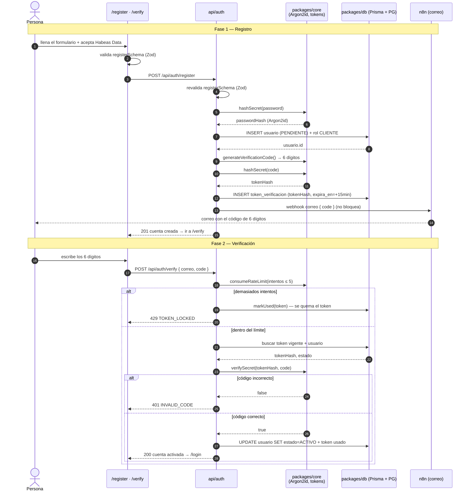
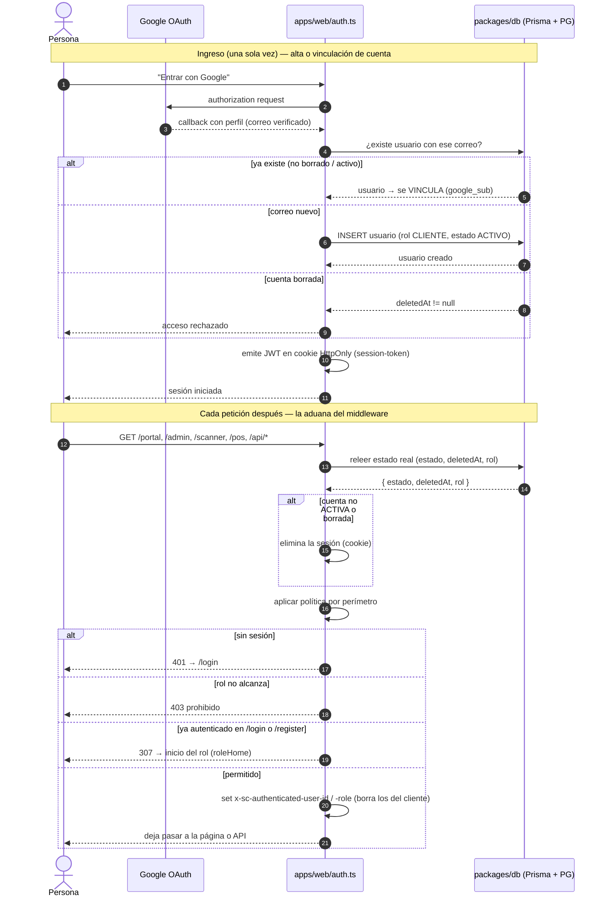
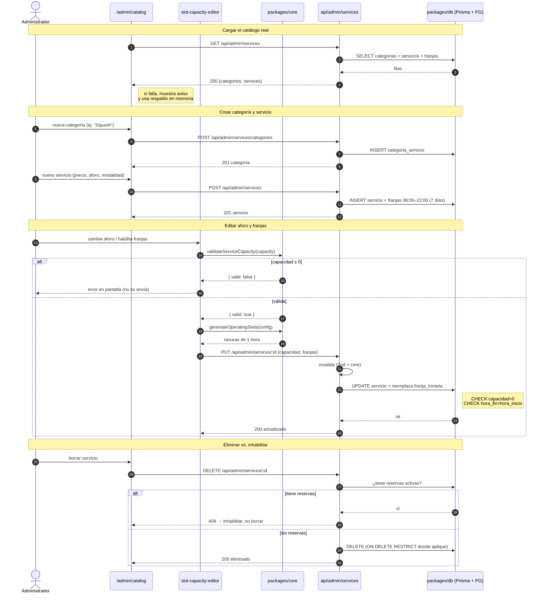
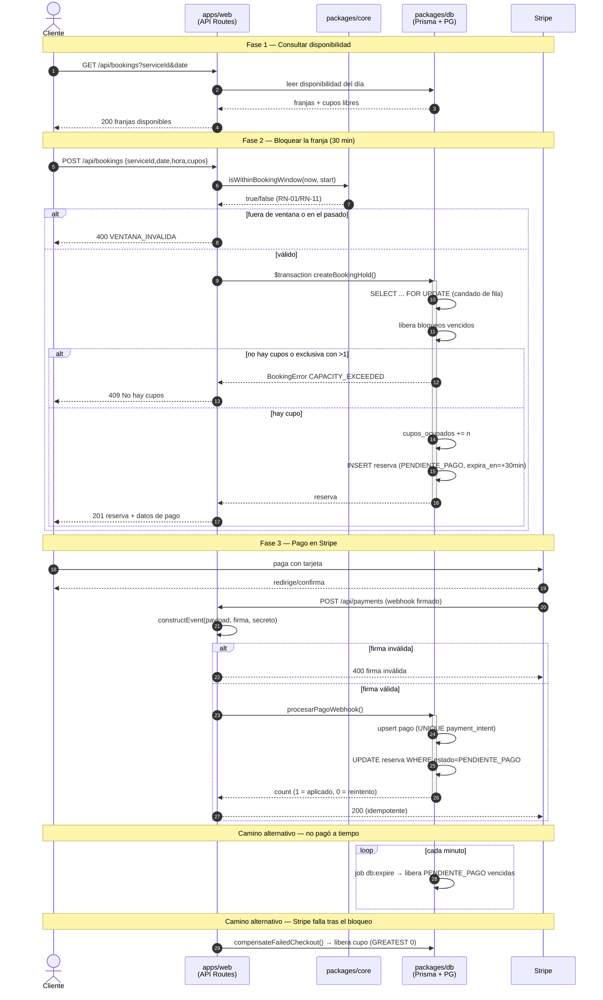
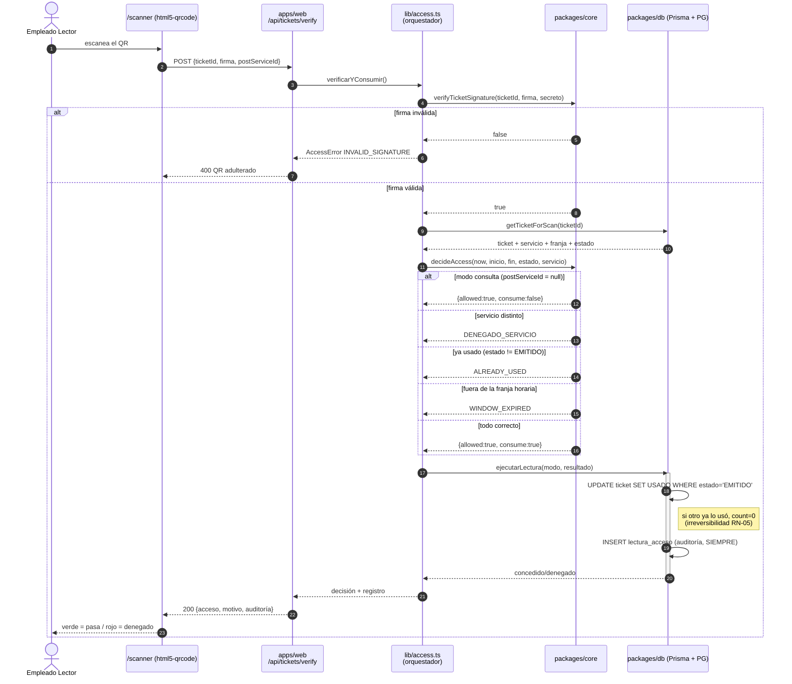
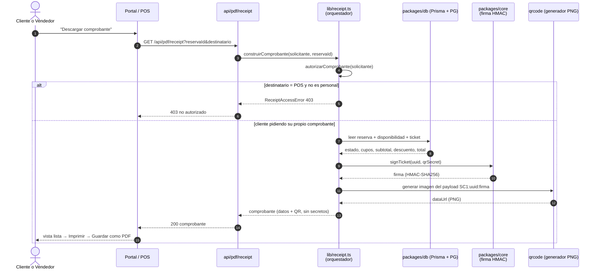
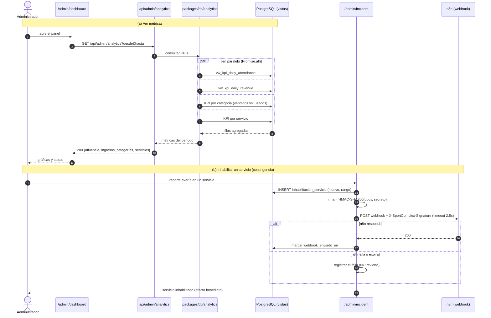
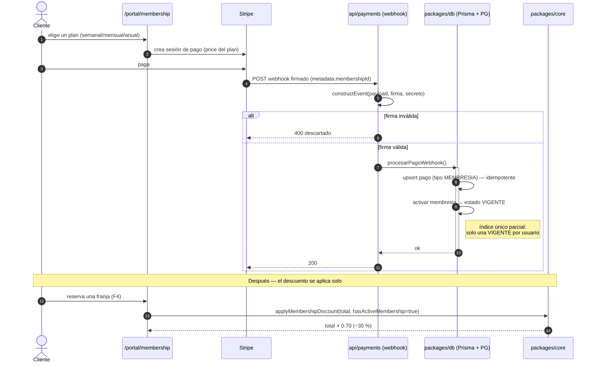

# SportComplex (AKROS) — Guía completa para la presentación

> Documento de estudio y apoyo para exponer el proyecto **SportComplex**, la plataforma de un
> complejo deportivo (reservas, membresías, pago 100 % sin efectivo y control de acceso con QR).
> Está escrito para que **entiendas** cada parte: qué hace, por qué está así, y qué tecnología la
> resuelve. Se organiza **por flujos de usuario** (sigue el recorrido real de las personas dentro
> del sistema), y cada flujo recorre las tres capas a la vez: **frontend → backend → base de datos**.

---

## Cómo leer este documento

Cada flujo tiene la misma estructura:

1. **El objetivo** — qué problema resuelve para la persona o el negocio.
2. **El recorrido** — los pasos reales, nombrando los archivos donde vive cada paso.
3. **El diagrama de secuencia** — el mismo recorrido dibujado paso a paso (un diagrama por flujo,
   del F1 al F8), para **ver** el orden de los mensajes y dónde se defiende la integridad.
4. **El código clave** — fragmentos reales del proyecto, explicados.
5. **El lado de la base de datos** — qué se guarda y con qué garantías.
6. **¿Qué tecnologías intervienen y para qué?** — en prosa, explicando **la utilidad de cada
   herramienta dentro de este proyecto** (no una lista de nombres suelta).

> **Sobre los diagramas:** están escritos en **Mermaid**, un lenguaje de diagramas en texto. GitHub,
> GitLab, VS Code (extensión Markdown Preview Mermaid) y Obsidian los dibujan automáticamente. Si tu
> visor no los renderiza, verás el texto entre ```` ```mermaid ```` y ```` ``` ````; en ese caso
> puedes pegarlo en <https://mermaid.live> para ver el dibujo (y exportarlo como imagen para las
> diapositivas).

---

## 0. Visión general: qué es SportComplex y cómo está construido

### 0.1 El producto

SportComplex es el sistema de gestión de un club deportivo con varias sedes (canchas de tenis,
pádel y fútbol, piscinas, gimnasio y zona húmeda). Resuelve cuatro cosas a la vez:

1. **Reservar** un espacio en franjas de una hora, dentro de una ventana máxima de 15 días.
2. **Cobrar** siempre por internet (modelo *cashless*): nunca entra dinero en efectivo.
3. **Controlar el acceso** con un código QR que se valida en la puerta del complejo.
4. **Administrar** el catálogo, los aforos, las membresías y ver analítica gerencial.

### 0.2 La arquitectura en capas

El proyecto está deliberadamente separado en capas, para que la lógica de negocio no dependa ni de
la pantalla ni de la base de datos:

```
┌─────────────────────────────────────────────────────────────┐
│  apps/web  ·  Next.js  (pantallas + API Routes + middleware) │
│      │  usa                                                   │
│      ▼                                                        │
│  packages/validation  ·  contratos Zod compartidos           │
│  packages/ui          ·  componentes visuales                │
│      │  usa                                                   │
│      ▼                                                        │
│  packages/core        ·  reglas de negocio puras              │
│   (disponibilidad, precios, QR, tokens, Stripe, n8n)         │
│      │  usa                                                   │
│      ▼                                                        │
│  packages/db          ·  acceso a datos (Prisma + repos)      │
│      │  habla con                                             │
│      ▼                                                        │
│  PostgreSQL (Supabase)                                        │
└─────────────────────────────────────────────────────────────┘
        packages/automation · flujos n8n (correo, contingencias)
```

La idea es que **`packages/core` contiene reglas puras y comprobables** (por ejemplo, "¿esta reserva
cae dentro de los próximos 15 días?" o "¿el descuento de socio es del 30 %?"), que **`packages/db`
es el único que toca la base de datos**, y que **`apps/web` solo orquesta** (recibe una petición,
valida, llama a la lógica y responde). Esta separación es lo que permite probar el negocio sin
levantar el servidor ni la base de datos.

### 0.3 El monorepo

Todo vive en **un solo repositorio** con varios paquetes, gestionado con **Turborepo + pnpm
workspaces**. Cada carpeta `apps/*` o `packages/*` es un paquete con su propio `package.json`, y se
referencian entre sí con `workspace:*`. Su utilidad práctica: compartir tipos y lógica entre el
frontend y el backend sin copiar y pegar, y construir/probar solo lo que cambió.

### 0.4 Las constantes que gobiernan todo el negocio

En `packages/core/src/domain/index.ts` viven los números que definen el sistema. Están centralizados
para que el frontend, el backend y la base de datos hablen del mismo negocio:

```ts
export const TIMEZONE = "America/Bogota" as const;
export const BOOKING_WINDOW_DAYS = 15 as const;      // RN-01: máximo 15 días de anticipación
export const CHECKOUT_TTL_MINUTES = 30 as const;     // RN-04: 30 min para pagar
export const MEMBERSHIP_DISCOUNT_RATE = 0.3 as const; // RN-08: 30 % para socios
```

La **zona horaria** es un dato de negocio, no un detalle técnico: el club está en Medellín, así que
"hoy" y "las 06:00" siempre se calculan en `America/Bogota`, nunca en la hora del navegador. Esto lo
resuelve la librería **date-fns-tz** (que verás repetida en varios flujos).

---

## 1. Mapa de flujos (el recorrido de las personas)

| # | Flujo | Quién lo usa | Rutas/piezas principales |
|---|-------|--------------|--------------------------|
| F1 | Registro y verificación de cuenta | Futuro cliente | `/register`, `/verify`, `api/auth/*` |
| F2 | Inicio de sesión y control de acceso por rol | Todos | `/login`, `auth.ts`, `middleware.ts` |
| F3 | Administrar catálogo, aforo y franjas | Administrador | `/admin/catalog`, `api/admin/services` |
| F4 | Reservar y pagar | Cliente | `/portal/book`, `api/bookings`, `api/payments` |
| F5 | Emitir y validar el ticket QR | Cliente + Lector | `api/tickets/verify`, `/scanner`, `lib/access.ts` |
| F6 | Descargar el comprobante PDF | Cliente + Vendedor | `api/pdf/receipt`, `lib/receipt.ts` |
| F7 | Analítica y contingencias | Administrador | `/admin/dashboard`, `api/admin/analytics`, n8n |
| F8 | Membresías | Cliente | `/portal/membership`, `api/payments` |

---

## F1 — Registro y verificación de cuenta

### El objetivo
Que una persona pueda crear su cuenta y **demostrar que el correo es suyo** antes de poder reservar.
Los clientes nacen en estado `PENDIENTE` y solo pasan a `ACTIVO` cuando ingresan el código de 6
dígitos que reciben por correo. Así se evitan cuentas falsas y correos mal escritos.

### El recorrido
1. La persona llena el formulario en `apps/web/src/app/(auth)/register/page.tsx`. Antes de enviar
   nada, el formulario valida con el contrato compartido `registerSchema` y **obliga a marcar la
   casilla de Habeas Data** (consentimiento de tratamiento de datos, Ley 1581 de 2012).
2. El navegador hace `POST /api/auth/register` (`apps/web/src/app/api/auth/register/route.ts`).
3. El backend vuelve a validar, crea el `usuario` en estado `PENDIENTE`, le asocia el rol `CLIENTE`
   y genera un código de 6 dígitos.
4. El código **no se guarda en claro**: se guarda su *hash*. El código en claro solo viaja al correo.
5. La persona va a `/verify`, escribe los 6 dígitos y el backend los compara contra el hash.

### El diagrama de secuencia

Fíjate en que el código **nunca se guarda en claro**: lo que se persiste es su `hash`, y el código
real solo viaja hacia n8n (el correo). La rama de intentos fallidos muestra cómo se *quema* el token
al llegar al límite.



### El código clave

El registro crea la cuenta y el token de verificación (nótese que solo se persiste el hash):

```ts
// apps/web/src/app/api/auth/register/route.ts
const passwordHash = await hashSecret(password);          // Argon2id
const usuario = await prisma.usuario.create({
  data: { correo: email, passwordHash, nombre, rolId: clienteRole.id, estado: "PENDIENTE" },
});

const code = generateVerificationCode();                   // 6 dígitos CSPRNG
const tokenHash = await hashSecret(code);                  // se guarda el hash, no el código
const expiraEn = new Date(Date.now() + TOKEN_TTL_MS);      // 15 minutos
await createToken(usuario.id, tokenHash, expiraEn);
await sendVerificationCodeEmail({ usuarioId: usuario.id, to: email, nombre, code, expiraEn });
```

El hasheo de contraseña y de código lo resuelve **Argon2id** (`@node-rs/argon2`), y el proyecto lo
documenta con sus parámetros:

```ts
// packages/core/src/security/token.ts
export async function hashSecret(plain: string): Promise<string> {
  const { hash } = await getArgon2();
  return hash(plain, { algorithm: ARGON2ID_ALGORITHM, memoryCost: 19456, timeCost: 2, parallelism: 1 });
}
// → produce algo como $argon2id$v=19$m=19456,t=2,p=1$...
```

La verificación protege contra fuerza bruta (máximo de intentos y, si se excede, quema el token):

```ts
// apps/web/src/app/api/auth/verify/route.ts
const userCheck = consumeRateLimit(userKey, VERIFY_MAX_ATTEMPTS_PER_TOKEN, tokenWindowMs);
if (!userCheck.allowed) {
  await markUsed(latestToken.id);         // al 5.º intento se invalida el token
  return fail("TOKEN_LOCKED", "Demasiados intentos fallidos. Solicite un nuevo código.", 429);
}
const valid = await verifySecret(latestToken.tokenHash, code); // Argon2id en tiempo constante
if (!valid) return fail("INVALID_CODE", "Código inválido", 401);
await prisma.usuario.update({ where: { id: usuario.id }, data: { estado: "ACTIVO" } });
```

### El lado de la base de datos
Se guardan dos cosas. Primero la fila del **usuario** con su correo, su contraseña ya hasheada y su
estado (`PENDIENTE` → `ACTIVO`). Segundo, una fila en **`token_verificacion`** con el `token_hash`,
la fecha de creación, la de expiración y, cuando se usa, la fecha de uso (`usado_en`). El correo es
`UNIQUE`, así que no puede haber dos cuentas con el mismo; y el `token_hash` también es `UNIQUE`, de
modo que dos códigos nunca chocan. La relación `usuario → token_verificacion` usa borrado en cascada
porque el token es efímero y no es historial financiero.

### ¿Qué tecnologías intervienen y para qué?
**PostgreSQL** es quien almacena de verdad las cuentas y los tokens, y **Prisma** es la pieza que
traduce el modelo escrito en `schema.prisma` a esa base: el esquema es la **única fuente de verdad**
de las tablas, y a partir de él Prisma genera el cliente TypeScript con el que el código hace
`prisma.usuario.create(...)`. **Argon2id** garantiza que ni la contraseña ni el código se guarden en
claro, de modo que un robo de la base no revela las credenciales. La validación la hace **Zod** con
un contrato *compartido*: exactamente el mismo `registerSchema` corre en el navegador (para dar
retroalimentación inmediata) y en el servidor (para no fiarse del cliente). Y el envío del correo no
lo hace SportComplex directamente, sino que dispara un **webhook a n8n** mediante la librería
**ky**: la plataforma no depende de un servidor de correo propio, y si el correo falla no se revierte
el registro (regla RN-12: los efectos secundarios no bloquean la transacción principal).

---

## F2 — Inicio de sesión y control de acceso por rol

### El objetivo
Que cada persona entre a su espacio y **solo pueda ver lo que le corresponde**. Hay cuatro roles:
`Administrador`, `Empleado_Vendedor` (taquilla), `Empleado_Lector` (escáner de acceso) y `Cliente`.
El sistema decide, en cada petición, quién es y a dónde puede ir.

### El recorrido
1. En `/login` la persona entra con **correo y contraseña** o con **Google**.
2. El login con Google lo maneja `apps/web/src/auth.ts` (Auth.js / NextAuth). El login con
   credenciales pasa por el endpoint de auth.
3. A partir de ahí, **cada petición pasa por `apps/web/src/middleware.ts`**, que es la aduana del
   sistema: revisa sesión, estado de la cuenta y rol, y decide si deja pasar, redirige o niega.

### El diagrama de secuencia

Dos momentos distintos: primero el **ingreso** (con Google, que vincula la cuenta si el correo ya
existe) y luego la **aduana** en cada petición. Fíjate en que el middleware **relee el estado de la
cuenta** (no se fía del JWT) y en el orden de la política: sin sesión → `401`, rol insuficiente →
`403`, ya autenticado entrando al login → redirección `307` a su inicio.



### El código clave

La configuración de sesión es un JWT guardado en una cookie segura (HttpOnly, SameSite):

```ts
// apps/web/src/auth.config.ts
export const authConfig = {
  providers: [Google],
  pages: { signIn: "/login" },
  session: { strategy: "jwt" },
  cookies: {
    sessionToken: {
      name: process.env.NODE_ENV === "production"
        ? "__Secure-authjs.session-token"
        : "authjs.session-token",
      options: { httpOnly: true, sameSite: "lax", path: "/", secure: process.env.NODE_ENV === "production" },
    },
  },
} satisfies NextAuthConfig;
```

El middleware aplica la política **por perímetro** (de arriba hacia abajo: primero autentica, luego
comprueba estado, luego rol) y, muy importante, **relee el estado de la cuenta desde la base de datos
en cada petición** para que una desactivación surta efecto al instante:

```ts
// apps/web/src/middleware.ts
const account = await prisma.usuario.findUnique({
  where: { id: sessionToRefresh.userId },
  select: { id: true, estado: true, deletedAt: true, rol: { select: { nombre: true } } },
});
// Si la cuenta no está ACTIVA o fue borrada, se elimina la sesión:
if (!account || (account.estado === "PENDIENTE" && !isAuthenticationLanding) || !currentRole) {
  currentSession = null;
}
```

Y traduce el rol a una **respuesta HTTP correcta**: `401` si no hay sesión, `403` si el rol no
alcanza, o una redirección `307` al inicio del rol si ya está autenticado:

```ts
// Cada rol tiene su casa (packages/core/src/domain/index.ts)
export const roleHome: Record<Role, string> = {
  Administrador: '/admin/dashboard',
  Empleado_Vendedor: '/pos',
  Empleado_Lector: '/scanner',
  Cliente: '/portal',
};
// En el middleware, para la landing/login/registro:
if (role && isAccountActive(status) && ROLE_HOME[role]) {
  return NextResponse.redirect(url, 307);
}
```

Cuando la sesión es válida, el middleware **inyecta cabeceras internas de confianza** para que el
backend sepa quién actúa sin volver a autenticar, y **borra** cualquier cabecera con el mismo nombre
que haya mandado el cliente (para que nadie se haga pasar por otro):

```ts
// apps/web/src/middleware.ts
const internalActorHeaders = ["x-sc-authenticated-user-id", "x-sc-authenticated-role"];
for (const header of internalActorHeaders) requestHeaders.delete(header);
if (currentSession && isActive && role && currentSession.userId) {
  requestHeaders.set("x-sc-authenticated-user-id", currentSession.userId);
  requestHeaders.set("x-sc-authenticated-role", role);
}
```

### El lado de la base de datos
Se usan las tablas **`rol`** (los cuatro roles) y **`usuario`** (con su `rol_id`, su `estado` y su
`google_sub` para vincular la cuenta de Google). El login con Google sigue una regla fina: si ya
existe un usuario con ese correo, se *vincula* esa cuenta en lugar de crear un duplicado; si la
cuenta está borrada o inactiva, se rechaza el acceso.

### ¿Qué tecnologías intervienen y para qué?
**NextAuth (Auth.js v5)** resuelve toda la autenticación —tanto el proveedor de **Google OAuth**
como la sesión **JWT** en cookie— y **Supabase Auth** aporta, además de la base de datos, un cliente
con el que el middleware puede validar tokens de dispositivos con `@supabase/supabase-js`. Lo
distintivo aquí es que **el control de acceso por rol no vive en cada pantalla**, sino en un único
**middleware** que actúa como aduana común a todo el sistema (páginas y APIs). Esa decisión evita el
clásico error de "olvidarse de proteger una ruta": la política se cumple en un solo lugar. La
comprobación de estado se apoya en **Prisma** (lectura de `usuario`/`rol` en tiempo real) y el
resultado se devuelve como respuesta HTML 403 legible o como JSON según lo que acepte el cliente.

---

## F3 — Administrar catálogo, aforo y franjas horarias

### El objetivo
Que un administrador defina **qué se puede reservar** (canchas, piscinas, gimnasio…), a qué precio,
con qué aforo y en qué franjas horarias. Es el flujo que "prepara el terreno" para que los clientes
puedan reservar. Esta parte del frontend **está completamente implementada** y conectada a la base
de datos real (no es un prototipo).

### El recorrido
1. La pantalla `apps/web/src/app/(admin)/admin/catalog/page.tsx` carga el catálogo real con
   `GET /api/admin/services`.
2. El administrador crea una **categoría** (ej. "Squash") con `POST /api/admin/services/categories`.
3. Crea una **instancia de servicio** (ej. "Cancha de tenis · Cancha 3") con `POST /api/admin/services`.
   El sistema le genera por defecto franjas de 06:00 a 22:00 para los siete días.
4. Edita el **aforo y las franjas** con el editor especializado
   `apps/web/src/components/admin/slot-capacity-editor.tsx`.
5. Activa/pausa con `PATCH` y elimina con `DELETE` (que devuelve **409** si el servicio tiene
   reservas activas: en ese caso se debe *inhabilitar*, no borrar).

### El diagrama de secuencia

El punto importante es la **doble validación**: la regla "aforo > 0" se comprueba en la pantalla
(funciones puras de `core`), otra vez en el servidor, y termina impuesta como `CHECK` en PostgreSQL.
Y el `DELETE` con reservas vivas se **niega con 409** en lugar de romper la integridad referencial.



### El código clave

La conexión real a la base de datos se hace al montar la pantalla (con manejo de error y reserva
local como respaldo si la API no responde):

```ts
// admin/catalog/page.tsx
const loadData = useCallback(async () => {
  setLoading(true);
  try {
    const res = await fetch('/api/admin/services');
    if (!res.ok) throw new Error(`Error ${res.status}`);
    const json = await res.json();
    if (!json.success || !json.data) throw new Error(json.error?.message);
    const dbCategories = json.data.categories as DbCategory[];
    const dbServices = json.data.services as DbService[];
    setCategories(dbCategories.map(mapDbCategory));
    setCatalog(dbServices.map((s) => mapDbService(s, mappedCategories)));
  } catch (err) {
    setFetchError(msg);                    // muestra aviso ámbar + botón Reintentar
    setCatalog(initialCatalog);            // respaldo en memoria
  } finally { setLoading(false); }
}, []);
```

El guardado del aforo y las franjas arma la lista de franjas y persiste en la BD; si el backend
rechaza, **lanza para que el editor muestre el error** (incluido el 409):

```ts
// admin/catalog/page.tsx  (handleSaveSchedule)
const franjasHorarias = [];
for (let dia = 1; dia <= 7; dia++) {
  for (let h = updatedConfig.startHour; h < updatedConfig.endHour; h++) {
    const timeStr = `${String(h).padStart(2, "0")}:00`;
    if (!updatedConfig.disabledSlots.includes(timeStr)) {
      franjasHorarias.push({ diaSemana: dia, horaInicio: timeStr, horaFin: `${h + 1}:00` });
    }
  }
}
const res = await fetch(`/api/admin/services/${numId}`, {
  method: 'PUT',
  headers: { 'Content-Type': 'application/json' },
  body: JSON.stringify({ capacidadMaxima: updatedConfig.capacity,
    modalidad: updatedConfig.isShared ? 'AFORO' : 'EXCLUSIVA', franjasHorarias }),
});
if (!res.ok || !json.success) throw new Error(json.error?.message); // el editor lo muestra
```

La regla de aforo positivo se valida con una función pura de `core`, que refleja un `CHECK` de la
base de datos:

```ts
// packages/core/src/services/availability.ts
export function validateServiceCapacity(capacity: number) {
  if (!Number.isInteger(capacity)) return { valid: false, error: "La capacidad debe ser un número entero." };
  if (capacity <= 0) return { valid: false, error: "La capacidad debe ser estrictamente mayor a 0 (CHECK capacity > 0)." };
  return { valid: true };
}
```

Y el editor genera las ranuras horarias con un **generador puro** (lo que se ve en pantalla y lo que
se guarda salen del mismo cálculo):

```ts
// packages/core/src/services/availability.ts
export function generateOperatingSlots(config: OperatingScheduleConfig): GeneratedOperatingSlot[] {
  const slots = [];
  for (let hour = config.startHour; hour < config.endHour; hour++) {
    const timeStr = `${String(hour).padStart(2, "0")}:00`;
    const isDisabled = config.disabledSlots?.includes(timeStr) ?? false;
    slots.push({ time: timeStr, endTime: `${hour + 1}:00`, capacity: config.capacity,
      isShared: config.isShared, isAvailable: !isDisabled });
  }
  return slots;
}
```

### El lado de la base de datos
El catálogo se modela en cuatro tablas: **`categoria_servicio`** (el tipo: cancha, piscina, gimnasio,
zona húmeda), **`servicio`** (la instancia concreta, con su precio `tarifa`, su `capacidad_maxima`,
su `modalidad` y su `estado`), **`franja_horaria`** (los turnos de una hora por día de la semana) y
**`disponibilidad`** (las franjas ya materializadas para una fecha concreta, con `cupos_totales` y
`cupos_ocupados`). La base de datos impone por sí misma tres reglas con `CHECK`: que
`capacidad_maxima > 0`, que `hora_fin > hora_inicio` y que `cupos_ocupados` esté entre 0 y
`cupos_totales`. Además hay un `UNIQUE (servicio_id, franja_id, fecha)` para que una franja no se
duplique.

### ¿Qué tecnologías intervienen y para qué?
**PostgreSQL** guarda el catálogo y, sobre todo, **hace cumplir las reglas con restricciones
(CHECK)**, de modo que aunque el código de la aplicación tuviera un fallo, la base no aceptaría un
aforo de cero ni un rango de horas invertido. **Prisma** traduce el modelo declarado en
`schema.prisma` a esas tablas y genera las migraciones y el cliente tipado; su valor aquí es que la
estructura del catálogo se define una sola vez. En el frontend, **React 19** maneja el estado de la
pantalla y el editor, y **Tailwind CSS 4** da el estilo sin salir del marcado; los iconos vienen de
**lucide-react**. La validación cruzada vuelve a apoyarse en **Zod** y en funciones puras de
**core**, que garantizan que la regla "aforo > 0" se compruebe tanto en pantalla como en el servidor
y como `CHECK` en la base (tres capas, una sola regla).

---

## F4 — Reservar y pagar (el flujo central)

### El objetivo
Que un cliente aparte una franja y la pague **sin que dos personas terminen con la misma franja** y
**sin que el sistema quede bloqueado** si alguien abre el pago y se va. Es el corazón del proyecto:
combina disponibilidad, bloqueo temporal, cobro con Stripe y reglas de negocio (ventana de 15 días,
30 minutos para pagar, descuento de socio).

### El recorrido
1. El cliente (ya en `Cliente`) pide la disponibilidad con
   `GET /api/bookings?serviceId=..&date=..`.
2. Crea la reserva con `POST /api/bookings`. Esto **bloquea la franja por 30 minutos**: se incrementa
   la ocupación, se crea una reserva en estado `PENDIENTE_PAGO` con `expira_en = ahora + 30 min` y
   se deja `pago_id` en nulo.
3. El cliente paga en **Stripe**. Si el pago sale bien, el evento de Stripe llega a
   `POST /api/payments`, que **confirma** la reserva (`PENDIENTE_PAGO → CONFIRMADA`) y crea el pago.
4. Si el cliente no paga en 30 minutos, un **job** (`db:expire`) o la limpieza perezosa liberan la
   franja. Y si Stripe falla justo después del bloqueo, se **compensa** liberando el cupo.

### El diagrama de secuencia

Léelo de arriba hacia abajo: cada flecha es un mensaje entre dos participantes. Fíjate en las zonas
`alt` (caminos alternativos: éxito, fallo, sin cupos) y en las notas, que marcan **dónde** se defiende
la integridad (el candado, la idempotencia, la compensación).



### El código clave

La creación del bloqueo ocurre dentro de **una transacción** y empieza tomando un **candado de fila**
(`SELECT ... FOR UPDATE`) sobre la franja, para que dos personas reservando a la vez se serialicen:

```ts
// packages/db/src/repositories/bookings.ts
async function lockAvailability(tx, availabilityId) {
  await tx.$queryRaw`SELECT id FROM disponibilidad WHERE id = ${availabilityId} FOR UPDATE`;
}

export async function createBookingHold(input, now = new Date()) {
  return prisma.$transaction(async (tx) => {
    // ...localiza la franja exacta...
    await lockAvailability(tx, candidate.id);
    await releaseExpiredHolds(tx, candidate.id, now);   // libera bloqueos vencidos

    const availability = await tx.disponibilidad.findUnique({ ... });
    if (availability.cuposOcupados + input.cantidadCupos > availability.cuposTotales)
      throw new BookingError("No hay suficientes cupos disponibles.", "CAPACITY_EXCEEDED", 409);
    if (availability.servicio.modalidad === "EXCLUSIVA" && input.cantidadCupos !== 1)
      throw new BookingError("Las franjas exclusivas permiten una sola reserva.", "INVALID_BOOKING_QUANTITY", 400);

    await tx.disponibilidad.update({
      where: { id: availability.id },
      data: { cuposOcupados: { increment: input.cantidadCupos } },
    });

    const subtotal = Number((Number(availability.servicio.tarifa) * input.cantidadCupos).toFixed(2));
    const expiresAt = new Date(now.getTime() + HOLD_TTL_MINUTES * 60_000); // 30 min
    return tx.reserva.create({
      data: { disponibilidadId: availability.id, titularId: input.userId,
        cantidadCupos: input.cantidadCupos, canal: "ONLINE", estado: "PENDIENTE_PAGO",
        subtotal, descuentoPct: 0, total: subtotal, expiraEn: expiresAt },
    });
  });
}
```

La ventana de 15 días y la prohibición de reservar en el pasado son reglas puras de `core`, siempre
calculadas en hora de Bogotá:

```ts
// packages/core/src/services/availability.ts
export function isWithinBookingWindow(now: Date, start: Date): boolean {
  if (start.getTime() <= now.getTime()) return false;              // RN-11: no al pasado
  return bogotaDateString(start) <= maxBookingDateString(now);     // RN-01: dentro de 15 días
}
```

El cobro se idempotenta: el webhook de Stripe crea el **pago** y confirma la reserva de forma
condicional, de manera que **reenviar el mismo evento no duplica nada**:

```ts
// packages/db/src/repositories/payments.ts  (procesarPagoWebhook → procesarIntento)
// 1) Upsert del PAGO por su identificador natural único.
let pago = await tx.pago.findUnique({ where: { stripePaymentIntentId: input.stripePaymentIntentId } });
if (!pago) { pago = await tx.pago.create({ data: { ...input, estado: input.estado } }); }

// 2) Confirmación condicional: solo gana quien encuentra PENDIENTE_PAGO.
const upd = await tx.reserva.updateMany({
  where: { id: input.reservaId, estado: "PENDIENTE_PAGO" },
  data: { estado: "CONFIRMADA", pagoId: pago.id },
});
const reservaConfirmada = upd.count === 1;   // reintentos ven count = 0
```

Y el webhook de Stripe verifica primero la firma del evento (nadie puede falsificar un pago):

```ts
// apps/web/src/app/api/payments/route.ts
event = new Stripe(secretKey).webhooks.constructEvent(payload, signature, webhookSecret);
// ...
const { userId, bookingId, membershipId } = parsePaymentIntentMetadata(intent.metadata);
await procesarPagoWebhook({
  stripePaymentIntentId: intent.id, usuarioId: userId,
  monto: stripeAmountToMonto(intent.amount ?? 0),
  estado: event.type === "payment_intent.succeeded" ? "APROBADO" : "FALLIDO",
  tipo: bookingId ? "RESERVA" : "MEMBRESIA", reservaId: bookingId,
  membresiaId: membershipId ? Number(membershipId) : undefined,
});
```

La compensación (si Stripe falla tras el bloqueo) libera el cupo sin bajar de cero y sin crear pago:

```ts
// packages/db/src/repositories/checkout.ts
await tx.$executeRaw`UPDATE "disponibilidad"
  SET "cupos_ocupados" = GREATEST(0, "cupos_ocupados" - ${reserva.cantidadCupos})
  WHERE id = ${reserva.disponibilidadId}`;
```

El descuento de socio es una función pura:

```ts
// packages/core/src/services/pricing.ts
export function applyMembershipDiscount(amountCents: number, hasActiveMembership: boolean): number {
  if (!hasActiveMembership) return amountCents;
  return Math.round(amountCents * (1 - MEMBERSHIP_DISCOUNT_RATE)); // 30 %
}
```

### El lado de la base de datos
Intervienen tres tablas. **`disponibilidad`** lleva el aforo real (`cupos_totales` y
`cupos_ocupados`) y el candado de fila se toma sobre ella. **`reserva`** guarda cada apartado con su
`estado` (`PENDIENTE_PAGO`, `CONFIRMADA`, `EXPIRADA`, `CANCELADA_ADMINISTRATIVA`), su `expira_en`,
su subtotal con `descuento_pct` y total. **`pago`** guarda el cobro con
`stripe_payment_intent_id` **único**, que es la clave de la idempotencia. Hay dos índices que valen
oro: un `CHECK (cupos_ocupados BETWEEN 0 AND cupos_totales)` que impide sobreventa a nivel motor, y
un **índice parcial** hecho en SQL crudo para encontrar rápido los bloqueos vencidos:

```sql
-- packages/db/prisma/migrations/20261007143000_reserva_ttl_partial_index/migration.sql
CREATE INDEX IF NOT EXISTS "reserva_expira_ttl_idx"
  ON "reserva"("expira_en")
  WHERE "estado" = 'PENDIENTE_PAGO';
```

Ese índice parcial solo indexa las reservas en `PENDIENTE_PAGO` (las que pueden expirar), así que el
job de limpieza es barato. Además hay un índice compuesto `(titular_id, estado)` para dibujar el
historial de un cliente.

### ¿Qué tecnologías intervienen y para qué?
**Stripe** es la infraestructura de pago: crea la sesión de cobro y emite el evento que confirma la
reserva; su SDK (`stripe`) se usa además para **verificar la firma** del webhook, con lo que se
descarta cualquier evento falso. **PostgreSQL** es quien de verdad resuelve la concurrencia: el
`SELECT ... FOR UPDATE` y el `CHECK` de cupos garantizan que **nunca se sobrevenda**, incluso con
dos clics simultáneos. **Prisma** orquesta esas transacciones (los métodos `$transaction`), ejecuta
las consultas tipadas y permite las consultas crudas (`$queryRaw`) para lo que el ORM no expresa,
como los candados de fila y los índices parciales. **Prisma** es también el que define, en
`schema.prisma`, la unicidad de `stripe_payment_intent_id` que hace idempotente el cobro. Del lado
del backend, las **API Routes de Next.js** exponen `GET/POST /api/bookings` y el webhook
`/api/payments`. Y para las fechas, **date-fns / date-fns-tz** fijan el cálculo en `America/Bogota`,
de modo que "hoy" y la ventana de 15 días no dependan del reloj o la zona del visitante.

---

## F5 — Emitir y validar el ticket QR (control de acceso)

### El objetivo
Convertir una reserva pagada en un **pase QR** que se valida en la puerta del complejo, con tres
reglas estrictas: solo vale para **su** servicio, solo dentro de **su** franja horaria, y **nunca se
puede usar dos veces**.

### El recorrido
1. Al confirmarse el pago (o al emitirse el comprobante) nace el **ticket**, cuyo contenido de QR es
   `SC1:<uuid>:<firma>`.
2. En portería, el empleado `Empleado_Lector` usa la pantalla `/scanner`
   (`apps/web/src/app/(staff)/scanner/page.tsx`).
3. El escaneo entra por `/api/tickets/verify`, que delega en el orquestador
   `apps/web/src/lib/access.ts`.
4. El orquestador valida la **firma antes de tocar la base de datos**, carga el ticket, decide el
   acceso y, si corresponde, lo **canjea** y deja registro de auditoría.

### El diagrama de secuencia

Fíjate en el orden defensivo: la **firma se verifica primero** (sin base de datos) y el **canje** se
hace con un `UPDATE ... WHERE estado='EMITIDO'`, que es lo que garantiza que un segundo escaneo nunca
"use dos veces" el pase. Las ramas `alt` son los distintos denegados, cada uno con su código.



### El código clave

El QR no es un simple identificador: lleva una **firma HMAC-SHA256**. Cualquiera que intente cambiar
el UUID invalida la firma, y la firma se comprueba **antes** de consultar la base:

```ts
// packages/core/src/security/qr.ts
export function signTicket(ticketId: string, secret: string): string {
  return createHmac("sha256", secret).update(ticketId).digest("hex");
}
export function verifyTicketSignature(ticketId: string, signature: string, secret: string): boolean {
  const expected = signTicket(ticketId, secret);
  if (expected.length !== signature.length) return false;
  let diff = 0;                                  // comparación en tiempo constante
  for (let i = 0; i < expected.length; i++) diff |= expected.charCodeAt(i) ^ signature.charCodeAt(i);
  return diff === 0;
}
export function buildTicketQrPayload(ticketId: string, signature: string): string {
  return `${TICKET_QR_PREFIX}:${ticketId}:${signature}`;   // "SC1:uuid:firma"
}
```

La decisión de acceso es una **función pura** que aplica las tres reglas (servicio, ventana y ciclo
de uso) y distingue el **modo consulta** (informativo, nunca consume):

```ts
// packages/core/src/services/access-control.ts
export function decideAccess(opts): AccessDecision {
  if (opts.postServiceId === null) return { allowed: true, consume: false }; // modo consulta (RN-05)
  if (opts.ticketServiceId !== opts.postServiceId) return { allowed: false, code: "SERVICE_MISMATCH" };
  if (opts.ticketStatus !== "EMITIDO") return { allowed: false, code: "ALREADY_USED" };
  if (opts.now < opts.start || opts.now > opts.end) return { allowed: false, code: "WINDOW_EXPIRED" };
  return { allowed: true, consume: true };
}
```

El orquestador deja claro el orden: **primero la firma, después la base de datos**:

```ts
// apps/web/src/lib/access.ts
// 1. Firma primero: nunca consultar la BD con un QR adulterado.
if (!verifyTicketSignature(input.ticketId, input.signature, options.qrSecret)) {
  throw new AccessError("Firma del QR inválida.", "INVALID_SIGNATURE", 400);
}
const ticket = await getTicketForScan(input.ticketId, db);
const decision = decideAccess({ now, start, end, ticketStatus: ticket.estado,
  ticketServiceId: String(ticket.reserva.disponibilidad.servicio.id),
  postServiceId: input.postServiceId === null ? null : String(input.postServiceId) });
```

El canje es **irreversible a nivel motor**: el `UPDATE` solo toca tickets en estado `EMITIDO`, así que
un segundo escaneo no encuentra fila que actualizar y se audita como denegado:

```ts
// packages/db/src/repositories/tickets.ts  (ejecutarLectura)
const upd = await tx.ticketQr.updateMany({
  where: { id: input.ticketId, estado: "EMITIDO" },   // la irreversibilidad vive aquí (RN-05)
  data: { estado: "USADO", usadoPor: input.empleadoId, usadoEn: now },
});
const canjeado = upd.count === 1;
// … y SIEMPRE se escribe una fila de auditoría en LECTURA_ACCESO:
const lectura = await tx.lecturaAcceso.create({ data: {
  ticketId: input.ticketId, empleadoId: input.empleadoId,
  asignacionId: input.modo === "CONSULTA" ? null : input.asignacionId,
  modo: input.modo, resultado, fechaHora: now } });
```

### El lado de la base de datos
Tres tablas. **`ticket_qr`** guarda el `codigo_uuid` (el UUID que va firmado en el QR), su `estado`
(`EMITIDO`/`USADO`), quién lo usó y cuándo; es único por reserva y por código. **`asignacion_puesto`**
registra el turno de un lector en un servicio (para saber desde qué puesto se escaneó). Y
**`lectura_acceso`** es la bitácora de auditoría: **cada lectura escribe exactamente una fila**, con
su modo (`TURNO`/`CONSULTA`) y su resultado (`CONCEDIDO`, `DENEGADO_SERVICIO`, `DENEGADO_HORARIO`,
`DENEGADO_USADO`, `CONSULTA`). En modo consulta, además, `asignacion_id` es obligatoriamente nulo.

### ¿Qué tecnologías intervienen y para qué?
**HMAC-SHA256** (el módulo `crypto` de Node) da la firma del QR: es simétrico y rapidísimo, ideal
para que el servidor firme al emitir y valide al escanear. La **irreversibilidad** del canje *no* se
confía al código de aplicación, sino al `WHERE estado = 'EMITIDO'` del `UPDATE`, garantizado por
**PostgreSQL**: si dos lectores escanean el mismo ticket al tiempo, exactamente uno gana y el otro
recibe un denegado, sin condiciones de carrera. **Prisma** vuelve a envolver el canje y la auditoría
en una sola transacción (o se canjea todo, o no se canjea nada). En el frontend, el escáner usa la
librería **html5-qrcode** (acceso a cámara) y el **generador de QR `qrcode`** produce la imagen que
verás en el comprobante (F6). **Zod** valida el payload del escaneo antes de procesarlo.

---

## F6 — Descargar el comprobante (PDF con QR)

### El objetivo
Entregar al cliente (o imprimir en taquilla) un **comprobante** de su reserva, con los datos del
club, el detalle de la reserva y el **código QR de acceso**. El comprobante debe poder guardarse
como PDF con el botón de imprimir del navegador.

### El recorrido
1. Se pide `GET /api/pdf/receipt?reservaId=..&destinatario=PORTAL|POS`.
2. La ruta delega en el orquestador `apps/web/src/lib/receipt.ts`, que arma **todo en el servidor**.
3. El servidor devuelve los datos y la **imagen del QR ya generada** (data URL PNG).
4. El componente visual `packages/ui/src/templates/ticket-receipt.tsx` los muestra; las reglas de
   `@media print` hacen que se imprima limpio.

### El diagrama de secuencia

Todo lo sensible pasa **en el servidor**: se autoriza según quién pide y para qué destino, se firma el
QR y se genera la imagen **antes** de enviarla. El navegador solo recibe datos y un PNG ya listos; el
secreto de firma no sale nunca del backend.



### El código clave

El comprobante **firma el QR en el servidor** y nunca expone secretos ni identificadores de pago:

```ts
// apps/web/src/lib/receipt.ts  (construirComprobante)
const payload = ticketQr
  ? buildTicketQrPayload(ticketQr.codigoUuid, signTicket(ticketQr.codigoUuid, qrSecret))
  : null;
const qr = payload
  ? { payload, dataUrl: await (options.generarQrDataUrl ?? qrDataUrlPorDefecto)(payload) }
  : null;
```

La autorización es fina: el cliente solo baja **sus** comprobantes; el comprobante de **taquilla**
(`POS`) solo lo puede emitir el personal:

```ts
// apps/web/src/lib/receipt.ts  (autorizarComprobante)
const esTitular = solicitante.userId === input.titularId;
const esStaff = solicitante.role === "Administrador" || solicitante.role === "Empleado_Vendedor";
if (solicitante.destinatario === "POS" && !esStaff) throw new ReceiptAccessError(...403);
```

El componente de impresión es simple y limpio, con la regla de impresión marcada:

```tsx
// packages/ui/src/templates/ticket-receipt.tsx
export function TicketReceipt(props: { serviceName, holder, startTime, endTime, qrDataUrl }) {
  return (
    <article className="ticket-receipt ... text-center">
      <h2>SportComplex — Comprobante</h2>
      
      <p className="no-print">Usa Imprimir → Guardar como PDF (RN-14).</p>
    </article>
  );
}
```

### El lado de la base de datos
No crea tablas nuevas: **lee** la reserva con su disponibilidad (servicio y franja) y su ticket. Lo
importante aquí es que el comprobante es una **proyección de solo lectura** del estado real
(estado de la reserva, canal, cupos, subtotal, descuento, total, y estado del ticket).

### ¿Qué tecnologías intervienen y para qué?
La librería **`qrcode`** genera la imagen PNG del QR en el servidor (así el cliente recibe la imagen
lista y el secreto de firma nunca sale del backend). El **módulo `crypto`** vuelve a aportar la firma
HMAC. El template vive en **`packages/ui`**, la librería de componentes compartida, para que pueda
reutilizarse tanto en el portal del cliente como en la taquilla. **CSS (Tailwind)** aplica las reglas
`@media print` que adaptan el diseño para la impresión/PDF. Y todo el acceso a datos se hace con
**Prisma**, respetando a quién le corresponde cada comprobante.

---

## F7 — Analítica gerencial y contingencias

### El objetivo
Dar al administrador una visión de **cómo va el club** (afluencia, transacciones, ingresos,
rendimiento por categoría y por servicio) y permitir **inhabilitar un servicio** ante una
contingencia (una avería), notificando a los sistemas externos.

### El recorrido
1. La pantalla `/admin/dashboard` pide las métricas a `/api/admin/analytics`.
2. El repositorio `packages/db/src/repositories/analytics.ts` lee **vistas SQL** que ya traen los
   indicadores calculados.
3. Para una contingencia, el administrador usa `/admin/incident`, que registra la inhabilitación y
   dispara un **webhook firmado** a n8n.

### El diagrama de secuencia

Dos caminos: (a) **leer** métricas, que no recompone las tablas a mano sino que consulta **vistas SQL**
en paralelo; y (b) **inhabilitar** un servicio ante una avería, que además notifica a n8n con un
webhook **firmado** y **no bloqueante** (si n8n falla o tarda, el flujo principal no se cae).



### El código clave

La analítica no recorre las tablas a mano: consulta **vistas** que resumen los indicadores del día
(`vw_kpi_daily_attendance`, `vw_kpi_daily_revenue`, etc.), y las ejecuta en paralelo:

```ts
// packages/db/src/repositories/analytics.ts
const [attendanceRows, revenueRows, categoryRows, serviceRows] = await Promise.all([
  db.$queryRawUnsafe(`SELECT ... FROM vw_kpi_daily_attendance WHERE ($1::text IS NULL OR fecha_uso >= $1::date) ...`, startDateParam, endDateParam),
  db.$queryRawUnsafe(`SELECT ... FROM vw_kpi_daily_revenue WHERE ...`, startDateParam, endDateParam),
  // ... categoría y servicio (vendidos vs. usados) ...
]);
```

El webhook de contingencia va **firmado** para que n8n sepa que viene de SportComplex y **no
bloquea**: tiene un tiempo de espera corto y, si falla, solo se registra:

```ts
// apps/web/src/lib/contingency-webhook.ts
const signature = createHmac("sha256", secret).update(body).digest("hex");
await fetch(url, {
  method: "POST",
  headers: { "Content-Type": "application/json", "X-SportComplex-Signature": `sha256=${signature}` },
  body, signal: AbortSignal.timeout(2500),   // no bloquea el flujo principal
});
```

### El lado de la base de datos
La analítica se apoya en las tablas transaccionales ya descritas (`ticket_qr` en `USADO` para la
afluencia, `pago` en `APROBADO` para los ingresos, `reserva` en `CONFIRMADA` para las ventas) y en
una tabla extra, **`festivo`**, que registra los días festivos de Colombia (útil para explicar picos o
valle). En contingencias se usa **`inhabilitacion_servicio`**, que guarda el motivo, el rango de
tiempo y, cuando corresponde, la fecha en que se envió el webhook.

### ¿Qué tecnologías intervienen y para qué?
**PostgreSQL** hace aquí un trabajo grande: las **vistas** (`vw_kpi_*`) encapsulan las agregaciones
complejas del negocio, y gracias a los **índices** (sobre `fecha_hora` de `lectura_acceso`, sobre
`estado` de `pago`, etc.) esas consultas son rápidas. **Prisma** expone la ejecución de esas vistas
desde el repositorio. **n8n** es la plataforma de automatización del club: recibe los webhooks
(correo, contingencias) y conecta SportComplex con el resto de herramientas sin código propio; la
firma **HMAC-SHA256** garantiza que n8n solo actúe ante peticiones legítimas. Todo el cálculo de
fechas vuelve a anclarse en `America/Bogota` mediante **date-fns-tz**.

---

## F8 — Membresías

### El objetivo
Vender planes (semanal, mensual, anual) que dan al socio un **30 % de descuento** en sus reservas
mientras la membresía esté **vigente**, y permitir una sola membresía vigente por persona.

### El recorrido
1. La pantalla `/portal/membership` (hoy es un espacio planificado) presentará los planes.
2. El pago del plan entra por el mismo webhook de Stripe (`POST /api/payments`), identificado con
   `metadata.membershipId`, que activa la membresía.
3. Con la membresía `VIGENTE`, el cálculo de precios (F4) aplica el descuento del 30 %.

### El diagrama de secuencia

Fíjate en que la activación **no depende de un endpoint propio**: reutiliza el **mismo webhook de
Stripe** que ya confirma las reservas (F4), y se despacha según el `metadata`. La regla "una sola
membresía vigente por persona" la hace cumplir el **índice único parcial** de PostgreSQL, no el
código.



### El lado de la base de datos
Dos tablas. **`plan_membresia`** define los planes con su `periodicidad` (`SEMANAL`, `MENSUAL`,
`ANUAL`), su precio, su `descuento_pct` y su `stripe_price_id`. **`membresia`** registra la
suscripción de cada persona con su estado (`VIGENTE`, `VENCIDA`, `CANCELADA`), sus fechas y su
`stripe_subscription_id`. La regla "solo una vigente por persona" **no** se confía al código: se
impone con un **índice único parcial**:

```sql
-- packages/db/prisma/migrations/20261005180000_membresia_vigente_uniq/migration.sql
CREATE UNIQUE INDEX IF NOT EXISTS "membresia_usuario_vigente_uniq"
  ON "membresia"("usuario_id")
  WHERE "estado" = 'VIGENTE';
```

Y el descuento del 30 % se blinda con un `CHECK`:

```sql
ALTER TABLE "plan_membresia"
  ADD CONSTRAINT "plan_membresia_descuento_pct_check" CHECK (descuento_pct = 30.00);
```

### ¿Qué tecnologías intervienen y para qué?
**Stripe** gestiona además las **suscripciones recurrentes** (con su `stripe_subscription_id`), de
modo que la renovación del plan corre por cuenta de la pasarela. **PostgreSQL** garantiza con el
**índice único parcial** que, aunque el código fallara, nadie termine con dos membresías vigentes al
mismo tiempo; y el **CHECK** fija el descuento en 30 %. **Prisma** modela ambas tablas y las
migraciones (incluidas las restricciones que Prisma no expresa de forma declarativa y que por eso
van en SQL crudo). El **descuento** en sí se aplica con la función pura de **core**
(`applyMembershipDiscount`), reutilizada tanto en línea como en taquilla.

---

## Anexo A — El modelo de datos de un vistazo

16 tablas agrupadas por propósito:

| Grupo | Tablas | Para qué sirven |
|-------|--------|-----------------|
| Personas y seguridad | `rol`, `usuario`, `token_verificacion` | Quién es cada persona, con qué rol, y la verificación del correo |
| Catálogo | `categoria_servicio`, `servicio`, `franja_horaria` | Qué se puede reservar, a qué precio y en qué turnos |
| Disponibilidad | `disponibilidad`, `festivo` | Aforo real por fecha y festivos de Colombia |
| Dinero | `pago`, `plan_membresia`, `membresia` | Cobros (idempotentes), planes y membresías |
| Reserva | `reserva` | El apartado con su estado, TTL y totales |
| Acceso | `ticket_qr`, `asignacion_puesto`, `lectura_acceso` | El pase QR, los turnos de portería y la auditoría |
| Contingencia | `inhabilitacion_servicio` | Averías y suspensiones de servicios |

**Enums de dominio** (15 en total) que tipan el negocio, entre otros: `EstadoUsuario`,
`EstadoReserva`, `EstadoTicket`, `EstadoPago`, `ModalidadServicio`, `ModoLectura`,
`ResultadoLectura`, `PeriodicidadPlan`, `EstadoMembresia`.

**Garantías que impone la base de datos** (no solo el código):

- `CHECK (capacidad_maxima > 0)`, `CHECK (hora_fin > hora_inicio)`,
  `CHECK (cupos_ocupados BETWEEN 0 AND cupos_totales)` → no se sobrevende ni se configura mal un
  servicio.
- `UNIQUE (servicio_id, franja_id, fecha)` → una franja no se duplica.
- `UNIQUE (stripe_payment_intent_id)` → idempotencia del cobro.
- Índice único parcial de membresía vigente → una sola vigente por persona.
- Índice parcial `reserva_expira_ttl_idx` → encontrar bloqueos vencidos es barato.
- `ON DELETE RESTRICT` en relaciones con historial (pagos, reservas, tickets) → no se borra un
  usuario con historial; se **inactiva** en su lugar (borrado lógico).

---

## Anexo B — Mapa de rutas y roles

| Prefijo | Quién entra | Comportamiento si no cumple |
|---------|-------------|-----------------------------|
| `/` , `/login`, `/register` | Público | Si ya hay sesión, redirige `307` a la casa del rol |
| `/portal/*` | Cliente activo | Redirige a `/login`; si la cuenta no está activa, `403` |
| `/admin/*` | Administrador | Redirige a `/login` o `403` |
| `/pos/*` | Administrador \| Empleado Vendedor | Redirige a `/login` o `403` |
| `/scanner/*` | Administrador \| Empleado Lector | Redirige a `/login` o `403` |
| `/api/admin/*` | Administrador | `401` sin sesión, `403` si el rol no alcanza |
| `/api/bookings`, `/api/pdf/receipt` | Cliente o personal según el caso | `401`/`403` |
| `/api/pos/*` | Vendedor | `401`/`403` |
| `/api/access/*`, `/api/tickets/verify` | Lector | `401`/`403` |

---

## Anexo C — Estado actual y pendientes (honestidad de alcance)

Para que la presentación sea creíble, conviene decir qué está terminado y qué no:

- **Completamente implementado y conectado a la base de datos:** registro + verificación, login y
  control de acceso por rol, administración de catálogo/aforo/franjas, motor de reserva (bloqueo TTL,
  ventana de 15 días, multirreserva), webhook de pago con idempotencia, motor de canje QR con
  auditoría, comprobante con QR firmado, analítica por vistas y webhook de contingencia.
- **Planificado / en stub (pantalla presente, lógica pendiente):** la interfaz del **portal del
  cliente** (`/portal`, `/portal/book`, `/portal/tickets`, `/portal/membership`), la pantalla del
  **escáner** (`/scanner`) y la de **taquilla** (`/pos`) tienen su ruta y su intención documentada,
  pero su UI completa está marcada como `TODO`. La lógica de negocio de esas pantallas (motor de
  reserva, canje, comprobante) **ya existe y funciona** en backend; lo que falta es la capa visual.
- **Membresías:** el modelo de datos y el descuento están listos; falta cerrar la UI de planes.

---

## Anexo D — Cómo correr el proyecto

```bash
# En la raíz del monorepo
pnpm install
pnpm --filter @sportcomplex/db db:generate     # genera el cliente Prisma
pnpm --filter @sportcomplex/db db:migrate      # aplica migraciones a la base
pnpm dev                                        # levanta apps/web (Next.js)

# Job de expiración de reservas (se programa cada minuto en producción)
pnpm --filter @sportcomplex/db db:expire
```

Variables de entorno relevantes: `DATABASE_URL`, `NEXT_PUBLIC_SUPABASE_URL`,
`NEXT_PUBLIC_SUPABASE_ANON_KEY`, `STRIPE_SECRET_KEY`, `STRIPE_WEBHOOK_SECRET`, `QR_HMAC_SECRET`,
`N8N_AUTH_EMAIL_WEBHOOK_URL`, `N8N_CONTINGENCY_WEBHOOK_URL`, `N8N_CONTINGENCY_HMAC_SECRET`.

---

## Coda — La idea que quieres que se recuerde

SportComplex está construido alrededor de **tres ideas simple pero firmemente aplicadas**:

1. **La lógica de negocio vive una sola vez y no depende del framework.** En `packages/core` están
   las reglas puras (ventana de 15 días, descuento del 30 %, decisión de acceso, firma del QR), de
   modo que se pueden probar sin servidor ni base de datos y se reutilizan en línea y en taquilla.
2. **Las garantías críticas las impone la base de datos, no la buena voluntad del código.** No se
   sobrevende por el `CHECK` de cupos y el `FOR UPDATE`; no se paga dos veces por el `UNIQUE` del
   `payment_intent`; no se usa dos veces un ticket por el `WHERE estado='EMITIDO'`; no hay dos
   membresías vigentes por el índice único parcial. Esto es lo que hace al sistema **confiable bajo
   concurrencia**.
3. **Cada tecnología está donde aporta valor, y se entiende por qué está ahí.** Prisma como única
   fuente de verdad del esquema y dueño de las transacciones; Argon2id y HMAC-SHA256 para que nada
   sensible viaje ni se guarde en claro; Stripe para cobrar y para las suscripciones; n8n para los
   efectos secundarios (correo y contingencias) sin bloquear el flujo; date-fns-tz para que el
   negocio viva en hora de Medellín; Zod para que el mismo contrato valide en navegador y servidor.
