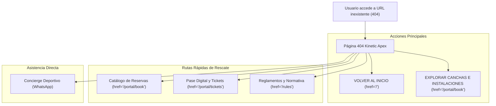

# Especificación Técnica: Página 404 "Kinetic Apex"

- **Documento:** RFC-UI-404 / Documentación de Diseño y Arquitectura Frontend
- **Incidencia / Ticket:** SCRUM-185
- **Rama:** `feature/scrum-185-not-found-page`
- **Ubicación en Monorepo:** `apps/web/src/app/not-found.tsx`
- **Autor / Rol:** Lead Frontend Engineer & Design Systems Specialist
- **Fecha:** Octubre 2026
- **Stack:** Next.js 16 (App Router), React 19, TypeScript, Tailwind CSS, Framer Motion

---

## 1. Objetivo y Contexto de Diseño

### 1.1 Metáfora Atlética "Kinetic Apex"
La experiencia de error 404 en el complejo deportivo **AKROS** transforma una situación de fallo o recurso ausente en una interacción táctica deportiva empática y resolutiva. 

En lugar de presentar un mensaje crudo y técnico, se adopta la metáfora del **"Saque de Fondo • Fuera de Límites"**:
- **Cancha Táctica:** Fondo sutil con el trazado SVG reglamentario de una cancha multideportiva (perímetro discontinuo, círculo central, áreas de meta y cuadrantes de saque).
- **Marcador Central:** Despliegue de un `404` prominente con tipografía de alto peso visual (`font-black`) que evoca un marcador electrónico de estadio.
- **Narrativa Funcional:** "Esta jugada quedó fuera de la cancha", comunicando de inmediato que la URL, franja horaria o servicio ya no existe, cambió de programación o fue retirado temporalmente, ofreciendo rutas inmediatas de reanudación sin fricción.

---

## 2. Arquitectura de Ruta y Coexistencia con RootLayout

### 2.1 Next.js 16 App Router (`not-found.tsx`)
En Next.js App Router, `apps/web/src/app/not-found.tsx` se invoca automáticamente en dos escenarios:
1. Cuando un usuario solicita una ruta inexistente en cualquier nivel de la aplicación.
2. Cuando una función de servidor invoca programáticamente `notFound()` de `next/navigation`.

### 2.2 Prevención de Duplicidad con `RootLayout`
El archivo `apps/web/src/app/layout.tsx` actúa como envoltura global proveyendo fuentes (`Plus_Jakarta_Sans`), variables CSS y proveedores de contexto (`AppProvider`). A su vez, los layouts de segmento (como `(public)/layout.tsx`) inyectan la navegación contextual.

**Invariante de Implementación:**
- `not-found.tsx` **no** monta un `TopBar`, `Header` ni `Footer` internos redundantes.
- Utiliza la directiva `'use client';` en la línea 1 para permitir el uso seguro de hooks de animación (`useReducedMotion`) y microinteracciones de puntero/foco.
- El contenedor principal asegura centrado vertical y horizontal mediante la clase base:
  ```css
  min-h-[80vh] w-full flex flex-col items-center justify-center px-4 sm:px-6 py-12
  ```

---

## 3. Mapeo de Rutas de Rescate Integradas

Para garantizar que el usuario nunca quede en un callejón sin salida (*dead-end*), la interfaz expone dos niveles jerárquicos de navegación asistida:



### 3.1 Acciones Principales (Grid de 2 Columnas)
| Control | Componente | Ruta Destino | Jerarquía Visual | Microinteracción |
| :--- | :--- | :--- | :--- | :--- |
| **Volver al Inicio** | `next/link` | `/` | **Primario:** Fondo `#c9ef75` (lima), texto `#123e30` (verde bosque oscuro), sombra pronunciada. | `whileHover={{ scale: 1.02 }}`, `whileTap={{ scale: 0.98 }}` |
| **Explorar Canchas** | `next/link` | `/portal/book` | **Secundario:** Borde `#e2e6df` / `#26352d`, fondo adaptable, texto neutral oscuro/claro. | `whileHover={{ scale: 1.02 }}`, `whileTap={{ scale: 0.98 }}` |

### 3.2 Rutas Rápidas de Rescate (Grid de 3 Columnas)
Ubicadas en una sección separada por una línea sutil con el encabezado `"RUTAS DISPONIBLES EN EL CLUB"` y el contador `"3 opciones inmediatas"`:
1. **Catálogo de Reservas** (`/portal/book`):
   - Icono: `CalendarDays`
   - Descripción: "Canchas de pádel, tenis y fútbol"
2. **Pase Digital y Tickets** (`/portal/tickets`):
   - Icono: `Ticket`
   - Descripción: "Credencial activa y accesos QR"
3. **Reglamentos y Normativa** (`/rules`):
   - Icono: `FileText`
   - Descripción: "Políticas del club y convivencia"

Cada tarjeta cuenta con microinteracciones `group-hover` que desplazan la flecha indicadora (`ArrowRight`) y resaltan el borde con el color institucional lima (`hover:border-[#c9ef75]/60`).

### 3.3 Asistencia Inmediata (Concierge Deportivo)
- Texto de contingencia: "¿Crees que se trata de un error del sistema?"
- Enlace directo a WhatsApp: `https://wa.me/573000000000` con icono `Headphones` y etiqueta `"CONTACTAR A CONCIERGE DEPORTIVO"`, con atributos de seguridad `target="_blank"` y `rel="noopener noreferrer"`.

---

## 4. Matriz de Tokens y Colores (Modo Claro vs. Modo Oscuro)

El diseño sincroniza con la paleta atlética oficial del sistema AKROS:

| Elemento / Rol | Modo Claro (Light) | Modo Oscuro (Dark) | Token / Clase Tailwind | Ratio Contraste WCAG |
| :--- | :--- | :--- | :--- | :--- |
| **Lienzo / Fondo Global** | `#f7f8f5` (Canvas claro) | `#0b120f` (Canvas bosque profundo) | `bg-white dark:bg-[#15201b]` | > 14:1 (AAA) |
| **Borde de Contenedores** | `#e2e6df` | `#26352d` | `border-[#e2e6df] dark:border-[#26352d]` | 3.2:1 (Bordes) |
| **Número 404 (Marcador)** | `#123e30` sólido | Gradiente `#d9f29f` → `#9eaba3` → `#425248` | `text-[#123e30] dark:bg-clip-text dark:bg-gradient-to-b` | > 10:1 (AAA) |
| **Cancha Táctica (SVG)** | Stroke `#123e30`, opacidad 10% | Stroke `#c9ef75`, opacidad 20% | `stroke-[#123e30] dark:stroke-[#c9ef75]` | Decorativo (No estorba) |
| **Punto Ping Activo** | `#c9ef75` (Lima eléctrico) | `#c9ef75` | `bg-[#c9ef75]` | 8.3:1 contra `#123e30` |
| **Texto Principal (H1)** | `#121a16` | `#f2f5f1` | `text-[#121a16] dark:text-[#f2f5f1]` | 15.8:1 / 13.5:1 (AAA) |
| **Texto Secundario / Párrafos**| `#526058` | `#9eaba3` | `text-[#526058] dark:text-[#9eaba3]` | 4.8:1 / 4.6:1 (AA) |
| **Botón Primario (Fondo)** | `#c9ef75` (Hover: `#d6f694`) | `#c9ef75` (Hover: `#d6f694`) | `bg-[#c9ef75] hover:bg-[#d6f694]` | 8.4:1 con `#123e30` |
| **Botón Primario (Texto)** | `#123e30` | `#123e30` | `text-[#123e30]` | 8.4:1 (AAA) |
| **Anillo de Foco (Focus Ring)**| `#123e30` | `#c9ef75` | `focus-visible:ring-[#123e30] dark:focus-visible:ring-[#c9ef75]` | Cumple WCAG 2.4.7 / 2.4.11 |

---

## 5. Políticas de Accesibilidad y Motion (WCAG 2.2)

### 5.1 Reducción de Movimiento (`prefers-reduced-motion`)
De acuerdo con el criterio de éxito **WCAG 2.3.3 (Animation from Interactions)**:
- Se implementa el hook `useReducedMotion()` de `framer-motion`:
  ```tsx
  const shouldReduceMotion = useReducedMotion();

  const cardVariants = {
    initial: shouldReduceMotion
      ? { opacity: 0, y: 0, scale: 1 }
      : { opacity: 0, y: 14, scale: 0.98 },
    animate: { opacity: 1, y: 0, scale: 1 },
  };

  const cardTransition = shouldReduceMotion
    ? { duration: 0.15 }
    : { duration: 0.3, ease: [0.22, 1, 0.36, 1] };
  ```
- Ante `prefers-reduced-motion: reduce`:
  - Se anulan las traslaciones en el eje Y (`y: 0`) y la escala (`scale: 1`).
  - La duración de entrada se acorta a 150 ms con desvanecimiento de opacidad pura.
  - Las microinteracciones de escala (`scale: 1.02` / `scale: 0.98`) se desactivan (`undefined`).
  - Las animaciones CSS de pulso continuo (`animate-ping`) incorporan `motion-reduce:animate-none`.
  - Las traslaciones de flechas en hover incorporan `motion-reduce:transform-none`.

### 5.2 Jerarquía de Encabezados y Semántica
- La pantalla cuenta con una jerarquía de títulos estricta:
  - `<h1>` para "Esta jugada quedó fuera de la cancha" (asociado a la sección mediante `aria-labelledby="not-found-heading"`).
  - `<h2>` para "RUTAS DISPONIBLES EN EL CLUB".
  - `<h3>` para cada una de las tarjetas de rescate.
- Se incluye un elemento oculto para lectores de pantalla (`<span className="sr-only">Error 404: Página no encontrada</span>`) adyacente al marcador numérico táctico.

### 5.3 Navegación por Teclado e Indicadores de Foco
- Todos los elementos interactivos (`<Link>`) exponen anillos de foco de alto contraste mediante la clase canónica:
  ```css
  focus-visible:outline-none focus-visible:ring-2 focus-visible:ring-[#123e30] dark:focus-visible:ring-[#c9ef75] focus-visible:ring-offset-2
  ```
- No se bloquea el tabulador ni se desordena la secuencia de navegación natural del DOM.

### 5.4 Tamaños de Destino Táctil (Target Size)
- Todos los enlaces y botones superan el umbral mínimo de **44 x 44 px** exigido por WCAG 2.5.5 / 2.5.8, permitiendo una experiencia cómoda en terminales móviles o tabletas.

---

## 6. Verificación y Resultados de Calidad

| Comando | Propósito | Resultado |
| :--- | :--- | :--- |
| `pnpm --filter web test` | Validación de suites de prueba unitaria de la web | **319 pruebas superadas (0 fallos)** |
| `pnpm run typecheck` | Comprobación estricta de tipos con TypeScript | **Exit Code 0 (Sin errores de tipado)** |
| `pnpm run lint` | Análisis estático con ESLint en todos los paquetes | **Exit Code 0 (5 tareas exitosas)** |
