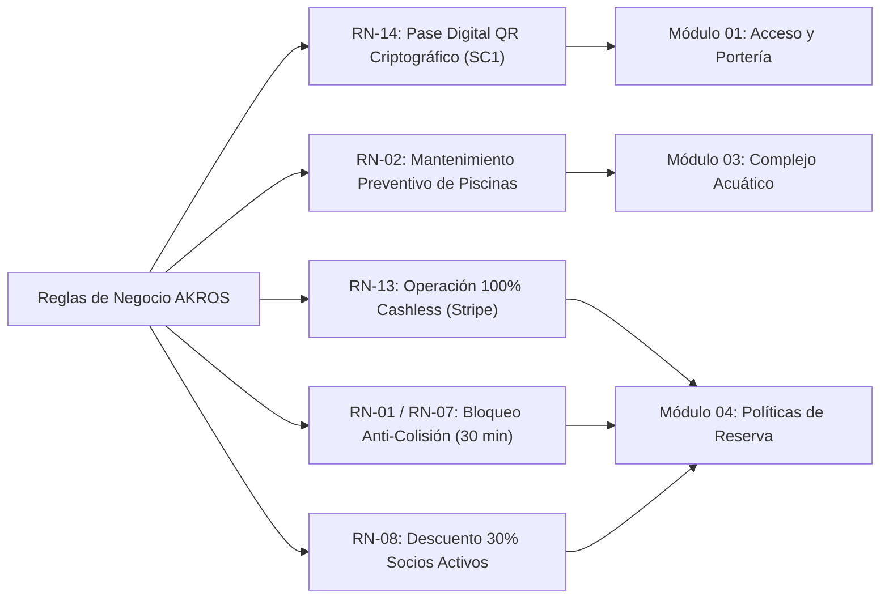

# Documentación Técnica: Vista Oficial de Reglamentos y Marco Normativo (SCRUM-185)

- **Documento:** RFC-UI-RULES / Especificación de Arquitectura Legal y de Convivencia
- **Incidencias Relacionadas:** SCRUM-185, SCRUM-186, SCRUM-187
- **Rama:** `feature/scrum-185-not-found-page`
- **Ubicación en Monorepo:** `apps/web/src/app/(public)/rules/page.tsx`
- **Autor / Rol:** Lead Frontend Engineer & Design Systems Specialist
- **Fecha:** Octubre 2026
- **Stack:** Next.js 16 (App Router), React 19, TypeScript, Tailwind CSS, Framer Motion

---

## 1. Justificación de Producto (SCRUM-186)

### 1.1 Contexto y Decisión de Permanencia
Dentro del refinamiento arquitectónico de la plataforma del complejo deportivo **AKROS**, se evaluó la necesidad de contar con una vista oficial y permanente de reglamentos (`/rules`) frente a la opción de mantener textos dispersos o enlaces provisionales hacia marcadores vacíos (`#`).

**Decisión Tomada:** Se aprueba por unanimidad la **permanencia e implementación formal** de la ruta canónica `/rules` en virtud de tres fundamentos de producto:
1. **Respaldo Jurídico y Exoneración de Responsabilidad:** En complejos deportivos con canchas de pádel, tenis de polvo de ladrillo, fútbol FIFA y piscinas climatizadas, la ley colombiana exige la publicidad clara de los reglamentos de uso, riesgos inherentes y condiciones de salubridad.
2. **Erradicación Sistemática de Enlaces Huérfanos:** La plataforma contenía enlaces residuales hacia `/legal` (un placeholder estático no estructurado) o potenciales rutas inactivas. `/rules` consolida en un único punto autoritativo todos los términos del club.
3. **Cierre del Bucle de Rescate 404:** La página de error 404 ("Kinetic Apex") integra como ruta de rescate destacada `"Reglamentos y Normativa"` apuntando a `/rules`. La existencia de esta página asegura que el usuario rescatado aterrice en una experiencia funcional de alto valor.

---

## 2. Marco Legal Colombiano Aplicado (SCRUM-187)

La estructura de la vista de reglamentos no es meramente declarativa, sino que se alinea rigurosamente con las disposiciones vigentes en el ordenamiento jurídico de la República de Colombia:

| Ley / Decreto | Título / Materia | Artículos del Reglamento AKROS | Requisitos Clave Implementados |
| :--- | :--- | :--- | :--- |
| **Ley 181 de 1995** | Ley del Deporte y Aprovechamiento del Tiempo Libre | Módulos 02 y 05 | Fomento de la práctica deportiva segura, juego limpio (*fair play*), respeto a jueces/árbitros y preservación de escenarios deportivos públicos y privados. |
| **Ley 1209 de 2008** | Seguridad y Salubridad en Piscinas | Módulo 03 (Arts. 3.1 - 3.3) | Obligatoriedad de salvavidas certificados, sensores perimetrales, uso estricto de gorro de baño y ducha corporal previa, prohibición de recipientes de vidrio y supervisión ininterrumpida de menores de 12 años. |
| **Ley 1581 de 2012** & Decreto 1377 de 2013 | Régimen General de Protección de Datos Personales (Habeas Data) | Módulo 06 (Arts. 6.1 - 6.3) | Tratamiento seguro de datos, cifrado bancario, autorización informada para credenciales QR y aviso visible sobre monitoreo por Circuito Cerrado de Televisión (CCTV). |
| **Ley 1801 de 2016** | Código Nacional de Seguridad y Convivencia Ciudadana | Módulo 05 (Arts. 5.1 - 5.3) | Prohibición absoluta de porte de armas, consumo de cigarrillo tradicional, vapeadores, sustancias psicoactivas o licor en zonas de práctica atlética; sanciones de expulsión y veto. |

---

## 3. Trazabilidad de Reglas de Negocio del Sistema (RN)

La vista de reglamentos plasma explícitamente en el front-end las reglas de negocio autoritativas definidas en el Software Requirements Specification (SRS) de AKROS:

- **RN-14 (Acceso Criptográfico QR):** Estipula que el ingreso por torniquetes automatizados o lectura manual del rol `Empleado_Lector` requiere la presentación de un código QR firmado con estándar `SC1`. Pases intransferibles.
- **RN-02 (Jornadas Técnicas de Piscinas):** Mantenimiento e hipercloración de la piscina todos los lunes hábiles (o martes siguiente en caso de lunes festivo nacional).
- **RN-13 (Modelo 100% Cashless):** Cero recepción de efectivo en taquilla POS o recepción. Todas las transacciones se realizan vía tarjeta o billetera digital mediante Stripe.
- **RN-01 & RN-07 (Bloqueo Provisional Anti-Colisión):** Retención de la franja horaria durante 30 minutos mientras se concluye el pago, liberando el slot si expira el temporizador.
- **RN-08 (Beneficio de Membresía):** Descuento automático del 30% en reservas para socios con membresía vigente.

---

## 4. Auditoría y Saneamiento de Enlaces

Para garantizar una navegación cohesionada sin enlaces rotos ni huérfanos, se auditaron y corrigieron todos los puntos de acceso normativo:

| Archivo / Componente | Elemento Afectado | Enlace Previo | Enlace Corregido (Canónico) | Estado Post-Auditoría |
| :--- | :--- | :--- | :--- | :--- |
| `apps/web/src/components/home/institutional-footer.tsx` | Enlace columna "Club & Experiencia" | `/legal` | `/rules` | **Saneado** (Apunta a vista oficial) |
| `apps/web/src/components/home/institutional-footer.tsx` | Enlace barra inferior legal | `/legal` | `/rules` | **Saneado** (Apunta a vista oficial) |
| `apps/web/src/components/top-bar.tsx` | Elemento de menú público "Reglamentos" | `/legal` | `/rules` | **Saneado** (Apunta a vista oficial) |
| `apps/web/src/components/home/faq-section.tsx` | Banner "Ver reglamentos oficiales" | `/legal` | `/rules` | **Saneado** (Apunta a vista oficial) |
| `apps/web/src/app/(auth)/register/page.tsx` | Enlace "Política de Tratamiento de Datos" | `/legal` | `/rules` | **Saneado** (Apunta a vista oficial) |
| `apps/web/src/app/not-found.tsx` | Tarjeta rápida 3: "Reglamentos y Normativa" | `/rules` | `/rules` | **Verificado** (Rescate táctico 404 operativo) |
| `apps/web/src/app/(public)/legal/page.tsx` | Endpoint histórico `/legal` | Estático básico | `redirect('/rules')` | **Redireccionado** (Sin enlaces huérfanos) |

---

## 5. Accesibilidad y Estándares UI (WCAG 2.2 & W3C APG)

### 5.1 Estándar WAI-ARIA APG para Acordeones
Cada uno de los 6 módulos normativos se estructura siguiendo estrictamente el patrón W3C WAI-ARIA Authoring Practices Guide:
- El encabezado es un `<button type="button">` con:
  - `id="module-btn-{id}"`
  - `aria-expanded="true|false"`
  - `aria-controls="module-content-{id}"`
- La región desplegable posee:
  - `id="module-content-{id}"`
  - `role="region"`
  - `aria-labelledby="module-btn-{id}"`
- Soporte nativo de activación mediante teclado: al ser elementos `<button>` estándar, los eventos de apertura/cierre responden automáticamente a las teclas `Enter` (Key 13) y `Space` (Key 32).

### 5.2 Reducción de Movimiento (`prefers-reduced-motion`)
- Se implementa el hook `useReducedMotion()` de `framer-motion`:
  - En condiciones estándar: animación suave de altura y opacidad con duración de 250ms y curva cúbica `[0.22, 1, 0.36, 1]`.
  - Ante preferencia activa de reducción de movimiento: duración comprimida a 50ms para respuesta inmediata sin mareos o distracciones vestibulares.

### 5.3 Acciones Globales de Usabilidad
- Botones de control colectivo `"Expandir todos"` y `"Colapsar todos"` en la cabecera de la grilla.
- Botón `"Descargar Normativa PDF"` que dispara la impresión/guardado en PDF optimizado mediante `window.print()`.
- Botón de compartir enlace al portapapeles con confirmación visual accesible (`role="status"`).
