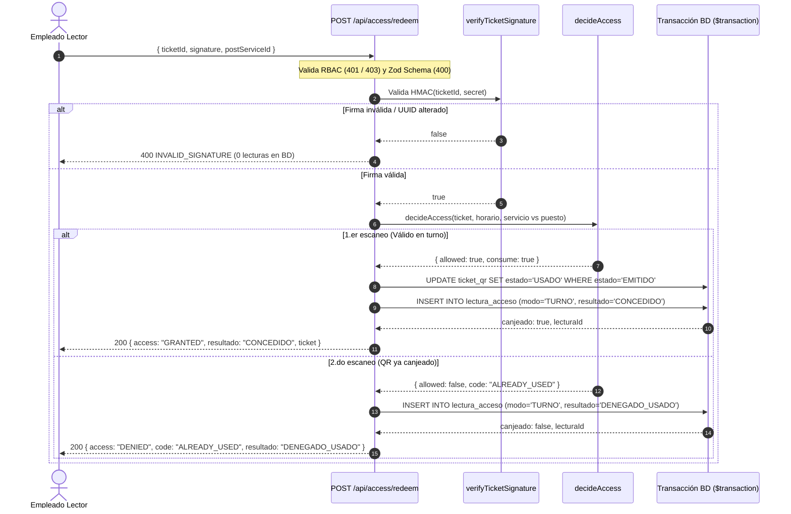

# TSK-BE-14 — Endpoint de canje en modo turno

`POST /api/access/redeem`

Endpoint transaccional de canje de tickets en modo turno (asociado a un puesto/servicio cubierto por el empleado lector). Valida la firma criptográfica HMAC-SHA256 antes de consultar la base de datos, ejecuta el canje atómico transmutando el ticket de `EMITIDO` a `USADO`, audita la lectura en `LECTURA_ACCESO` con `modo = TURNO` y devuelve los datos del boleto para su visualización en la aplicación móvil del escáner (HU-14 / RF-13 / RN-05).

## Criterio de Aceptación Clave

> Tras "Dar Acceso" el boleto pasa a `USADO` con marca temporal e ID del empleado, y un segundo escaneo del mismo QR se deniega.

- **Idempotencia e irreversibilidad transaccional**: El cambio de estado se realiza con `UPDATE ticket_qr SET estado='USADO', usadoPor=:empleadoId, usadoEn=:now WHERE id=:id AND estado='EMITIDO'`. Solo una transacción gana; el boleto transmutado nunca regresa a `EMITIDO` (RN-05).
- **Segundo escaneo denegado**: Si se reenvía el mismo código o se escanea de nuevo, `decideAccess` detecta el estado `USADO` y deniega con `code = "ALREADY_USED"` y `resultado = "DENEGADO_USADO"`, conservando inalterados la marca temporal y el empleado del canje original, registrando exactamente una nueva fila en `LECTURA_ACCESO`.
- **Auditoría estricta y asignación best-effort**: Cada intento genera exactamente una fila en `LECTURA_ACCESO` con `modo = TURNO` y el resultado correspondiente (`CONCEDIDO`, `DENEGADO_SERVICIO`, `DENEGADO_HORARIO`, `DENEGADO_USADO`). Si el empleado lector tiene un turno vigente registrado en `asignacion_puesto` para ese servicio, se vincula `asignacion_id`; si no cuenta con asignación registrada en base de datos, el canje procede normalmente y se audita con `asignacion_id = null` (comportamiento best-effort para no bloquear el acceso de clientes legítimos).
- **Validación criptográfica previa y tipado estricto**: Si la firma HMAC no coincide con `QR_HMAC_SECRET` o el UUID fue alterado, se rechaza inmediatamente con `400 INVALID_SIGNATURE` sin realizar consultas ni escrituras en la base de datos. Asimismo, `postServiceId` exige enteros positivos estrictos y rechaza valores booleanos (`true`/`false`), decimales o nulos.

## Autorización y Perímetro

- Roles autorizados: `Administrador` y `Empleado_Lector` con estado `ACTIVO`.
- Sin sesión: `401 UNAUTHORIZED`.
- Rol no autorizado (ej. `CLIENTE`) o empleado inactivo: `403 FORBIDDEN`.
- Si `QR_HMAC_SECRET` no está configurado en el entorno: `503 QR_NOT_CONFIGURED`.

## Flujo de Ejecución



## Contrato de la API

### Request

```jsonc
POST /api/access/redeem
Content-Type: application/json

{
  "ticketId": "9f0d6f4e-0000-4000-8000-0000000000ff",   // UUIDv4 contenido en el QR
  "signature": "3f79e89d10e54d8b9...",                  // HMAC-SHA256 (64 hex)
  "postServiceId": 1                                     // ID del servicio en el puesto cubierto (Int > 0)
}
```

### Response 200 — Acceso Concedido (Canje Exitoso)

```jsonc
{
  "success": true,
  "data": {
    "access": "GRANTED",
    "modo": "TURNO",
    "resultado": "CONCEDIDO",
    "canjeado": true,
    "lecturaId": "1",
    "ticket": {
      "id": "ticket-1",
      "reservaId": "reserva-1",
      "estado": "USADO",
      "servicioId": 1,
      "servicioNombre": "Cancha 1",
      "fecha": "2026-10-10",
      "horaInicio": "10:00:00",
      "horaFin": "11:00:00",
      "titularId": "cliente-1",
      "titularNombre": "Cliente Uno"
    }
  },
  "timestamp": "2026-10-11T15:30:00.000Z"
}
```

### Response 200 — Acceso Denegado (Ejemplo: Segundo Escaneo)

```jsonc
{
  "success": true,
  "data": {
    "access": "DENIED",
    "code": "ALREADY_USED",
    "modo": "TURNO",
    "resultado": "DENEGADO_USADO",
    "canjeado": false,
    "lecturaId": "2",
    "ticket": {
      "id": "ticket-1",
      "reservaId": "reserva-1",
      "estado": "USADO",
      "servicioId": 1,
      "servicioNombre": "Cancha 1",
      "fecha": "2026-10-10",
      "horaInicio": "10:00:00",
      "horaFin": "11:00:00",
      "titularId": "cliente-1",
      "titularNombre": "Cliente Uno"
    }
  },
  "timestamp": "2026-10-11T15:30:01.000Z"
}
```

### Respuestas de Error

- `400 VALIDATION_ERROR`: `postServiceId` nulo, booleano, no numérico, decimal o faltante; `ticketId` no es UUID; firma no es 64 hex.
- `400 INVALID_SIGNATURE`: Firma HMAC incorrecta o QR manipulado (0 consultas a BD).
- `401 UNAUTHORIZED`: Petición sin sesión válida.
- `403 FORBIDDEN`: Rol sin permisos de lector o cuenta inactiva.
- `404 TICKET_NOT_FOUND`: Ticket inexistente en base de datos.
- `503 QR_NOT_CONFIGURED`: Falta `QR_HMAC_SECRET` en variables de entorno.

## Pruebas Automatizadas

- `packages/validation/test/access.schema.test.ts`:
  - Valida `accessRedeemSchema` obligando `postServiceId` como entero positivo y rechazando booleanos (`true`/`false`), `null`, valores negativos, 0 y decimales.
- `apps/web/src/app/api/access/redeem/__tests__/route.test.ts`:
  - Canje exitoso en modo TURNO transmuta `EMITIDO` → `USADO`, audita `CONCEDIDO` y devuelve datos del boleto.
  - Segundo escaneo deniega con `ALREADY_USED` y no altera timestamp ni empleado original del boleto.
  - Firma HMAC inválida y UUID alterado rechazados con 400 antes de consultar la BD.
  - Rechazo de `postServiceId` nulo o ausente en modo turno (400).
  - Denegación por discrepancia de puesto/servicio (`SERVICE_MISMATCH` / `DENEGADO_SERVICIO`).
  - Denegación por ventana horaria vencida (`WINDOW_EXPIRED` / `DENEGADO_HORARIO`).
  - Control de acceso por rol y estado de usuario (401 / 403).
  - Ticket inexistente (404) y falta de variable de entorno (503).
  - Canje sin turno asignado previo (best-effort, audita `asignacionId = null`).
