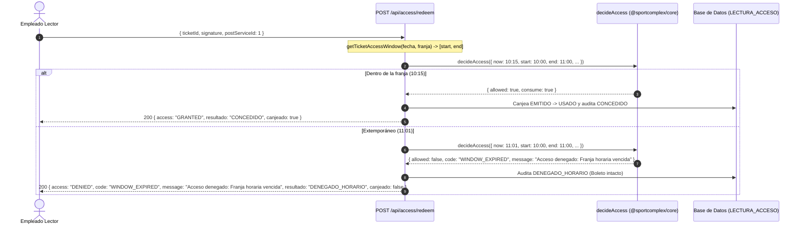

# TSK-BE-17 — Validación de franja horaria de ingreso

> **Jira:** SCRUM-130  
> **Tarea:** TSK-BE-17  
> **Historia de Usuario:** `HU-17` (RF-15 / RN-06)  
> **Fase:** F3 · **Story Points:** 1 pt · **Componente:** Backend  
> **Depende de:** `TSK-BE-14`  
> **Rama sugerida / activa:** `feature/tsk-be-17-validación-de-franja-horaria-de`  

---

## 1. Alcance Técnico y Reglas de Negocio

- **RN-06 (Ventana de Acceso):** El ingreso físico a las instalaciones únicamente se autoriza dentro del rango cerrado $[HoraInicio, HoraFin]$ de la franja horaria reservada.
- **Zona Horaria Canónica (`America/Bogota` / UTC-5):** Todo cálculo y comparación de instantes temporales se normaliza bajo la hora legal de Colombia (`America/Bogota`), combinando la fecha del calendario de la reserva (`fecha` `@db.Date`) con las marcas de tiempo de la franja (`hora_inicio` y `hora_fin` `@db.Time`).
- **Idempotencia e Integridad del Boleto:** Un intento extemporáneo deniega el acceso con `code = "WINDOW_EXPIRED"` y resultado de auditoría `DENEGADO_HORARIO`, registrando exactamente una fila en `LECTURA_ACCESO` sin consumir ni alterar el boleto (`ticket.estado` permanece en `EMITIDO`).
- **Mensaje Contractual:** `ACCESS_WINDOW_EXPIRED_MESSAGE = "Acceso denegado: Franja horaria vencida"` exportado desde `@sportcomplex/core` y devuelto en las respuestas denegadas tanto en `POST /api/access/redeem` como en `POST /api/access`.

---

## 2. Criterio de Aceptación Clave

> **Criterio de Aceptación:**  
> Tiquete con franja 10:00–11:00 con hora actual 10:15 se valida; a las 11:01 se deniega con **"Acceso denegado: Franja horaria vencida"**.

### Comportamiento de Fronteras (Intervalo Cerrado $[10:00:00, 11:00:00]$)

| Hora de Escaneo (Bogotá) | Equivalente UTC (`-05:00`) | Resultado | Código / Mensaje | Estado del Boleto |
|---|---|---|---|---|
| `09:59:59` | `14:59:59Z` | `DENIED` (`DENEGADO_HORARIO`) | `WINDOW_EXPIRED` `"Acceso denegado: Franja horaria vencida"` | `EMITIDO` (intacto) |
| `10:00:00` | `15:00:00Z` | `GRANTED` (`CONCEDIDO`) | N/A (Canje exitoso) | Pasa a `USADO` |
| `10:15:00` | `15:15:00Z` | `GRANTED` (`CONCEDIDO`) | N/A (Canje exitoso) | Pasa a `USADO` |
| `11:00:00` | `16:00:00Z` | `GRANTED` (`CONCEDIDO`) | N/A (Canje exitoso) | Pasa a `USADO` |
| `11:00:01` | `16:00:01Z` | `DENIED` (`DENEGADO_HORARIO`) | `WINDOW_EXPIRED` `"Acceso denegado: Franja horaria vencida"` | `EMITIDO` (intacto) |
| `11:01:00` | `16:01:00Z` | `DENIED` (`DENEGADO_HORARIO`) | `WINDOW_EXPIRED` `"Acceso denegado: Franja horaria vencida"` | `EMITIDO` (intacto) |

---

## 3. Arquitectura y Componentes Modificados

### Cambios Implementados

1. **`packages/core/src/services/access-control.ts`:**
   - Constante contractual exportada: `ACCESS_WINDOW_EXPIRED_MESSAGE = "Acceso denegado: Franja horaria vencida"`.
   - Constantes adicionales de denegación: `ACCESS_SERVICE_MISMATCH_MESSAGE` y `ACCESS_ALREADY_USED_MESSAGE`.
   - Función auxiliar: `isWithinAccessWindow(now: Date, start: Date, end: Date): boolean`.
   - Función centralizada: `getTicketAccessWindow(disponibilidad)` con soporte polimórfico para instancias `Date` y cadenas ISO en zona horaria legal de Colombia (`America/Bogota`, UTC-5).
   - Motor puro `decideAccess`: incluye el campo descriptivo `message` al denegar el acceso.

2. **`apps/web/src/lib/access.ts`:**
   - Re-exporta `getTicketAccessWindow` y `ACCESS_WINDOW_EXPIRED_MESSAGE` desde `@sportcomplex/core`.
   - `EscaneoResultado` extiende su contrato con `message?: string`.
   - `procesarEscaneo` propaga el mensaje explicativo contractual en todas las salidas denegadas (`access === "DENIED"`).

3. **Pruebas Automatizadas:**
   - `packages/core/src/services/access-control.test.ts`:
     - Test de aceptación unitario verificando validación a las 10:15 y denegación a las 11:01 con el mensaje exacto.
     - Pruebas de bordes exactos `[10:00:00, 11:00:00]` y rechazo en `09:59:59` y `11:00:01`.
     - Verificación de construcción de franja en `America/Bogota` para objetos `Date` y strings.
   - `apps/web/src/app/api/access/redeem/__tests__/route.test.ts`:
     - Test de aceptación end-to-end sobre el endpoint de canje en modo turno (`POST /api/access/redeem`).
     - Validación de bordes y preservación inmutable del boleto en la base de datos ante denegación horaria.
   - `apps/web/src/app/api/access/__tests__/access.test.ts`:
     - Verificación del contrato de salida con `message: "Acceso denegado: Franja horaria vencida"`.

---

## 4. Verificación de Calidad

- `pnpm --filter @sportcomplex/core test`: 55/55 tests pasando exitosamente.
- `pnpm --filter web test`: 97/97 tests pasando exitosamente.
- `pnpm test`: suite completa del monorepo en verde.
- `pnpm lint`: 0 errores y 0 advertencias de ESLint en todos los paquetes.
- `pnpm --filter @sportcomplex/core typecheck && pnpm --filter web typecheck`: 0 errores de TypeScript.
