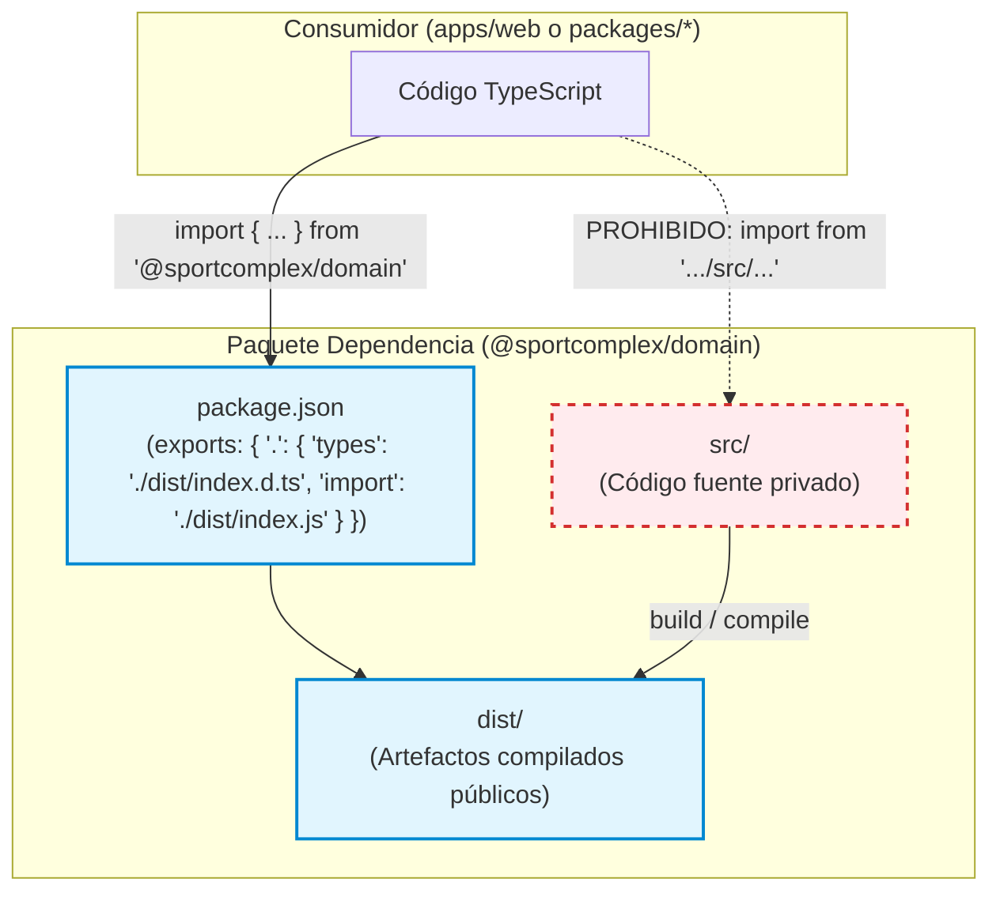

# ADR 001: Límites Estrictos de Paquetes y Exportaciones en el Monorepo

- **Título y Estado**: Aprobado (Fase 0/Fase 3)
- **Fecha y Autores**: 2026-10-14 - Célula Infra / SportComplex

## Contexto y Problema

En iteraciones tempranas del monorepo, los paquetes y aplicaciones importaban código de otros paquetes accediendo directamente a sus rutas internas de código fuente (p. ej. `import { ... } from '@sportcomplex/domain/src/...'`). Esta práctica generaba un fuerte acoplamiento a la estructura interna de directorios, eludía las fronteras y contratos públicos de cada paquete, impedía empaquetar o publicar artefactos compilados limpios y causaba inconsistencias entre entornos de desarrollo (TypeScript directo) y entornos de producción (compilados a JavaScript).

## Decisión Arquitectónica

1. **Eliminación total de subpath imports a código fuente**: Queda terminantemente prohibido importar rutas internas `/src/*` de otros paquetes del monorepo (`@sportcomplex/*/src/*`).
2. **Exportaciones controladas vía `package.json#exports`**: Cada paquete debe declarar de forma explícita en su `package.json` su interfaz pública utilizando la propiedad `exports`, mapeando tanto tipos (`types`) como puntos de entrada (`import`/`default`) apuntando exclusivamente a artefactos en `dist/`.
3. **Compilación obligatoria a `dist/`**: Todo paquete consumido internamente debe ser compilado a su directorio `dist/` mediante sus scripts de build (`tsc` o bundler). Los consumidores importan siempre desde el punto de entrada canónico del paquete (p. ej. `@sportcomplex/domain`).

## Diagrama Mermaid

## Consecuencias

### Positivas
- **Encapsulación y bajo acoplamiento**: Cada paquete expone únicamente lo que decide hacer público mediante su índice exportado.
- **Consistencia de ejecución**: El código ejecutado y probado utiliza artefactos compilados estándar, evitando discrepancias de transpilación.
- **Refactorización segura**: Se pueden renombrar y reestructurar archivos internos en `src/` sin romper dependencias externas.

### Compromisos
- **Flujo de compilación**: Es mandatorio compilar paquetes dependientes antes de ejecutar o probar paquetes dependientes en monorepo (`turbo run build` / `npm run build`).

## Validación y Guardrails

- **Guardrail automatizado**: Relación directa con `npm run verificar:limites` / `scripts/verificar-limites.sh`.
- Este script analiza el AST o realiza un escaneo regex de imports en todo el repositorio para rechazar cualquier importación que coincida con `@sportcomplex/*/src/`. El pipeline de CI falla de forma inmediata si se detecta cualquier violación.
