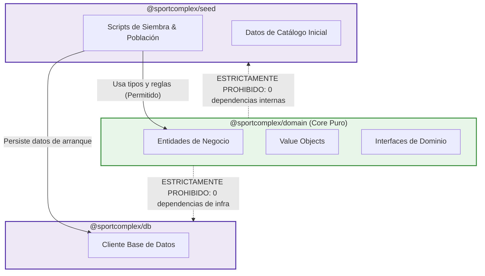

# ADR 002: Separación Estricta entre Dominio y Semilla de Datos

- **Título y Estado**: Aprobado (Fase 0/Fase 3)
- **Fecha y Autores**: 2026-10-14 - Célula Infra / SportComplex

## Contexto y Problema

El paquete `@sportcomplex/domain` representa el núcleo central de reglas de negocio, entidades puras y contratos de tipos del sistema SportComplex. Anteriormente, existía la tendencia de acoplar lógica o datos de arranque (seeders, catálogos iniciales, IDs predeterminados) dentro del paquete de dominio, o hacer que el dominio dependiera de otros paquetes del monorepo (como acceso a bases de datos o validaciones externas). Esto violaba los principios de arquitectura limpia y hacía que el núcleo de negocio fuera frágil y dependiente de la infraestructura y del aprovisionamiento inicial.

## Decisión Arquitectónica

1. **Aislamiento absoluto de `@sportcomplex/domain`**: El paquete `@sportcomplex/domain` debe mantener cero (0) dependencias internas del monorepo y un mínimo estricto de dependencias externas (preferiblemente solo TypeScript/utilidades de tipado puro).
2. **Segregación a `@sportcomplex/seed`**: Toda la lógica de inicialización, datos de catálogo precargados, generadores de datos iniciales y scripts de siembra se aíslan exclusivamente dentro del paquete `@sportcomplex/seed`.
3. **Flujo unidireccional**: `@sportcomplex/seed` puede depender de `@sportcomplex/domain` para instanciar y tipar las entidades según el modelo canónico, pero `@sportcomplex/domain` jamás debe conocer o importar nada proveniente de `@sportcomplex/seed`.

## Diagrama Mermaid

## Consecuencias

### Positivas
- **Inmutabilidad y estabilidad del dominio**: El núcleo de la aplicación es agnóstico a la persistencia y al estado inicial de las bases de datos.
- **Portabilidad**: `@sportcomplex/domain` se puede compartir sin sobrecarga en cualquier entorno (web, móvil, workers, CLI).
- **Mantenimiento claro**: Los cambios en scripts de siembra o datos de catálogo no alteran el artefacto de dominio ni invalidan su caché de compilación.

### Compromisos
- Los modelos creados en `@sportcomplex/seed` deben someterse a las restricciones públicas de `@sportcomplex/domain`, requiriendo mapeos formales si los datos de carga crudos difieren de las entidades de dominio.

## Validación y Guardrails

- **Guardrail automatizado**: Verificación integrada en `npm run verificar:limites`.
- El linter de arquitectura inspecciona el archivo `packages/domain/package.json` para verificar que `dependencies` y `devDependencies` hacia paquetes `@sportcomplex/*` sea un conjunto vacío (`{}`). El build falla si se introduce cualquier dependencia monorepo en `@sportcomplex/domain`.
