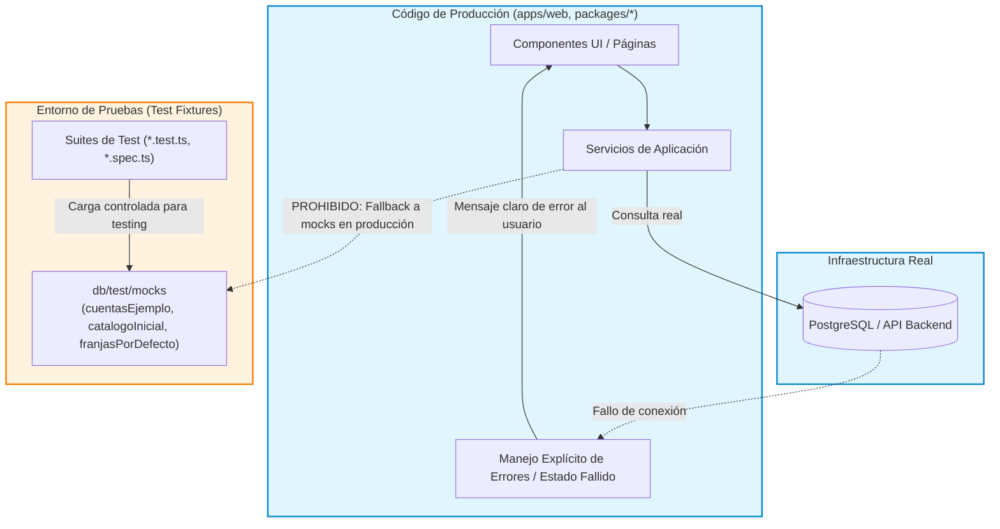

# ADR 003: Cero Mock en Código de Producción

- **Título y Estado**: Aprobado (Fase 0/Fase 3)
- **Fecha y Autores**: 2026-10-14 - Célula Infra / SportComplex

## Contexto y Problema

Durante fases de prototipado rápido, se introdujeron estructuras de datos simuladas como mecanismos de fallback directo en componentes de interfaz y servicios de aplicación (p. ej. `cuentasEjemplo`, `catalogoInicial`, `franjasPorDefecto`). Si la base de datos no respondía o si un endpoint fallaba, la aplicación silenciosamente cambiaba a estos mocks hardcodeados. Esto causaba comportamientos fantasmas en producción, enmascaraba caídas del backend o de la base de datos, dificultaba la detección de errores de integración y ponía en riesgo la consistencia e integridad de datos de los usuarios reales.

## Decisión Arquitectónica

1. **Erradicación total en producción**: Queda prohibida la presencia de objetos, arrays, funciones de mock o datos de ejemplo preestablecidos en el código empaquetado para producción (`apps/web`, `packages/application`, etc.).
2. **Fallo explícito ante indisponibilidad**: Si la base de datos o un servicio requerido no responde, el sistema debe emitir errores explícitos (circuit breaker, pantallas de error, estados vacíos controlados), nunca sustituir los datos por listas mock.
3. **Confinamiento a suites de pruebas**: Los datos mock (`cuentasEjemplo`, `catalogoInicial`, etc.) quedan confinados exclusivamente a:
   - Suites de pruebas unitarias y de integración (`*.test.ts`, `*.spec.ts`).
   - El directorio `db/test/mocks` o utilidades específicas de test fixtures.
   - Entornos de pruebas E2E aislados.

## Diagrama Mermaid

## Consecuencias

### Positivas
- **Fidelidad y observabilidad**: Los fallos en la capa de datos son evidentes y medibles de inmediato en telemetría y logs.
- **Seguridad e integridad**: Se erradica el riesgo de que un usuario interactúe o intente mutar datos artificiales de demostración en un entorno real.
- **Reducción de bundle size**: Se eliminan cargas estáticas innecesarias de JSON y objetos embebidos en el bundle de cliente.

### Compromisos
- La experiencia de desarrollo local requiere una instancia de PostgreSQL en ejecución o semillas cargadas mediante `pnpm run seed` en lugar de poder visualizar la app sin base de datos.

## Validación y Guardrails

- **Guardrail automatizado**: Vinculado al comando `npm run verificar:limites`.
- Escáner de código estático (AST/ESLint) configurado para vetar identificadores reservados (`cuentasEjemplo`, `catalogoInicial`, `franjasPorDefecto`) y patrones de mock fuera de carpetas de tests (`**/__tests__/**`, `**/*.spec.*`, `**/*.test.*`, `db/test/mocks/**`). Si se detecta una referencia en rutas de producción, el build es cancelado de forma automática.
