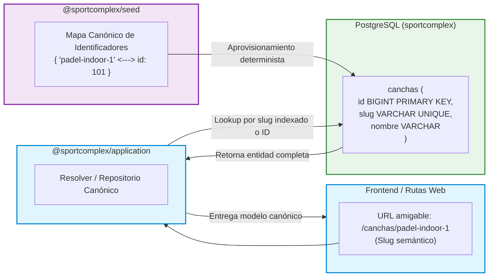

# ADR 004: Resolución del Sistema Dual de IDs (Slugs vs IDs Numéricos)

- **Título y Estado**: Aprobado (Fase 0/Fase 3)
- **Fecha y Autores**: 2026-10-14 - Célula Infra / SportComplex

## Contexto y Problema

El sistema coexistía con dos esquemas dispares para identificar entidades clave (canchas, complejos, categorías y productos):
1. **IDs numéricos autoincrementales (`SERIAL` / `BIGINT`)** en las tablas de PostgreSQL, utilizados tradicionalmente por foreign keys y optimización de índices relacionales.
2. **Identificadores textuales / Slugs semánticos (`cancha-futbol-5-a`, `padel-indoor-1`)** en el catálogo de frontend, rutas amigables de navegación SEO y configuraciones de clientes.

Esta divergencia provocaba desajustes en endpoints REST, colisiones en procesos de migración, y la necesidad de heurísticas ad-hoc dispersas en múltiples paquetes para mapear slugs a IDs enteros.

## Decisión Arquitectónica

1. **Mapa Canónico Único en `@sportcomplex/seed`**: Se centraliza la correspondencia biunívoca entre slugs semánticos e IDs fijos o generados dentro de `@sportcomplex/seed`.
2. **Inmutabilidad y Determinismo**: Las migraciones y seeders garantizan que los slugs semánticos tengan un ID relacional determinista en todas las bases de datos de desarrollo, staging y producción.
3. **Soporte Canónico en Dominio y Persistencia**:
   - La base de datos mantiene restricciones únicas tanto para `id` (`BIGINT PRIMARY KEY`) como para `slug` (`VARCHAR UNIQUE NOT NULL`).
   - Los contratos de API y repositorios permiten resolución transparente mediante identificador canónico sin conversiones dispersas en componentes UI.

## Diagrama Mermaid

## Consecuencias

### Positivas
- **Cero ambigüedad**: Fin a las inconsistencias entre datos cargados por semillas y consultas de catálogo en el frontend.
- **Rendimiento óptimo**: Búsquedas eficientes por clave primaria o índice único de slug sin conversiones dinámicas en tiempo de ejecución.
- **URLs amigables y estables**: El usuario disfruta de enlaces legibles (`/canchas/futbol-7`) con la robustez de claves foráneas relacionales en base de datos.

### Compromisos
- Toda nueva entidad semilla debe registrarse formalmente en el mapa de `@sportcomplex/seed` definiendo su slug y especificación relacional correspondiente.

## Validación y Guardrails

- **Guardrail automatizado**: Comprobado por `npm run verificar:limites`.
- Los tests de integración y validadores de semillas verifican la unicidad estricta y correspondencia del mapa canónico antes de insertar registros en base de datos.
- Prohibición estricta de diccionarios de conversión manual `slugToId` hardcodeados en el código de `apps/web`.
