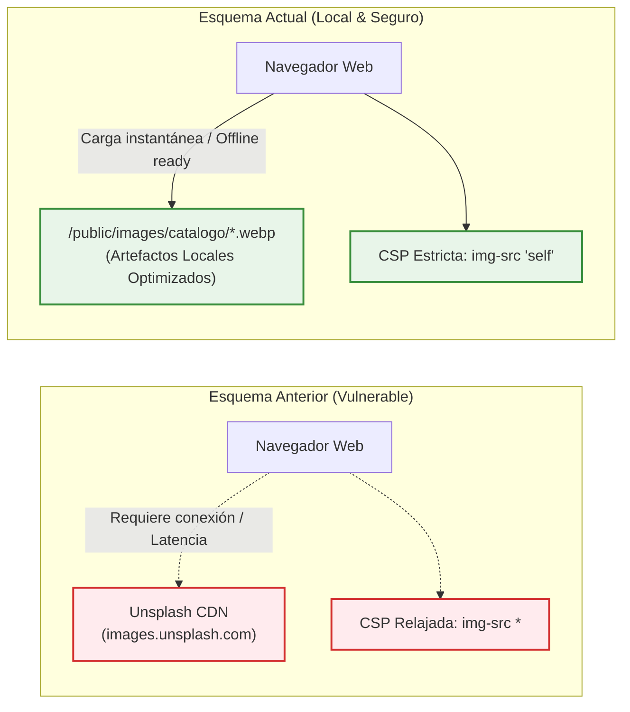

# ADR 005: Localización y Optimización de Imágenes del Catálogo

- **Título y Estado**: Aprobado (Fase 0/Fase 3)
- **Fecha y Autores**: 2026-10-14 - Célula Infra / SportComplex

## Contexto y Problema

El catálogo inicial y las vistas de canchas y complejos referenciaban recursos gráficos alojados en CDNs y servicios externos (especialmente Unsplash: `images.unsplash.com`). Esta dependencia presentaba múltiples inconvenientes críticos:
1. **Falta de resiliencia offline**: Imposibilidad de trabajar, probar o ejecutar demostraciones sin conexión estable a Internet.
2. **Latencia variable y rotura de enlaces**: Cambios de URLs, políticas de rate limiting o caídas del servicio externo degradaban la experiencia del usuario.
3. **Violaciones de Política de Seguridad (CSP)**: Requería relajar las directivas `img-src` de Content Security Policy en Next.js/Web para permitir dominios externos arbitrarios.
4. **Sobrecarga de red**: Falta de compresión uniforme y formatos modernos adaptados a dispositivos móviles.

## Decisión Arquitectónica

1. **Migración a almacenamiento local**: Todas las imágenes del catálogo se descargan, optimizan y almacenan localmente dentro del directorio `/public/images/catalogo/` de la aplicación web.
2. **Formato estándar WebP**: Todas las imágenes se convierten a formato WebP optimizado con resolución controlada y compresión eficiente.
3. **Restricción estricta de Content Security Policy (CSP)**: La directiva `img-src` de CSP se restringe a `'self'` y fuentes de datos locales (`data:`/`blob:` según necesidad), prohibiendo dominios externos como `unsplash.com`.
4. **Rutas canónicas en base de datos**: Las tablas de catálogo y las semillas almacenan rutas locales relativas (p. ej. `/images/catalogo/cancha-futbol-5.webp`).

## Diagrama Mermaid

## Consecuencias

### Positivas
- **Resiliencia completa sin conexión**: La aplicación opera al 100% en entornos locales o redes cerradas.
- **Seguridad robusta**: Cabeceras CSP endurecidas eliminando vectores de inyección o rastreo de terceros.
- **Rendimiento predecible**: Tiempos de carga reducidos gracias al formato WebP servido directamente con encabezados de caché `Cache-Control: immutable`.

### Compromisos
- Ligero incremento en el tamaño del repositorio o artefacto estático de despliegue (mitigado por la alta tasa de compresión de WebP).

## Validación y Guardrails

- **Guardrail automatizado**: Inspección ejecutada en `npm run verificar:limites`.
- Escaneo de código en plantillas, componentes y semillas para asegurar que ninguna URL coincida con dominios externos (`unsplash.com`, `pexels.com`, etc.).
- Verificación en tests E2E y de headers HTTP comprobando que la cabecera `Content-Security-Policy` no incluya excepciones para dominios no autorizados.
