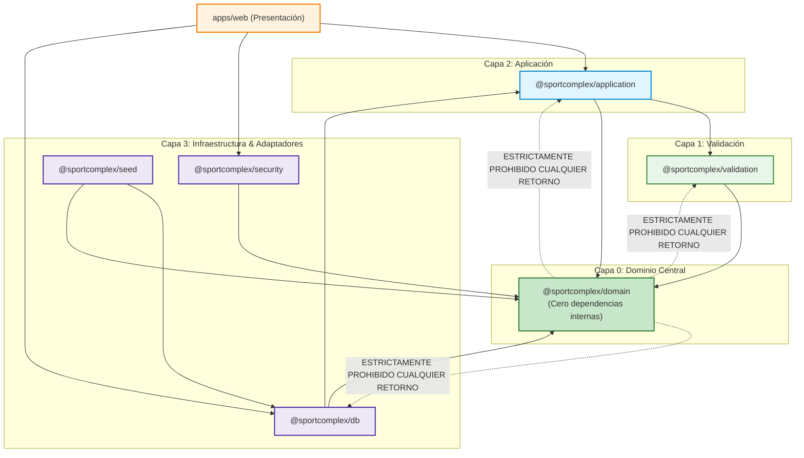

# ADR 006: Grafo Acíclico de Dependencias y Reglas de Dirección

- **Título y Estado**: Aprobado (Fase 0/Fase 3)
- **Fecha y Autores**: 2026-10-14 - Célula Infra / SportComplex

## Contexto y Problema

A medida que el monorepo incorporó más paquetes y servicios, surgieron riesgos de dependencias circulares (p. ej., módulos de infraestructura intentando importar lógica de aplicación, o validaciones dependiendo de componentes web). Un grafo de dependencias desordenado o cíclico provoca bloqueos en el árbol de compilación, orden de inicialización impredecible en tiempo de ejecución, imposibilidad de realizar tree-shaking eficaz y dificultades extremas para aislar y probar capas de forma independiente.

## Decisión Arquitectónica

1. **Grafo Acíclico Dirigido (DAG) Estricto**: Se define una jerarquía estratificada unidireccional y sin ciclos:
   - Capa 0: `@sportcomplex/domain` (0 dependencias internas).
   - Capa 1: `@sportcomplex/validation` (depende únicamente de `domain`).
   - Capa 2: `@sportcomplex/application` (depende de `domain` y `validation`).
   - Capa 3: `@sportcomplex/db`, `@sportcomplex/security`, `@sportcomplex/seed` (infraestructura, persistencia y seguridad; dependen de `domain`, `validation` y/o `application`).
   - Capa 4: `apps/web` (capa de presentación y entrega; puede consumir todas las capas anteriores según su rol).
2. **Prohibición de Dependencias Circulares**: Queda terminantemente vetado cualquier ciclo directo o indirecto entre paquetes.
3. **Regla de Inversión y Dirección**: Las capas internas (dominio/aplicación) jamás importan capas externas (db/web). La infraestructura se adapta a las interfaces y contratos definidos en las capas internas.

## Diagrama Mermaid

## Consecuencias

### Positivas
- **Orden de compilación predecible**: Turbo y herramientas de empaquetado optimizan el pipeline paralelizando builds según el DAG sin fallos ni condiciones de carrera.
- **Testabilidad desacoplada**: El dominio y las validaciones se pueden probar en milisegundos sin levantar motores de base de datos ni servidores web.
- **Claridad de responsabilidades**: Cada desarrollador sabe con precisión en qué capa reside cada artefacto y qué puede consumir.

### Compromisos
- Es necesario respetar patrones de inversión de dependencias o puertos y adaptadores para situaciones donde la aplicación necesita interactuar con infraestructura.

## Validación y Guardrails

- **Guardrail automatizado**: Ejecutado durante `npm run verificar:limites`.
- Herramienta de análisis estático de dependencias (Madge / Turborepo boundary check / script de límites) que recorre el grafo de paquetes.
- Si se detecta un ciclo de dependencias o una importación que vulnere la dirección establecida (p. ej., `domain` importando `db`), el pipeline de integración continua finaliza con código de error 1.
