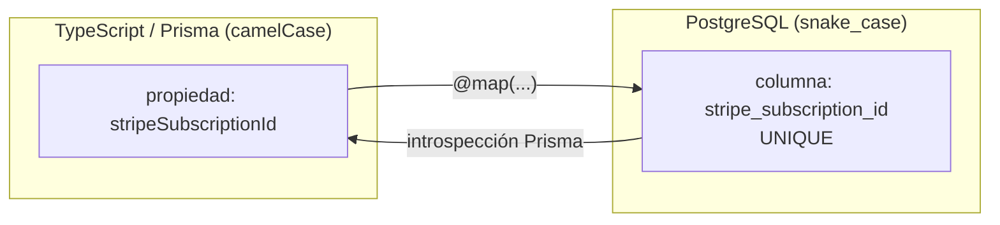

# ADR 007: Mapeo y Nomenclatura de Campos Contractuales (Compatibilidad Objeto-Relacional)

- **Título y Estado**: Aprobado (Fase 0 — Contract DB v1 §4.5)
- **Fecha y Autores**: 2026-10-14 — Célula DB / SportComplex

## Contexto y Problema

Durante la modularización de `@sportcomplex/db`, el contrato de Base de Datos v1 (§4.5) exige una decisión explícita de nomenclatura para cinco campos cuyo nombre de propiedad TypeScript difiere del de la columna SQL, todos con impacto directo en los contratos de consumo de `apps/web` y `packages/core`:

| # | Propiedad Prisma | Modelo | Columna PostgreSQL |
| :-: | :--- | :--- | :--- |
| 1 | `avatar` | `Usuario` | `avatar_url` |
| 2 | `googleSub` | `Usuario` | `google_sub` |
| 3 | `stripeSubscriptionId` | `Membresia` | `stripe_subscription_id` |
| 4 | `webhookEnviadoEn` | `InhabilitacionServicio` | `webhook_enviado_en` |
| 5 | `stripePriceId` | `PlanMembresia` | `stripe_price_id` |

La célula DB opera bajo frontera estricta (no modificar `apps/web`, `core`, `ui`, `config` ni CI): cualquier renombramiento de propiedades Prisma rompería contratos fuera de su scope.

## Decisión Arquitectónica

**Mantener las cinco propiedades Prisma existentes con `@map` transparente a `snake_case`**, sin renombrar:

1. **`avatar @map("avatar_url")`**: múltiples componentes de autenticación y perfil en `apps/web` consumen `user.avatar` directamente; la columna física ya cumple `snake_case`, no hay discrepancia de persistencia.
2. **`googleSub @map("google_sub")`**: respeta el claim `sub` de OIDC para federación Google; TypeScript `camelCase`, PostgreSQL `snake_case`.
3. **`stripeSubscriptionId @map("stripe_subscription_id")`**: +30 llamadas directas (`/api/memberships/subscribe`, `/api/payments`, stores, tests) dependen de la clave; unicidad garantizada por `membresia_stripe_subscription_id_key`.
4. **`webhookEnviadoEn @map("webhook_enviado_en")`**: 100% conforme a la convención contractual (español `camelCase` en TS, `snake_case` en SQL); traza la emisión de webhooks de contingencia.
5. **`stripePriceId @map("stripe_price_id")`**: alineado con la terminología de Stripe API (`Price ID`), consumido por checkout y utilitarios de membresías.

## Diagrama Mermaid

## Consecuencias

- **Integridad**: PostgreSQL respeta `snake_case` en el 100% de columnas e índices.
- **Retrocompatibilidad**: ninguna capa externa (`apps/web`, `core`) sufre cambios de contrato ni errores de tipos.
- **Mantenibilidad**: el mapeo queda documentado y trazable para futuras células; la regla general es "propiedad TS existente + `@map` a `snake_case`", y todo campo nuevo debe seguir esa misma convención desde su migración inicial.
