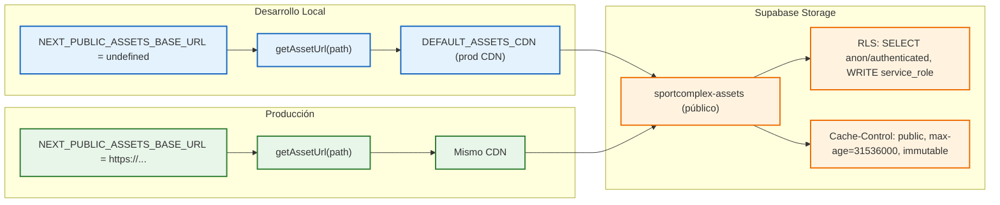

# ADR 008: Migración de Assets Multimedia a Supabase Storage CDN

- **Título y Estado**: Aprobado (Fase F2 · HU-29)
- **Fecha y Autores**: 2026-10-18 · Célula Infra / SportComplex

## Contexto y Problema

El [ADR 005](./005-localizacion-imagenes.md) (2026-10-14) establecía una política estricta de **imágenes locales obligatorias** en `/public/images/catalogo/` con CSP `img-src 'self'`, prohibiendo dominios externos (Unsplash, etc.). Esta decisión se tomó para:

1. Resiliencia offline completa.
2. Seguridad CSP robusta (`img-src 'self'`).
3. Rendimiento predecible (WebP servido con `Cache-Control: immutable`).

Sin embargo, la evolución del producto (HU-29, RF-00, RNF-04) exige:

- **Entrega por CDN global** para latencia mínima en móviles (Medellín y visitantes internacionales).
- **Invalidación controlada** sin rebuild del frontend (assets inmutables con `max-age=31536000, immutable`).
- **Reducción de bundle/repo** (eliminar ~4.4 MB de WebP del repositorio).
- **Escalabilidad**: nuevos assets (hero, marca, eventos) sin tocar código ni repo.

La política de "todo local" del ADR 005 entra en conflicto directo con estos requisitos operativos.

## Decisión Arquitectónica

1. **Migración a Supabase Storage CDN** para todos los assets de catálogo (23 WebP).
   - Bucket público `sportcomplex-assets` (políticas RLS: `SELECT` público, escritura solo `service_role`).
   - `Cache-Control: public, max-age=31536000, immutable` en cada objeto.
   - URLs canónicas: `https://<ref>.supabase.co/storage/v1/object/public/sportcomplex-assets/catalogo/<slug>.webp`.

2. **Excepción controlada a CSP** (`img-src`):
   - Se añade `https://phyesjwtzrmrcvmtajay.supabase.co` a `img-src` en `next.config.ts` / headers.
   - **No** se relaja a `*` ni a dominios arbitrarios; solo el bucket oficial del proyecto.

3. **Helper centralizado** `getAssetUrl(path)` en `@sportcomplex/core/assets`:
   - Fallback seguro: `DEFAULT_ASSETS_CDN = "https://phyesjwtzrmrcvmtajay.supabase.co/storage/v1/object/public/sportcomplex-assets"`.
   - Si `NEXT_PUBLIC_ASSETS_BASE_URL` no está definida (dev local sin `.env.local`), se usa el CDN de producción → **no hay 404 visuales**.
   - En producción, la variable se inyecta via GitHub Actions secret → misma URL.

4. **Limpieza de repo**: `apps/web/public/images/catalogo/**` eliminado (CA3 cumplido). Hero `.jpg`, `club-hero.png`, logos `.png/.svg` permanecen locales (fuera de alcance HU-29).

## Diagrama Mermaid

## Consecuencias

### Positivas
- **Latencia global baja**: CDN de Supabase (edge global) vs. origen único.
- **Cero 404 en dev**: fallback automático a CDN productivo.
- **Invalidez controlada**: nombres inmutables → nueva versión = nuevo nombre (hash).
- **Repo ligero**: -4.4 MB binarios; build más rápido, clon más ligero.
- **Escalabilidad**: nuevos assets (hero, eventos, marca) suben a Storage sin tocar código.

### Compromisos
- **CSP `img-src` ampliado**: se añade dominio Supabase (excepción documentada y acotada).
- **Dependencia externa**: disponibilidad del CDN de Supabase (SLA 99.9%).
- **Hero/logo locales**: `club-hero.png`, heroes `.jpg`, logos `.png/.svg` permanecen en `public/` (fuera de HU-29).

## Validación y Guardrails

- **Script `storage:setup --verify`**: healthcheck anónimo + `Cache-Control` verificado.
- **Script `assets:upload --verify`**: subida 23 WebP + verificación HEAD anónima.
- **Build gate**: `pnpm build` verifica `next.config.ts` `remotePatterns` + sin 404 en páginas estáticas.
- **Lint de límites**: `pnpm verificar:limites` (sin imports internos en helpers).

## Referencias

- HU-29 · RF-00 · RNF-04 · RN-13
- TSK-OPS-02 (SCRUM-179) · TSK-FE-29b (SCRUM-180) · TSK-FE-30b (SCRUM-181)
- [ADR 005](./005-localizacion-imagenes.md) (supersedido parcialmente)
- `docs/features/assets-multimedia.md` (implementación)
- `docs/infra/storage.md` (bucket, políticas, scripts)
- `packages/core/src/assets.ts` (helper centralizado)
- `packages/db/scripts/setup-storage-assets.mts` / `upload-assets-storage.mts`