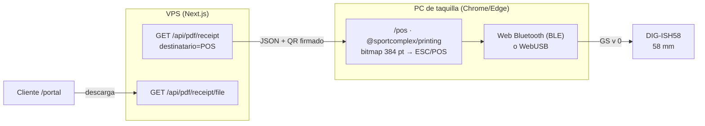

# ADR 009: Impresión térmica de tickets en taquilla desde el navegador (Bluetooth o USB)

- **Título y Estado**: Aprobado — enmienda RNF-05 / Decisión 3 del SRS
- **Fecha y Autores**: 2026-10-18 — SportComplex

## Contexto y Problema

El SRS (RNF-05, Decisión 3) descartaba el hardware térmico: todo "se imprimía" con `window.print()` y reglas `@media print`. En la práctica:

- El cliente tenía botones "Imprimir Recibo (58mm)" en su portal, que no aportan nada: su pase es digital (QR en pantalla y en el correo).
- El POS imprimía la página completa, porque ninguna regla apuntaba al voucher, y el membrete y el NIT estaban escritos a mano en el componente.
- La taquilla sí necesita entregar un ticket en papel. El prototipo `factura58` (Rust, `~/Development/experiments/pos-testing/dg-58mm-first-test`) demostró en papel, con la DIG-ISH58 (58 mm, 384 puntos, ESC/POS), que dibujar el ticket completo como bitmap da un resultado idéntico 1:1 a la vista previa y que el QR se lee sin problemas.

La app web corre en el VPS (Docker detrás de Caddy) y no puede ver el USB de la caja.

## Decisión Arquitectónica

1. **Solo el operador imprime.** Imprimir en la térmica es exclusivo de `Empleado_Vendedor` y `Administrador` desde `/pos`. El cliente reserva igual que antes y en papel solo puede **descargar el PDF** de 58 mm.
2. **Paquete `@sportcomplex/printing`** (TypeScript, sin React, hoja del grafo): es un port del núcleo de `factura58`.
   - Un único bitmap de 384 puntos sale como bytes ESC/POS (`GS v 0` en bandas de 64 filas, relleno de 64 NUL + `ESC @`, avance y corte parcial), como PDF de 58 mm y como vista previa RGBA.
   - Tipografía **Thermal Sans Mono 24** (12×24). La negrita se simula con doble impresión desplazada 1 punto, igual que en el prototipo.
   - Una prueba compara el texto punto a punto con los bytes que genera el prototipo en Rust. El QR se valida leyéndolo con `zbarimg`, porque `qrcode` de npm puede elegir otra máscara que la crate de Rust.
3. **Transporte desde el navegador, Bluetooth o USB**, en Chrome/Edge del operador (contexto seguro: HTTPS en producción, `localhost` en desarrollo). El operador empareja la impresora por el medio que tenga:
   - **Web Bluetooth (BLE)** (`@sportcomplex/printing/bluetooth`): la DIG-ISH58 se anuncia como `PrinterLE_xxxx`. Se escribe en la característica `0x2AF1` del servicio `0x18F0`; si no existe, se usa el UART ISSC (`49535343-…`) o el servicio `e7810a71-…`. La escritura es con respuesta, en trozos de 180 bytes, y BlueZ los parte según el MTU. Probado en papel el 2026-10-19: MTU 100, ~75 KB en ~40 s.
   - **WebUSB** (`@sportcomplex/printing/webusb`): `requestDevice` con la clase USB 0x07 y trozos de 4 KiB por el endpoint bulk OUT.
4. **Datos solo del servidor.** El ticket se arma con `GET /api/pdf/receipt` (`destinatario=POS`, solo personal). Así el membrete, los montos y el QR firmado (`SC1:<uuid>:<hmac>`) vienen resueltos por el servidor y `QR_HMAC_SECRET` nunca sale de él.
5. **Rutas nuevas:**
   - `GET /api/pdf/receipt/file`: PDF de 58 mm. Reutiliza el aislamiento por titular de `construirComprobante`.
   - `GET /api/pos/tickets/lookup`: el operador escanea el QR del pase, se verifica la firma y se obtiene la reserva para imprimirla. Cubre el caso del cliente que reservó online y quiere su ticket en papel.

## Diagrama Mermaid

## Consecuencias

- **Fidelidad**: la vista previa del POS, el PDF y el papel salen del mismo bitmap.
- **Sin instalación**: no hay agente local ni driver de impresión (ver [impresora-termica.md](../../infra/impresora-termica.md)):
  - **Bluetooth:** no se toca el sistema operativo. En Linux, Chrome puede pedir que se active `chrome://flags/#enable-experimental-web-platform-features`. Como `getDevices()` aún es experimental, puede tocar volver a emparejar al recargar el POS.
  - **USB:** configuración única por caja. En Linux hay que quitar `usblp`/CUPS y dar permiso con una regla udev; en Windows hay que cambiar el driver a WinUSB.
- **Navegadores**: solo Chromium (Chrome/Edge). En Firefox o Safari el POS lo avisa y ofrece el PDF.
- **Rendimiento**: imprimir una imagen es más lento que usar la fuente ROM de la impresora, sobre todo por Bluetooth (~40 s por ticket). Se acepta a cambio de la fidelidad, igual que en el prototipo.
- **Licencia de la fuente**: Thermal Sans Mono es GPLv2+ con *GNU Font Embedding Exception*. La tabla de glifos `src/fonts/thermal.ts` se distribuye bajo esa licencia (`packages/printing/fonts/LICENSE.md`); los tickets y PDF impresos no quedan sujetos a la GPL.
