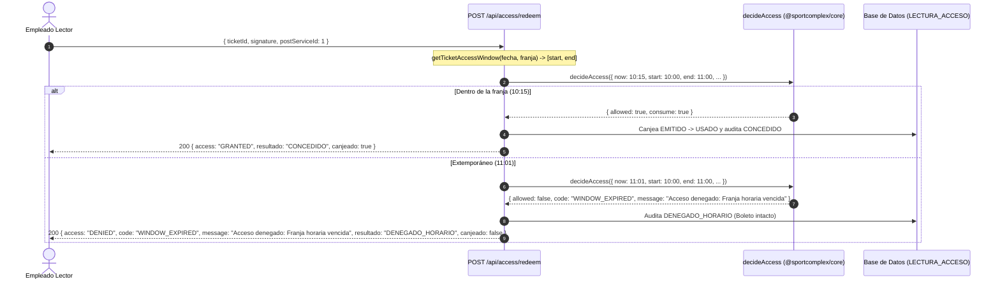

# TSK-BE-16 — Denegación explícita por discrepancia de zona

## Objetivo

Al escanear un tiquete desde un puesto asociado a otro servicio, denegar el acceso de forma explícita e indicar los nombres de ambos servicios. Por ejemplo:

> Acceso denegado: El tiquete pertenece a Piscina y se encuentra en Canchas

La validación compara el servicio de la reserva del tiquete con `postServiceId`, que identifica el servicio del puesto actual.

## Comportamiento implementado

- La discrepancia devuelve HTTP `403` con `error.code = SERVICE_MISMATCH` y el mensaje con los nombres del servicio del tiquete y del puesto.
- Este `403` usa el formato estándar de error (`success: false`, `error.message`); las denegaciones por horario o tiquete usado conservan el formato anterior HTTP `200` con `data.access = DENIED`. El frontend de TSK-FE-16 debe manejar ambos contratos.
- La regla aplica tanto a `POST /api/access/redeem` como a `POST /api/access`, que comparten el procesamiento de escaneo.
- El intento denegado conserva la auditoría existente (`DENEGADO_SERVICIO`) y no modifica el estado, el empleado ni la fecha de uso del tiquete.
- Si el identificador del puesto no corresponde a un servicio existente, la petición devuelve `404 SERVICE_NOT_FOUND`; no registra una lectura ni modifica el tiquete.
- Un servicio de puesto existente pero inhabilitado sigue participando en la comparación de zona: si el servicio no coincide con el del tiquete, aplica el mismo `403 SERVICE_MISMATCH`. La habilitación operativa del puesto no forma parte de esta task.
- Los demás resultados de acceso conservan sus respuestas actuales.

## Persistencia

No se modifica el esquema de Prisma ni se agrega una migración. Para construir el mensaje se consulta el nombre del servicio asociado al puesto; la auditoría de acceso ya existente registra la denegación.

## Cobertura automatizada

- `apps/web/src/app/api/access/redeem/__tests__/route.test.ts`: comprueba el HTTP `403`, el mensaje de aceptación, la auditoría de denegación y que el tiquete permanece `EMITIDO`.
- `apps/web/src/app/api/access/redeem/__tests__/route.test.ts` y `apps/web/src/app/api/access/__tests__/access.test.ts`: cubren ambos contratos HTTP `403`, el servicio inhabilitado y el servicio de puesto inexistente.
- Las pruebas existentes siguen cubriendo firma HMAC inválida antes de consultar la base de datos, autenticación, autorización, canje exitoso, doble escaneo y denegaciones por estado o franja horaria.
# TSK-BE-17 — Validación de franja horaria de ingreso

> **Jira:** SCRUM-130  
> **Tarea:** TSK-BE-17  
> **Historia de Usuario:** `HU-17` (RF-15 / RN-06)  
> **Fase:** F3 · **Story Points:** 1 pt · **Componente:** Backend  
> **Depende de:** `TSK-BE-14`  
> **Rama sugerida / activa:** `feature/tsk-be-17-validación-de-franja-horaria-de`  

---

## 1. Alcance Técnico y Reglas de Negocio

- **RN-06 (Ventana de Acceso):** El ingreso físico a las instalaciones únicamente se autoriza dentro del rango cerrado $[HoraInicio, HoraFin]$ de la franja horaria reservada.
- **Zona Horaria Canónica (`America/Bogota` / UTC-5):** Todo cálculo y comparación de instantes temporales se normaliza bajo la hora legal de Colombia (`America/Bogota`), combinando la fecha del calendario de la reserva (`fecha` `@db.Date`) con las marcas de tiempo de la franja (`hora_inicio` y `hora_fin` `@db.Time`).
- **Idempotencia e Integridad del Boleto:** Un intento extemporáneo deniega el acceso con `code = "WINDOW_EXPIRED"` y resultado de auditoría `DENEGADO_HORARIO`, registrando exactamente una fila en `LECTURA_ACCESO` sin consumir ni alterar el boleto (`ticket.estado` permanece en `EMITIDO`).
- **Mensaje Contractual:** `ACCESS_WINDOW_EXPIRED_MESSAGE = "Acceso denegado: Franja horaria vencida"` exportado desde `@sportcomplex/core` y devuelto en las respuestas denegadas tanto en `POST /api/access/redeem` como en `POST /api/access`.

---

## 2. Criterio de Aceptación Clave

> **Criterio de Aceptación:**  
> Tiquete con franja 10:00–11:00 con hora actual 10:15 se valida; a las 11:01 se deniega con **"Acceso denegado: Franja horaria vencida"**.

### Comportamiento de Fronteras (Intervalo Cerrado $[10:00:00, 11:00:00]$)

| Hora de Escaneo (Bogotá) | Equivalente UTC (`-05:00`) | Resultado | Código / Mensaje | Estado del Boleto |
|---|---|---|---|---|
| `09:59:59` | `14:59:59Z` | `DENIED` (`DENEGADO_HORARIO`) | `WINDOW_EXPIRED`<br>`"Acceso denegado: Franja horaria vencida"` | `EMITIDO` (intacto) |
| `10:00:00` | `15:00:00Z` | `GRANTED` (`CONCEDIDO`) | N/A (Canje exitoso) | Pasa a `USADO` |
| `10:15:00` | `15:15:00Z` | `GRANTED` (`CONCEDIDO`) | N/A (Canje exitoso) | Pasa a `USADO` |
| `11:00:00` | `16:00:00Z` | `GRANTED` (`CONCEDIDO`) | N/A (Canje exitoso) | Pasa a `USADO` |
| `11:00:01` | `16:00:01Z` | `DENIED` (`DENEGADO_HORARIO`) | `WINDOW_EXPIRED`<br>`"Acceso denegado: Franja horaria vencida"` | `EMITIDO` (intacto) |
| `11:01:00` | `16:01:00Z` | `DENIED` (`DENEGADO_HORARIO`) | `WINDOW_EXPIRED`<br>`"Acceso denegado: Franja horaria vencida"` | `EMITIDO` (intacto) |

---

## 3. Arquitectura y Componentes Modificados



### Cambios Implementados

1. **`packages/core/src/services/access-control.ts`:**
   - Constante contractual exportada: `ACCESS_WINDOW_EXPIRED_MESSAGE = "Acceso denegado: Franja horaria vencida"`.
   - Constantes adicionales de denegación: `ACCESS_SERVICE_MISMATCH_MESSAGE` y `ACCESS_ALREADY_USED_MESSAGE`.
   - Función auxiliar: `isWithinAccessWindow(now: Date, start: Date, end: Date): boolean`.
   - Función centralizada: `getTicketAccessWindow(disponibilidad)` con soporte polimórfico para instancias `Date` y cadenas ISO en zona horaria legal de Colombia (`America/Bogota`, UTC-5).
   - Motor puro `decideAccess`: incluye el campo descriptivo `message` al denegar el acceso.

2. **`apps/web/src/lib/access.ts`:**
   - Re-exporta `getTicketAccessWindow` y `ACCESS_WINDOW_EXPIRED_MESSAGE` desde `@sportcomplex/core`.
   - `EscaneoResultado` extiende su contrato con `message?: string`.
   - `procesarEscaneo` propaga el mensaje explicativo contractual en todas las salidas denegadas (`access === "DENIED"`).

3. **Pruebas Automatizadas:**
   - `packages/core/src/services/access-control.test.ts`:
     - Test de aceptación unitario verificando validación a las 10:15 y denegación a las 11:01 con el mensaje exacto.
     - Pruebas de bordes exactos `[10:00:00, 11:00:00]` y rechazo en `09:59:59` y `11:00:01`.
     - Verificación de construcción de franja en `America/Bogota` para objetos `Date` y strings.
   - `apps/web/src/app/api/access/redeem/__tests__/route.test.ts`:
     - Test de aceptación end-to-end sobre el endpoint de canje en modo turno (`POST /api/access/redeem`).
     - Validación de bordes y preservación inmutable del boleto en la base de datos ante denegación horaria.
   - `apps/web/src/app/api/access/__tests__/access.test.ts`:
     - Verificación del contrato de salida con `message: "Acceso denegado: Franja horaria vencida"`.

---

## 4. Verificación de Calidad

- `pnpm --filter @sportcomplex/core test`: 55/55 tests pasando exitosamente.
- `pnpm --filter web test`: 97/97 tests pasando exitosamente.
- `pnpm test`: suite completa del monorepo en verde.
- `pnpm lint`: 0 errores y 0 advertencias de ESLint en todos los paquetes.
- `pnpm --filter @sportcomplex/core typecheck && pnpm --filter web typecheck`: 0 errores de TypeScript.


---

# TSK-FE-14 — Escáner QR con selección de puesto de turno

## Objetivo y estado

La ruta `/scanner` permite a administradores y empleados lectores activos
seleccionar un servicio deportivo, leer un ticket QR firmado y solicitar su
canje. La integración está conectada al backend; no se utilizan tickets ni
respuestas de demostración.

## Integración con API

- `GET /api/access/services` carga la lista de puestos/servicios disponibles.
  El lector valida la forma de la respuesta y transforma cada ID en un entero
  positivo. La cámara no se activa hasta seleccionar un puesto válido.
- `POST /api/access/redeem` recibe `ticketId`, `signature` y `postServiceId`.
  El escáner solo extrae los datos del QR; el backend comprueba la firma, el
  rol/cuenta del operador, el servicio, la franja horaria y el estado del
  boleto.

El QR firmado sigue el formato:

```text
SC1:<ticket UUID>:<firma HMAC-SHA256 hexadecimal>
```

El servicio envía `postServiceId` como número entero positivo, nunca como
texto ni booleano. La pantalla muestra acceso concedido únicamente cuando la
respuesta contiene `access: "GRANTED"`.

| Respuesta | Presentación |
| --- | --- |
| `GRANTED` / `CONCEDIDO` | Acceso concedido y detalles disponibles del titular, reserva, servicio y horario |
| `DENIED` / `ALREADY_USED` | Boleto ya utilizado anteriormente |
| `DENIED` / `SERVICE_MISMATCH` | El ticket pertenece a otro escenario deportivo |
| `DENIED` / `WINDOW_EXPIRED` | Franja horaria vencida o no disponible; el boleto no se consume |

Las respuestas de denegación no se convierten en concesiones. Los fallos de
red y las respuestas mal formadas se propagan como errores visibles, separados
de los resultados de negocio.

## Ciclo de vida de cámara, diálogo y audio

La cámara se inicia solo después de elegir el puesto. Los fallos reales de
permisos o inicialización se presentan en la interfaz; los callbacks de
fotogramas sin QR se ignoran para evitar alertas repetitivas. Cerrar el diálogo
con Escape o con el botón de cerrar ejecuta el mismo reinicio que **Escanear
siguiente**: se limpia el ticket, se cierra el diálogo y se devuelve el flujo a
escaneo para reactivar la cámara.

El audio es opcional. Al habilitarlo desde el control del lector, el contexto
Web Audio se crea o reanuda directamente dentro del gesto del usuario, en
cumplimiento de las políticas de autoplay del navegador.

## Componentes

- `apps/web/src/app/(staff)/scanner/page.tsx`: coordina puesto, cámara, canje y estados.
- `apps/web/src/components/scanner/scanner.service.ts`: parser QR y cliente de los endpoints de servicios y canje.
- `apps/web/src/components/scanner/shift-selector.tsx`: selección del puesto antes de iniciar la lectura.
- `apps/web/src/components/scanner/scanner-header.tsx`: muestra el turno y controles de audio/tema.
- `apps/web/src/components/scanner/qr-camera-viewport.tsx`: ciclo de vida de la cámara y lectura QR.
- `apps/web/src/components/scanner/ticket-validation-modal.tsx`: estados de validación, denegación y confirmación.
- `apps/web/src/components/scanner/use-audio-feedback.ts`: tonos opcionales de éxito y error.
- `apps/web/src/components/scanner/__tests__/scanner.service.test.ts`: pruebas de parsing, listado de servicios y respuestas del canje.

## Verificación

Desde la raíz del monorepo:

```bash
pnpm --dir apps/web run typecheck
pnpm --dir apps/web run lint
pnpm --filter web test
```

Prueba manual sugerida: abrir `/scanner` con una cuenta autorizada, confirmar
que la cámara no inicia sin puesto, seleccionar un servicio y leer un QR
firmado. Verificar un canje concedido, un segundo intento (`ALREADY_USED`), un
ticket de otro servicio (`SERVICE_MISMATCH`) y un ticket fuera de horario
(`WINDOW_EXPIRED`). Cerrar el diálogo mediante Escape y X y confirmar que queda
listo para el siguiente escaneo. Los resultados finales siempre dependen de la
respuesta autoritativa del backend.


---

# TSK-FE-15 — Modo consulta informativo (HU-15 / RF-13)

> **Tarea ID:** `TSK-FE-15`  
> **Historia de Usuario:** `HU-15` (`RF-13`)  
> **Fase:** F3 · **Story Points:** 1 pt  
> **Responsable:** Leonardo  
> **Microcelda / Componente:** Frontend (`apps/web`)  
> **Depende de:** `TSK-BE-15` (`GET /api/tickets/verify/{code}`)  
> **Estado:** Resuelto / Implementado  
> **Rama sugerida:** `feature/tsk-fe-15-modo-consulta-informativo` (hacia `develop`)

---

## 1. Qué se hizo y por qué

En la operación de control de acceso de **SportComplex / AKROS Club**, el personal de portería o recepción (`Empleado_Lector` o `Administrador`) necesita consultar los detalles de una reserva cuando un socio o visitante presenta su código QR, sin que dicha consulta consuma el ticket ni descuente aforo.

Anteriormente, la ruta `/scanner` era solo un placeholder básico (`apps/web/src/app/(staff)/scanner/page.tsx`). Con esta tarea se implementó la interfaz completa del **Modo Consulta Informativo**:

| # | Componente / Archivo | Qué hace |
|---|----------------------|----------|
| 1 | `apps/web/src/app/(staff)/scanner/page.tsx` | Pantalla del escáner con toggle de Modo Consulta (sin puesto asignado), decodificador de cámara (`html5-qrcode`), vista de detalle del boleto y formulario alternativo para simulación/QA. **Sin botón de canje.** |
| 2 | `apps/web/src/components/scanner/consultation-result-card.tsx` | Componente modular de presentación del resultado de la consulta. Renderiza servicio, fecha, franja, titular y badge de estado con garantías de no consumo. |
| 3 | `apps/web/src/lib/qr-client.ts` | Parser cliente seguro y desacoplado de `node:crypto` para deserializar el payload estándar `SC1:<uuid>:<firma>`, JSON alternativo o pares delimitados. |
| 4 | `apps/web/src/lib/__tests__/qr-client.test.ts` | Suite de 4 pruebas unitarias para el parser de códigos QR en el cliente. |
| 5 | `apps/web/src/app/(staff)/scanner/__tests__/scanner-modo-consulta.test.ts` | Suite de 4 pruebas unitarias certificando contrato de datos, los 4 campos obligatorios y el criterio de aceptación. |
| 6 | `apps/web/src/app/(staff)/scanner/__tests__/visual-consultation-render.test.tsx` | Suite de 4 pruebas visuales de renderizado UI (`react-dom/server`) certificando la presencia visual de los campos, estados `EMITIDO`/`USADO` y ausencia total de botones de canje en el DOM. |

---

## 2. Alcance Técnico y Arquitectura

```
                        ┌────────────────────────────────────────────────────────┐
                        │             apps/web/(staff)/scanner                   │
                        │                                                        │
                        │  [Toggle: Modo Consulta (Sin puesto asignado)]         │
                        │                                                        │
                        │  Cámara (html5-qrcode)  ó  Ingreso Manual QA           │
                        │              SC1:<ticketId>:<signature>                │
                        └──────────────────────────┬─────────────────────────────┘
                                                   │
                                                   │ parseTicketQr()
                                                   │
                                                   ▼
                        ┌────────────────────────────────────────────────────────┐
                        │             GET /api/tickets/verify/{code}             │
                        │             Header: x-ticket-signature: <sig>          │
                        │                  (TSK-BE-15 / Backend)                 │
                        └──────────────────────────┬─────────────────────────────┘
                                                   │
                                                   │ 200 OK (Audita CONSULTA, 0 updates)
                                                   ▼
                        ┌────────────────────────────────────────────────────────┐
                        │              Pantalla de Detalle del Boleto            │
                        │                                                        │
                        │  • Servicio:       "Cancha Sintética 1"                │
                        │  • Fecha:          "2026-10-10"                        │
                        │  • Franja Horaria: "10:00:00 – 11:00:00"               │
                        │  • Titular:        "Leonardo Perez"                    │
                        │  • Estado:         [ EMITIDO ]                         │
                        │                                                        │
                        │  🔒 Modo Informativo: No permite gastos ni canjes.     │
                        │  [ Botón: "Consultar otro boleto" ] (Sin botón canje)  │
                        └────────────────────────────────────────────────────────┘
```

### 2.1. Integración con el Backend (`TSK-BE-15`)

La vista consume exclusivamente el endpoint de solo lectura:
```http
GET /api/tickets/verify/{code}
x-ticket-signature: {signature}
```

* **Sesión requerida:** `Administrador` o `Empleado_Lector` (verificado vía cookie de sesión).
* **Firma HMAC:** Viaja en la cabecera `x-ticket-signature` y se valida en servidor antes de consultar la base de datos.
* **Comportamiento en BD:** Registra exactamente 1 fila en `LECTURA_ACCESO` con `modo = 'CONSULTA'`, `resultado = 'CONSULTA'`, `asignacion_id = NULL`.
* **Garantía:** `canjeado: false`, cero sentencias `UPDATE` sobre `ticket_qr`.

---

## 3. Criterio de Aceptación Clave

> **Criterio Contractual:**  
> *El boleto permanece en `EMITIDO` tras la consulta y el empleado no puede gastos desde esta vista.*

### 3.1. Cumplimiento de Invariantes:
1. **Conservación de Estado:** El ticket consultado permanece exactamente en su estado (`EMITIDO`).
2. **Cero Mutaciones / Cero Gastos:** La vista no ejecuta ninguna petición mutacional (`POST /api/access` con consumo, ni endpoints de cobro).
3. **Ausencia Estricta de Botón de Canje:** La interfaz no renderiza ningún botón de *"Dar acceso"*, *"Canjear"*, *"Validar entrada"* o *"Consumir"*. El único control de avance es *"Consultar otro boleto"* para reiniciar la lectura.
4. **Alerta Explícita en Pantalla:** Se muestra un contenedor de seguridad resaltado:
   > *"Modo Consulta Informativo (RF-13): El boleto permanece en estado EMITIDO tras esta consulta. En esta vista informativa no se realizan gastos ni canjes de accesos."*

---

## 4. Pantalla de Información del Tiquete

La pantalla presenta de forma destacada y estructurada los cuatro datos obligatorios del alcance técnico, alineados con el sistema de diseño AKROS (`DESIGN.md`):

1. **Servicio:** Nombre de la instalación (`ticket.servicioNombre`), acompañado de icono de ubicación/instalación.
2. **Fecha:** Fecha programada de la reserva (`ticket.fecha` en formato `YYYY-MM-DD`).
3. **Franja Horaria:** Intervalo completo de la reserva (`ticket.horaInicio` – `ticket.horaFin`).
4. **Titular:** Nombre completo del cliente titular (`ticket.titularNombre`).
5. **Badge de Estado:** Indicador visible `EMITIDO` con estilo de éxito (`Badge variant="success"`).

---

## 5. Verificación y Pruebas

### 5.1. Pruebas Unitarias y Visuales Automatizadas

```bash
# Ejecutar tests de cliente, contrato y renderizado visual TSK-FE-15
pnpm --filter web exec tsx --test "src/lib/__tests__/qr-client.test.ts" "src/app/(staff)/scanner/__tests__/scanner-modo-consulta.test.ts" "src/app/(staff)/scanner/__tests__/visual-consultation-render.test.tsx"

# Verificación de linter
pnpm --filter web lint
```

**Resultados obtenidos:**
* `src/lib/__tests__/qr-client.test.ts`: **4/4 pasaron** (parseo SC1, JSON, pares y rechazo de corruptos).
* `src/app/(staff)/scanner/__tests__/scanner-modo-consulta.test.ts`: **4/4 pasaron** (contrato de datos, campos requeridos y preservación de `EMITIDO`).
* `src/app/(staff)/scanner/__tests__/visual-consultation-render.test.tsx`: **4/4 pasaron** (renderizado de tarjeta, presencia de 4 campos, rastro de auditoría, e invariante crítico: ausencia de botones de canje en el DOM).
* **Total:** **12/12 pruebas pasadas** (100% éxito).
* `pnpm --filter web lint`: **0 errores de lint**.

---

## 6. Ficha para Registro en Jira / Pull Request

* **Task ID:** `TSK-FE-15`
* **Historia de Usuario:** `HU-15` (`RF-13`)
* **Rama:** `feature/tsk-fe-15-modo-consulta-informativo`
* **Estado:** Resuelto / Listo para Code Review
* **Commits Clave:**
  * `feat: implementa modo consulta informativo en escáner móvil (TSK-FE-15)`
  * `test: tests unitarios para parser de QR y contrato de consulta (TSK-FE-15)`
  * `docs: documentación técnica TSK-FE-15 en docs/`

---

## 7. Seguimiento CI del PR (hacia `develop`)

Durante la revisión del PR se bloquearon los checks `ci / verificar (pull_request)` tres veces. Fixes aplicados en la misma rama:

| # | Error CI | Causa | Fix |
|---|----------|-------|-----|
| 1 | `TS7016: Could not find a declaration file for module 'react-dom/server'` en `visual-consultation-render.test.tsx` | Faltaba `@types/react-dom` en `apps/web` (solo existía `@types/react`) | `apps/web/package.json`: agregado `"@types/react-dom": "19.0.0"` exacto + `pnpm-lock.yaml` |
| 2 | `db:generate` falla solo en Windows (`"C:\Users\Leonardo" no se reconoce...`) + `WARN: "pnpm" field is no longer read` | Turbo 2.11.4 re-invoca tareas con la ruta absoluta de `pnpm.CMD` sin comillas; el usuario con espacio rompe `cmd.exe`. El campo `pnpm.onlyBuiltDependencies` está deprecado (ya vive como `allowBuilds` en `pnpm-workspace.yaml`) | Raíz `package.json`: eliminado campo `pnpm` deprecado; `db:generate` directo vía `pnpm --filter @sportcomplex/db exec prisma generate...`; `typecheck` encadenado vía `pnpm -r` sin turbo (compatible con CI en ubuntu) |
| 3 | `TS2578: Unused '@ts-expect-error' directive` en `pos/__tests__/pos-ui.test.ts(5,1)` | Interacción entre PRs: el test POS (TSK-FE-18, venido de `develop`) suprimía el error de tipos de `react-dom/server`; al agregar `@types/react-dom` (fix #1) el error suprimido desapareció y la directiva quedó huérfana. Solo visible en el merge commit del CI | `git merge origin/develop` + eliminada la directiva huérfana (el `import` queda intacto y tipado) |

**Verificación final local (equivalente a `ci.yml`):** `pnpm install --frozen-lockfile` OK · `pnpm typecheck` 5/5 OK · `pnpm lint` 5/5 OK (0 errores) · `pnpm --filter web build` OK · tests 20/20 (12 scanner TSK-FE-15 + 8 POS TSK-FE-18).


---

# TSK-FE-16 — Alerta roja de discrepancia de zona (HU-16 / RF-14)

> **Tarea ID:** `TSK-FE-16`
> **Historia de Usuario:** `HU-16` (`RF-14`)
> **Fase:** F3 · **Story Points:** 1 pt
> **Responsable:** Sebastián Mendoza
> **Microcelda / Componente:** Frontend (`apps/web`)
> **Depende de:** `TSK-BE-16` (`POST /api/access/redeem` → 403 `SERVICE_MISMATCH`)
> **Estado:** Resuelto / Implementado
> **Rama sugerida:** `feature/tsk-fe-16-alerta-roja-de-discrepancia-de` (hacia `develop`)

---

## 1. Qué se hizo y por qué

En el flujo de **Modo Turno** del escáner (`/scanner` con puesto asignado), cuando el empleado lector escanea un tiquete de otro servicio, el backend deniega con HTTP `403` y mensaje literal (ej. *"Acceso denegado: El tiquete pertenece a Piscina y se encuentra en Canchas"*). El servicio ya normalizaba ese 403, pero la UI solo lo mostraba como texto plano dentro del modal de validación, sin destacar a qué zona dirigir al usuario.

Con esta tarea, el estado `access-denied` con `code = SERVICE_MISMATCH` presenta una **pantalla bloqueante de alerta roja**:

| # | Componente / Archivo | Qué hace |
|---|----------------------|----------|
| 1 | `apps/web/src/components/scanner/scanner.service.ts` | Nuevo helper `parseZoneMismatch(message)` (+ tipo `ZoneMismatch`) que extrae `{ ticketService, postService }` del literal del 403. Devuelve `null` si el mensaje no sigue el formato. |
| 2 | `apps/web/src/components/scanner/ZoneMismatchScreen.tsx` | Nueva pantalla bloqueante (`role="alertdialog"`, cierre con Escape): texto literal del 403, tarjeta gigante **DIRIJA AL USUARIO A: {servicio}**, puesto actual, nota de que el boleto permanece `EMITIDO` y botón *Entendido / Continuar escaneando*. **Sin acciones de canje.** |
| 3 | `apps/web/src/app/(staff)/scanner/page.tsx` | En modo turno, `SERVICE_MISMATCH` cierra el modal y muestra la pantalla (nuevo estado `zoneMismatch`); al continuar se reanuda el escaneo (`handleScanNextTurno`). Los demás códigos conservan el modal genérico. |
| 4 | `apps/web/src/components/scanner/__tests__/zone-mismatch.test.ts` | 3 pruebas unitarias del parser (formato estándar, nombres con espacios/tildes, mensajes inválidos → `null`). |
| 5 | `apps/web/src/components/scanner/__tests__/zone-mismatch-screen.test.ts` | 3 pruebas de renderizado (`react-dom/server`): literal + destino destacado, invariante crítico sin canje, y fallback robusto sin inventar zona. |

---

## 2. Contrato consumido (TSK-BE-16) y doble formato

```http
POST /api/access/redeem
{ "ticketId": "<uuid>", "signature": "<hmac>", "postServiceId": 2 }
→ 403 { success: false, error: { code: "SERVICE_MISMATCH",
    message: "Acceso denegado: El tiquete pertenece a Piscina y se encuentra en Canchas" } }
```

* `scanner.service.ts → redeemTicket()` ya normaliza ese 403 a `{ access: "DENIED", resultado: "DENEGADO_SERVICIO", code: "SERVICE_MISMATCH", message }` (sin datos de ticket: el 403 no los trae).
* La pantalla trabaja solo con el literal + el puesto activo (`activeShift.courtName`); no requiere cambios de contrato.
* El intento denegado conserva la auditoría (`DENEGADO_SERVICIO`) y **no modifica el estado del tiquete** (`EMITIDO`), como exige `TSK-BE-16`.

---

## 3. Criterio de Aceptación Clave

> *El empleado puede leer en un vistazo a qué zona debe dirigir al usuario.*

1. **Lectura de un vistazo:** tarjeta roja de alto contraste con `DIRIJA AL USUARIO A: {servicio del tiquete}` en tipografía grande.
2. **Texto literal:** el `h1` reproduce íntegro el `error.message` del 403 (trazabilidad con el backend).
3. **Sin canje:** la pantalla no renderiza *"Dar acceso"*, *"Canjear"*, *"Conceder"* ni *"Registrar canje"*; la única acción es continuar escaneando (el ticket sigue `EMITIDO`).

---

## 4. Verificación y Pruebas

```bash
# Tests del parser + renderizado TSK-FE-16
pnpm --filter web exec tsx --test "src/components/scanner/__tests__/zone-mismatch.test.ts" "src/components/scanner/__tests__/zone-mismatch-screen.test.ts"

# Verificación completa (igual que CI)
pnpm install --frozen-lockfile
pnpm typecheck
pnpm lint
pnpm --filter web build
```

---

## 5. Ficha para Registro en Jira / Pull Request

* **Task ID:** `TSK-FE-16`
* **Historia de Usuario:** `HU-16` (`RF-14`)
* **Rama:** `feature/tsk-fe-16-alerta-roja-de-discrepancia-de`
* **Estado:** Resuelto / Listo para Code Review


---

# TSK-FE-17 — Visualización de límites de franja horaria

## Objetivo y cambio

La tarea FE-17 hace visibles los límites contractuales de acceso para que el
cliente conozca el estado de su ventana antes de acercarse al lector y el
operador reciba un resultado de expiración inequívoco. La ventana es inclusiva:
el acceso solo se permite dentro de `[hora_inicio, hora_fin]`; fuera de ella,
el backend deniega el acceso sin consumir el boleto.

## Componentes intervenidos

- `apps/web/src/components/portal/portal-utils.ts`: normaliza las horas y
  calcula el estado de la ventana usando `TIMEZONE` de `@sportcomplex/core`.
- `apps/web/src/components/portal/access-window-indicator.tsx`: muestra el
  rango horario y el badge dinámico `Franja Próxima`, `Acceso Abierto` o
  `Franja Vencida`; actualiza su estado mientras el portal está abierto.
- `apps/web/src/app/(customer)/portal/page.tsx` y
  `apps/web/src/app/(customer)/portal/tickets/page.tsx`: incorporan el indicador
  en los pases confirmados y en la visualización del QR.
- `apps/web/src/components/scanner/scanner.service.ts` y
  `apps/web/src/components/scanner/ExpiredSlotScreen.tsx`: mapean
  `WINDOW_EXPIRED`, priorizan el mensaje de la API y exponen la franja, el
  instante del intento y el estado `EMITIDO`.
- `apps/web/src/app/(staff)/scanner/page.tsx`: pasa a la alerta el mensaje
  devuelto por la validación.
- `apps/web/src/app/(customer)/portal/__tests__/portal.test.ts` y
  `apps/web/src/components/scanner/__tests__/scanner.service.test.ts`: verifican
  los límites y el contrato visual de expiración.

## RN-06, hora legal de Colombia y mensaje contractual

El portal compara las horas de reserva con la hora local de `TIMEZONE`
(`America/Bogota`, UTC-5), no con la zona horaria configurada en el dispositivo.
El inicio y el fin exactos pertenecen a la ventana abierta.

Para respuestas de escaneo `code: "WINDOW_EXPIRED"`, la pantalla utiliza primero
`data.message` de la API y recurre a
`ACCESS_WINDOW_EXPIRED_MESSAGE` de `@sportcomplex/core` si no viene en la
respuesta. El aviso indica que el intento quedó denegado únicamente por
restricción horaria y que el boleto sigue `EMITIDO`; no se consumió.

## Guía de verificación

1. Iniciar sesión en el portal y abrir `/portal/tickets` o el panel `/portal`.
2. Revisar un pase confirmado con una hora de inicio futura: debe mostrar
   `Franja Próxima` junto a la ventana de entrada en hora Colombia.
3. Dentro de `[hora_inicio, hora_fin]`, incluyendo ambos instantes exactos, el
   badge debe mostrar `Acceso Abierto`.
4. Después del fin de la ventana, el badge debe mostrar `Franja Vencida`.
5. Desde `/scanner`, seleccionar el servicio correspondiente y escanear un QR
   válido fuera de la ventana. La alerta debe mostrar el mensaje contractual,
   identificar la reserva y servicio, indicar `BOLETO EMITIDO` y aclarar que el
   intento se denegó únicamente por horario.
6. Ejecutar las pruebas y verificaciones de la aplicación web:

   ```bash
   pnpm --dir apps/web run typecheck
   pnpm --dir apps/web run lint
   pnpm --filter web test
   ```


---

# TSK-FE-17 — Alerta de franja vencida

**Historia de usuario:** HU-17  
**Requerimiento funcional:** RF-15  
**Dependencia de backend:** TSK-BE-17  
**Estado de implementación:** Implementado

## Objetivo

Cuando el endpoint de acceso deniega un ticket porque su franja horaria venció,
el escáner debe mostrar una vista de denegación completa que ayude al personal
de recepción a explicar el motivo del rechazo. No debe presentarse como un toast
ni permitir conceder el acceso.

## Experiencia implementada

- La respuesta `WINDOW_EXPIRED` se normaliza al estado de UI `EXPIRED`.
- La pantalla bloqueante presenta titular, ticket, cancha, horario contratado,
  hora del escaneo y minutos de retraso.
- La pantalla usa estilos compatibles con modo claro y oscuro, y tiempos en
  fuente monoespaciada.
- No se muestra una acción para conceder entrada.
- **Entendido / Continuar Escaneando** cierra la pantalla y vuelve a iniciar
  `html5-qrcode` en la misma página, sin recarga.
- **Derivar a Taquilla / POS** enlaza a `/pos`.

## Contrato utilizado y límite de tolerancia

La UI consume `POST /api/access`, enviando `ticketId`, `signature` y
`postServiceId`. El backend actual responde denegaciones de negocio con HTTP
200 y `data.code: "WINDOW_EXPIRED"`; los datos de la franja y del titular vienen
en `data.ticket`.

El contrato actual no devuelve la tolerancia configurada para la cancha. Además,
la regla activa deniega si `now > end` y no aplica minutos de gracia. En
consecuencia, el frontend calcula la demora a partir del `timestamp` de la
respuesta y muestra `courtToleranceMinutes: 0`, reflejando el comportamiento
actual sin inventar una tolerancia. Una tolerancia positiva requiere que
TSK-BE-17 amplíe el contrato y la regla de negocio.

## Archivos

- `apps/web/src/components/scanner/scanner.service.ts`: contrato tipado,
  parsing del QR y adaptación de respuesta de `/api/access`.
- `apps/web/src/components/scanner/ExpiredSlotScreen.tsx`: vista de denegación.
- `apps/web/src/app/(staff)/scanner/page.tsx`: flujo de cámara, validación y
  reactivación del escáner.
- `apps/web/src/components/scanner/__tests__/scanner.service.test.ts`: pruebas
  de parsing y normalización de respuestas expiradas.

## Validación ejecutada

- `pnpm --filter web typecheck`
- ESLint sobre los archivos del escáner y el layout.
- `pnpm --filter web test`
- `pnpm --filter web exec next build`


---

# TSK-FE-24 — Resiliencia Offline del Escáner QR

**Proyecto:** SportComplex (AKROS Club)  
**Componente:** `apps/web`  
**Dependencias:** TSK-FE-14 (Canje en modo turno) y TSK-FE-15 (Modo consulta informativo)  
**Rama:** `feature/tsk-fe-24-resiliencia-offline-del-escaner`  

---

## 1. Resumen Ejecutivo y Objetivos

La tarea **TSK-FE-24** dota a la vista `/scanner` del escáner de control de acceso de **SportComplex (AKROS Club)** de capacidades de resiliencia frente a pérdidas de conectividad y microcortes de red, garantizando **cero riesgo de fraude transaccional** y manteniendo al mismo tiempo la continuidad operativa del personal de portería (`Empleado_Lector`).

### Invariantes Críticos de Seguridad
1. **Canje transaccional bloqueado en offline:** Cuando el dispositivo pierde conectividad (`navigator.onLine === false` o `!isOnline`), el botón «Dar Acceso» se deshabilita visualmente y el handler bloquea la ejecución de forma preventiva. Jamás se emite una solicitud `POST /api/access/redeem` en estado desconectado.
2. **Cero autorización por caché:** La memoria caché local se restringe exclusivamente al modo consulta informativo. **Nunca** se autoriza un canje ni se concede acceso a partir de datos cacheados.
3. **No mutación local de estado:** Jamás se marca un boleto como `USADO` localmente ante una falla de red. El estado transaccional depende de forma estricta de la confirmación emitida por el backend.
4. **Tratamiento de resultado incierto:** Si ocurre un error de comunicación durante el canje, se notifica al operador de que el resultado es incierto sin afirmar éxito ni fallo definitivo, y **no se reintenta automáticamente el POST** para evitar canjes duplicados.

---

## 2. Arquitectura de la Solución

```
+-------------------------------------------------------------------------+
|                              /scanner                                   |
|                (apps/web/src/app/(staff)/scanner/page.tsx)              |
+------------------------------------+------------------------------------+
                                     |
                                     v
                  +--------------------------------------+
                  |        useNetworkResilience          |
                  | (hooks/use-network-resilience.ts)    |
                  +------------------+-------------------+
                                     |
         +---------------------------+---------------------------+
         |                                                       |
         v                                                       v
+-------------------------------+               +-------------------------------+
|       executeWithRetry        |               |    scanner_ticket_cache_v1    |
| - Intento inicial inmediato   |               | - localStorage seguro         |
| - Backoff: 1s -> 2s -> 4s     |               | - Sanitización estricta       |
| - Solo fallos transitorios    |               | - Solo datos informativos     |
| - Interrupción en 4xx         |               | - Cero firmas ni secretos     |
+-------------------------------+               +-------------------------------+
         |                                                       |
         v                                                       v
+-------------------------------+               +-------------------------------+
|  GET /api/tickets/verify/:id  |               |    ConsultationResultCard     |
|     (Modo Consulta)           |               |   [Datos locales en caché -   |
|                               |               |         Sin conexión]         |
+-------------------------------+               +-------------------------------+
```

### Componentes y Módulos Clave

1. **`apps/web/src/hooks/use-network-resilience.ts`**:
   Hook central desacoplado que encapsula:
   - Estado reactivo `isOnline` con inicialización segura compatible con SSR (`typeof window === 'undefined' ? true : navigator.onLine`).
   - Listeners de eventos de ventana `online` y `offline` con limpieza en el ciclo de desmontaje.
   - Algoritmo de reintento `executeWithRetry` con backoff exponencial exacto (1000 ms, 2000 ms, 4000 ms).
   - Clasificador de errores transitorios `isTransientNetworkError` que discrimina entre caídas de red y errores HTTP de negocio (4xx).
   - Acceso seguro y resiliente a la caché en `localStorage` bajo la clave `scanner_ticket_cache_v1`.

2. **`apps/web/src/app/(staff)/scanner/page.tsx`**:
   Página unificada del escáner (`Staff Portería`). Integra:
   - Indicador visual de estado accesible (`role="status"`, «En línea» / «Sin conexión»).
   - Banner corporativo accesible (`role="alert"`): «Sin conexión a internet. El canje de tickets está suspendido por seguridad».
   - Protección en `handleRedeem` y propagación de `isOnline` a `TicketValidationModal`.
   - Consulta con reintentos y recuperación desde caché cuando la red no está disponible.

3. **`apps/web/src/components/scanner/ticket-validation-modal.tsx`**:
   Modal de confirmación de canje con prop `isOnline`:
   - Botón «Dar Acceso» deshabilitado con etiqueta «Canje suspendido (Sin conexión)».
   - Alerta visible explicativa sobre la suspensión temporal del servicio por seguridad.

4. **`apps/web/src/components/scanner/consultation-result-card.tsx`**:
   Tarjeta informativa del boleto con soporte para `isCached`:
   - Distintivo obligatorio: `[Datos locales en caché - Sin conexión]`.
   - Banner de advertencia que explicita que la información puede estar desactualizada y no autoriza el acceso ni altera el estado del boleto.

---

## 3. Estrategia de Reintentos y Resiliencia de Red

### Algoritmo de Backoff Exponencial
Para operaciones de lectura informativa (`GET /api/tickets/verify/[code]`):
1. **Intento 0:** Inmediato (sin delay).
2. **Reintento 1:** Tras **1000 ms** (1 s) de espera si ocurre un fallo transitorio.
3. **Reintento 2:** Tras **2000 ms** (2 s) de espera.
4. **Reintento 3:** Tras **4000 ms** (4 s) de espera.
5. **Agotamiento:** Si el tercer reintento falla, se propaga la excepción para activar la recuperación de la caché local o reportar la indisponibilidad.

### Clasificación de Errores Transitorios vs. No Transitorios
- **Reintentables (transitorios):**
  - `TypeError: Failed to fetch` / `NetworkError` / errores de socket/DNS (`ECONNREFUSED`, `ETIMEDOUT`).
  - Códigos HTTP de servidor / pasarela: `502 Bad Gateway`, `503 Service Unavailable`, `504 Gateway Timeout`.
- **No reintentables (aborto inmediato):**
  - Errores HTTP de cliente / negocio: `400 Bad Request`, `401 Unauthorized`, `403 Forbidden`, `404 Not Found`, `422 Unprocessable Entity`.
  - Fallos de validación de firma HMAC o formato de QR malformado.

---

## 4. Política y Limitaciones de la Caché Local

- **Clave de persistencia:** `scanner_ticket_cache_v1` en `localStorage`.
- **Campos estrictamente permitidos:**
  ```typescript
  export interface TicketConsultationData {
    ticketId: string;
    titularNombre: string;
    servicioNombre: string;
    fecha: string;
    horaInicio: string;
    horaFin: string;
    cachedAt?: string;
  }
  ```
- **Campos expresamente prohibidos en la caché:**
  - Firmas HMAC (`signature`).
  - Secretos criptográficos (`qrSecret`, `secret`).
  - Identificadores de sesión o tokens de autenticación.
  - Resultados transaccionales (`access: "GRANTED"`).
- **Manejo de contingencias en almacenamiento:**
  - `JSON.parse` envuelto en bloques seguros: ante datos corruptos o ilegibles se restablece la colección sin arrojar excepciones no controladas.
  - Almacenamiento deshabilitado o cuotas excedidas (`QuotaExceededError`): se captura silenciosamente sin interrumpir el funcionamiento de la interfaz.

---

## 5. Matriz de Pruebas Automatizadas

La suite automatizada se ubica en:  
`apps/web/src/app/(staff)/scanner/__tests__/network-resilience.test.ts`

| Requisito / Escenario | Comprobación Verificada |
|:---|:---|
| **1. SSR seguro** | Inicialización segura sin `window` ni `navigator`, retornando valores por defecto seguros. |
| **2. Eventos online/offline** | Disparo de eventos `online` y `offline` en ventana, sincronización de estado y limpieza de listeners. |
| **3. Backoff exacto** | Intento inmediato y delays exactos de 1000 ms, 2000 ms y 4000 ms. |
| **4. Recuperación transitoria** | Fallo en intentos iniciales y resolución exitosa en reintento posterior. |
| **5. Agotamiento de reintentos** | Lanzamiento del error original tras superar `maxRetries = 3`. |
| **6. No reintento en 4xx** | Errores 400, 401, 403 y 404 abortan inmediatamente con 0 delays. |
| **7. Persistencia y sanitización** | Exclusión estricta de firmas HMAC y secretos criptográficos al persistir. |
| **8. Almacenamiento robusto** | Recuperación ante JSON corrupto y captura segura de `QuotaExceededError`. |
| **9. Bloqueo en interfaz** | Botón «Dar Acceso» deshabilitado y banner de alerta en `TicketValidationModal`. |
| **10. Cero solicitudes offline** | Bloqueo en handler impidiendo cualquier llamada `POST /api/access/redeem`. |
| **11. Sin cambios a USADO** | Imposibilidad de mutar localmente el estado del boleto ante fallas de red. |
| **12. Resultado incierto** | Advertencia al operador ante fallas de red en POST sin reintentar automáticamente. |
| **13. Consulta online exitosa** | Guardado de datos informativos sanitizados tras verificación positiva en backend. |
| **14. Consulta offline con caché** | Recuperación de datos cacheados con distintivo obligatorio `[Datos locales en caché - Sin conexión]`. |
| **15. Consulta offline sin caché** | Mensaje claro de indisponibilidad sin inventar información de validación. |
| **16. Errores HTTP sin acceso** | Errores 500 o respuestas inválidas nunca conceden acceso ni autorización. |
| **17. Reconexión en vivo** | Actualización reactiva del indicador a «En línea» sin recargar la página. |
| **Gherkin A** | Bloqueo de canje con `navigator.onLine === false`. |
| **Gherkin B** | Microcorte de red con reintentos y procesamiento satisfactorio. |
| **Gherkin C** | Consulta offline con boleto cacheado y distintivo. |
| **Gherkin D** | Consulta offline sin caché informando indisponibilidad. |
| **Gherkin E** | Resultado transaccional incierto sin reenvío automático. |
| **Gherkin F** | Reconexión en vivo actualizando el indicador visual. |

---

## 6. Verificación de Cumplimiento Técnico

- **Pruebas unitarias y de integración:** 41 pruebas ejecutadas y superadas en el módulo de escáner.
- **Typecheck:** `tsc --noEmit` sin errores en los 5 workspaces del monorepo (`validation`, `ui`, `db`, `core`, `web`).
- **Lint:** ESLint v9 en modo estricto sin advertencias ni errores en ningún paquete del monorepo.

