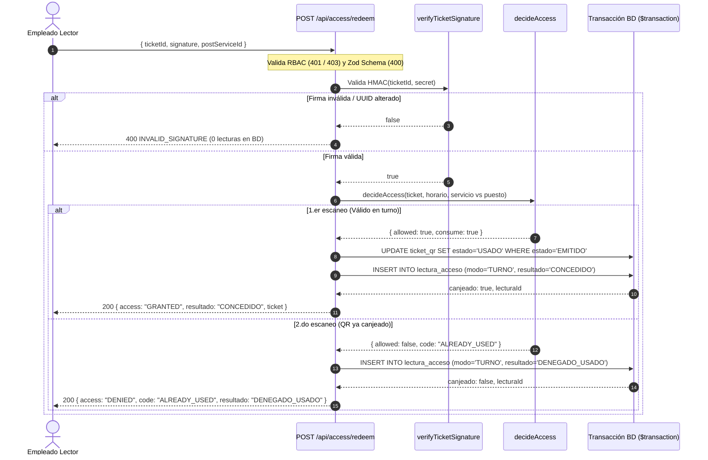

# Pagos y POS
> Estado: vigente 2026-10-15

> Sprint: SP1 - Core & Reservas Cashless · Fecha de implementación: 2026-10-08

## 1. Qué se hizo y por qué

La base de datos **ya tenía** el constraint (entregado con `TSK-BD-06`), pero no
existía código que lo explotara: el webhook devolvía `501 NOT_IMPLEMENTED` y
ninguna parte del sistema escribía en la tabla `PAGO` ni pasaba una reserva a
`CONFIRMADA`. El criterio de aceptación era imposible de cumplir:

> *Reenviar el mismo webhook dos veces deja **una sola** fila en `PAGO` y
> **una sola** reserva en `CONFIRMADA`.*

| # | Cambio | Archivo |
|---|--------|---------|
| 1 | Repositorio de pagos: upsert transaccional + confirmación/activación condicional | `packages/db/src/repositories/payments/payments.ts` |
| 2 | Export del repositorio en el paquete | `packages/db/src/index.ts` |
| 3 | Webhook Stripe real: verificación de firma + procesamiento idempotente | `apps/web/src/app/api/payments/route.ts` |
| 4 | Helpers de contrato de metadatos y monto | `packages/core/src/integrations/stripe.ts` (+ export en `packages/core/src/index.ts`) |
| 5 | Test del criterio de aceptación a nivel repositorio (7 tests) | `packages/db/src/repositories/payments.test.ts` |
| 6 | Test end-to-end del webhook con firma firmada (4 tests) | `apps/web/src/app/api/payments/__tests__/route.test.ts` |
| 7 | Soporte de `pago`/`membresia` + `WHERE id` en el mock de Prisma | `packages/db/test/mock-prisma.ts` |
| 8 | Disparo desacoplado de email con comprobante y QR en webhook Stripe (TSK-BE-34) | `apps/web/src/app/api/payments/email-dispatch.ts` |

**No hubo migraciones nuevas**: el `UNIQUE (stripe_payment_intent_id)` ya vive
en `migrations/20260930132534_init_sport_complex/migration.sql:270`
(`pago_stripe_payment_intent_id_key`) y en `schema.prisma:229` (`@unique`).

## 2. Cómo funciona la idempotencia (las 3 capas)

```
Stripe reintenta el evento (mismo byte a byte)
        │
        ▼
POST /api/payments ──► 1) constructEvent(payload, firma, whsec)   ← rechaza payloads ajenos
        │
        ▼
procesarPagoWebhook(input)   ← UNA transacción Prisma:
        │
        ├─ 2) upsert PAGO por stripe_payment_intent_id
        │      · no existe → create
        │      · ya existe → no duplica; solo avanza estado (jamás APROBADO → FALLIDO)
        │      · carrera concurrente → P2002 (UNIQUE) → reintenta la transacción (≤3)
        │
        ├─ 3) UPDATE reserva SET estado='CONFIRMADA'
        │      WHERE id = :reservaId AND estado='PENDIENTE_PAGO'   ← exactamente 1 gana
        │
        └─ 4) UPDATE membresia SET estado='VIGENTE'
               WHERE id = :membresiaId AND estado<>'VIGENTE'        ← exactamente 1 gana
```

Garantías:

- **1 fila en `PAGO` siempre**: la garantía la da el índice único del motor
  (no el código). Reintentos y carreras convergen a la misma fila.
- **1 sola transición a `CONFIRMADA`**: los updates son condicionales; la
  segunda corrida ve `count === 0` y es un no-op reportado en el resultado.
- **Respuesta predecible**: el webhook siempre responde `200` si el evento fue
  procesado o ignorado; `500` solo ante error inesperado (Stripe reintentará y
  la siguiente corrida es idempotente).

## 3. Guía para el equipo de BACKEND

### 3.1. Variables de entorno (ya existentes en `apps/web/.env.example`)

```env
STRIPE_SECRET_KEY="sk_test_..."
STRIPE_WEBHOOK_SECRET="whsec_..."
```

Si faltan, el endpoint responde `503 STRIPE_NOT_CONFIGURED` (no rompe nada).

### 3.2. Endpoint

| Método | Ruta | Auth | Qué hace |
|---|---|---|---|
| `POST` | `/api/payments` | Firma Stripe (no sesión) | Verifica firma y procesa `payment_intent.succeeded` / `payment_intent.payment_failed` |

Registrarlo en el dashboard de Stripe (o con la CLI):

```bash
stripe listen --forward-to localhost:3000/api/payments
stripe trigger payment_intent.succeeded   # o reenviar 2 veces: no duplica
```

### 3.3. Contrato de respuesta

```jsonc
// 200 — procesado (primera vez o reintento)
{ "success": true, "data": {
    "received": true, "pagoId": "…", "pagoCreado": true, "duplicado": false,
    "estado": "APROBADO", "reservaConfirmada": true, "reservaEstado": "CONFIRMADA",
    "membresiaActivada": false
}, "timestamp": "…" }

// 200 — ignorado a propósito (Stripe deja de reintentar)
{ "success": true, "data": { "received": true, "ignored": true,
    "reason": "EVENT_TYPE_NOT_HANDLED" | "MISSING_METADATA" } }

// 400 MISSING_SIGNATURE | INVALID_SIGNATURE · 503 STRIPE_NOT_CONFIGURED · 500 SERVER_ERROR
```

`duplicado: true` + `reservaConfirmada: false` en el segundo envío **es el
comportamiento esperado**, no un error.

### 3.4. Uso directo del repositorio (desde cualquier servicio/worker)

```ts
import { procesarPagoWebhook, PaymentError } from "@sportcomplex/db";

const resultado = await procesarPagoWebhook({
  stripePaymentIntentId: "pi_...",          // único, ≤100 chars
  usuarioId,                                // obligatorio (FK NOT NULL)
  monto: 75000,                             // número o "75000.00" (Decimal(12,2))
  estado: "APROBADO",                       // PENDIENTE | APROBADO | FALLIDO
  tipo: "RESERVA",                          // RESERVA | MEMBRESIA
  reservaId,                                // opcional → confirma la reserva
  membresiaId,                              // opcional → activa la membresía
});
// resultado: { pagoId, pagoCreado, duplicado, estado,
//              reservaConfirmada, reservaEstado, membresiaActivada }
```

Errores: lanza `PaymentError` (`VALIDATION_ERROR`, HTTP 400) ante entrada
inválida; cualquier otro error debe mapearse a `500` y dejar que Stripe reenvíe.

### 3.5. Crear el PaymentIntent (próximo paso — Flujo POS / checkout)

Todavía no existe `POST /api/payments/intent` (fuera del alcance de esta task,
vive en `feature/pos-stripe-cashless`). Cuando se cree, **debe** llevar los
metadatos definidos en core:

```ts
import { buildPaymentMetadata, stripeAmountToMonto, STRIPE_CURRENCY } from "@sportcomplex/core";

await stripe.paymentIntents.create({
  amount: 75000_00,                         // centavos: 75000.00 → stripeAmountToMonto(7500000)
  currency: STRIPE_CURRENCY,                // "cop"
  metadata: buildPaymentMetadata({ bookingId, userId, membershipId }),
});
```

Reglas del contrato de metadatos:

| Metadato | Obligatorio | Efecto en el webhook |
|---|---|---|
| `userId` | **Sí** | Dueño del `PAGO`; sin él el evento se ignora |
| `bookingId` | Para reservas | `tipo = RESERVA` y confirma la reserva |
| `membershipId` | Para membresías | `tipo = MEMBRESIA` y activa la membresía |
| `cashless` | Informativo | Marcado por `buildPaymentMetadata` (RN-13) |

Si llega un evento con los tres vacíos → `200 ignored / MISSING_METADATA`
(otro flujo de Stripe, p. ej. suscripciones, no debe romper este endpoint).

## 4. Guía para el equipo de FRONTEND

### 4.1. Qué garantiza el sistema hoy (ya usable)

1. **Reserva con hold**: `POST /api/bookings` crea la reserva en
   `PENDIENTE_PAGO` con TTL de 15 min (`createBookingHold`).
2. **Pago confirmado**: cuando Stripe notifique el `payment_intent.succeeded`,
   la reserva pasa sola a `CONFIRMADA` — el usuario ve el cambio al refrescar.
3. **Reintentos seguros**: si la conexión del checkout falla y el usuario
   reintenta el mismo pago, **no** se duplica la reserva ni el cobro.

### 4.2. Cómo consultar el estado de la reserva (para pintar la UI)

```ts
// Mientras el pago se procesa (estado del hold):
//   PENDIENTE_PAGO → mostrar "Procesando pago…" + countdown de 15 min (expiraEn)
//   CONFIRMADA     → éxito; mostrar el código QR del ticket
//   EXPIRADA       → el hold venció: reintentar reserva (la franja se liberó)
```

> El estado nunca pasa a `CONFIRMADA` por JS local: **solo** el webhook lo
> hace. Si el PaymentIntent termina `succeeded`, confía en el refresco.

### 4.3. Checkout con Stripe Elements (pendiente — `feature/pos-stripe-cashless`)

Los componentes ya están instalados (`@stripe/stripe-js`,
`@stripe/react-stripe-js`) y hay TODOs marcados en:

- `apps/web/src/app/(customer)/portal/book/page.tsx` — Elements + selector de franjas + timer TTL
- `apps/web/src/app/(staff)/pos/page.tsx` — POS cashless

Flujo previsto:

1. Backend: `POST /api/payments/intent` (futuro) → devuelve `client_secret`.
2. Frontend: `<Elements stripe={...} options={{ clientSecret }}>` → `<PaymentElement>` → `confirmPayment`.
3. Al confirmar: redirigir/poll a la reserva esperando `CONFIRMADA`
   (webhook normalmente llega en <2 s; hacer polling cada 2–3 s con tope del TTL).

### 4.4. Errores del webhook que puede ver el usuario

| Código HTTP | `error.code` | Significado para la UI |
|---|---|---|
| 400 | `INVALID_SIGNATURE` / `MISSING_SIGNATURE` | Error de integración (no mostrar al usuario; loguear) |
| 503 | `STRIPE_NOT_CONFIGURED` | Entorno sin claves: avisar al equipo, no reintentar |
| 500 | `SERVER_ERROR` | Transitorio: Stripe ya reintenta solo |

## 5. Cómo probarlo

```bash
## Unit + integración (mock de Prisma, sin BD real)
pnpm --filter @sportcomplex/db test        # 7 tests TSK-BD-09
pnpm --filter web test                     # 4 tests TSK-BD-09 (webhook firmado)

## End-to-end local con Stripe CLI
stripe listen --forward-to localhost:3000/api/payments
pnpm --filter web dev
## ... crear un pago y reenviar el evento 2 veces desde el dashboard de Stripe
```

**Criterio de aceptación cubierto por:**

- `packages/db/src/repositories/payments.test.ts` → *"reenviar el mismo webhook
  dos veces → 1 fila en PAGO y 1 reserva CONFIRMADA"* (+ carrera por `P2002`).
- `apps/web/src/app/api/payments/__tests__/route.test.ts` → mismo escenario a
  través del endpoint HTTP con firma verificada.

## 6. Fuera de alcance (no incluido en esta task)

- `POST /api/payments/intent` (creación de PaymentIntents) → `feature/pos-stripe-cashless`.
- UI de checkout / POS con Stripe Elements → tareas FE pendientes.
- Notificación al usuario (email/push) al confirmar → flujo aparte.
- Membresías: aquí solo se registra el pago y se activa de forma idempotente;
  el CRUD de planes/membresías continúa en `TSK-BD-11` (doc:
  `docs/features/membresias.md`).

## 7. Anexo TSK-BE-10 — QR, pago fallido y alias de ruta

Cambios incorporados para cerrar el alcance de `TSK-BE-10` (HU-10 / RF-09):

1. **Alias de ruta**: el handler canónico sigue en `POST /api/payments`; se
   añadió `POST /api/webhooks/stripe` como alias de compatibilidad con el
   contrato del ticket (`apps/web/src/app/api/webhooks/stripe/route.ts`
   reexporta el handler, sin duplicar lógica).
2. **`payment_intent.succeeded` → emisión del QR**: la misma transacción que
   confirma la reserva (`PENDIENTE_PAGO → CONFIRMADA`) crea la fila
   `TICKET_QR` en estado `EMITIDO`. Es idempotente por
   `UNIQUE(reserva_id)`: reenviar el webhook no duplica el boleto
   (`ticketQrEmitido: true` solo en la corrida que gana).
3. **`payment_intent.payment_failed` → cancelación + restitución**: se
   transiciona la reserva `PENDIENTE_PAGO → CANCELADA_PAGO` (nuevo valor del
   enum `EstadoReserva`, migración
   `20261009120000_reserva_cancelada_pago_enum`) y se restituye la franja
   (`cupos_ocupados -= cantidad`). Todo con update condicional: el webhook
   actúa de inmediato y el job TTL (`TSK-BD-08`) queda como red de seguridad
   para checkouts abandonados, **sin doble liberación** (quien no gana ve
   `count = 0`). El campo `franjaRestituida` indica si esta corrida liberó.
4. **Alerta de fallo**: `/api/payments` dispara el webhook de contingencia
   (n8n) de forma *fire-and-forget* ante un pago `FALLIDO`, sin bloquear ni
   revertir la respuesta a Stripe.

Contrato de respuesta extendido (200 procesado):

```jsonc
{ "received": true, "pagoId": "…", "duplicado": false, "estado": "APROBADO",
  "reservaConfirmada": true, "reservaEstado": "CONFIRMADA",
  "ticketQrEmitido": true, "franjaRestituida": false, "membresiaActivada": false }
```

> Nota: los conteos de pruebas de la §5 quedan actualizados a **8 tests** en
> `@sportcomplex/db` y **6 tests** en `web` tras este anexo.
## TSK-BD-09 + TSK-BD-10 — Idempotencia de pagos (Stripe) y canje de ticket con auditoría

> Ref histórica: `feature/tsk-bd-09-10-pagos-y-canje-ticket` (hacia `develop`)
> Tasks: **TSK-BD-09** (Idempotencia de pagos con Stripe · HU-10 / RF-09 · 3 pts)
> y **TSK-BD-10** (Canje de ticket + auditoría de accesos · HU-14..17 / RF-13·14·15 / RN-05)
> Sprint: SP1 - Core & Reservas Cashless · Fecha: 2026-10-08
> Doc detallado de la 09: [`TSK-BD-09-idempotencia-pagos-stripe.md`](pagos-pos.md)

## 1. Qué se hizo (resumen)

**TSK-BD-09 — pagos idempotentes.** El `UNIQUE (stripe_payment_intent_id)` ya
existía, pero el webhook devolvía `501`. Ahora `POST /api/payments` verifica la
firma de Stripe y ejecuta `procesarPagoWebhook()` en **una transacción**: upsert
de `PAGO` (reintenta ante `P2002`), `reserva PENDIENTE_PAGO → CONFIRMADA` y
activación de membresía, ambos con `WHERE` condicional. Reenviar el mismo
evento N veces deja **1 fila en `PAGO` y 1 reserva `CONFIRMADA`**.

**TSK-BD-10 — canje de ticket + pista de auditoría.** `POST /api/access`
reemplaza el stub `501`: valida la firma HMAC del QR **antes** de tocar la BD,
aplica `decideAccess()` (core) y ejecuta `ejecutarLectura()` en **una
transacción**: `UPDATE ticket_qr SET estado='USADO' WHERE estado='EMITIDO'` +
**exactamente 1 fila** en `LECTURA_ACCESO` por escaneo. Un boleto `USADO` jamás
vuelve a `EMITIDO` (RN-05) y el modo CONSULTA no lo altera nunca.

| # | Cambio | Archivo |
|---|--------|---------|
| 1 | Repositorio de pagos idempotente (BD-09) | `packages/db/src/repositories/payments/payments.ts` |
| 2 | Repositorio de tickets: canje + auditoría transaccional (BD-10) | `packages/db/src/repositories/access/tickets.ts` |
| 3 | Export de ambos repositorios | `packages/db/src/index.ts` |
| 4 | Webhook Stripe real | `apps/web/src/app/api/payments/route.ts` |
| 5 | Orquestador del escáner (firma → decide → transacción) | `apps/web/src/lib/api/access.ts` |
| 6 | Endpoint de escaneo (reemplaza stub 501) | `apps/web/src/app/api/access/route.ts` |
| 7 | Fix `postServiceId` (`z.uuid()` → `z.coerce.number()`, era FK a `servicio.id Int`) | `packages/validation/src/platform/access.schema.ts` |
| 8 | Helpers de metadatos/monto Stripe | `packages/core/src/integrations/stripe.ts` |
| 9 | Tests: 7 BD-09 + 5 BD-10 (repo), 4 webhook, 8 escáner, 3 schema | ver §6 |

**No hubo migraciones nuevas**: `ticket_qr`, `lectura_acceso`, `asignacion_puesto`
y los enums `EstadoTicket` / `ModoLectura` / `ResultadoLectura` ya existían
(desde `TSK-BD-06`); lo que faltaba era el código que los usa.

## 2. Cómo funciona el canje y la auditoría (BD-10)

```
Escáner QR (content = ticket_qr.codigo_uuid) + firma HMAC + puesto (o null)
        │
        ▼
POST /api/access ──► sesión + rol Administrador | Empleado_Lector  (401/403)
        │
        ▼
procesarEscaneo()  (apps/web/src/lib/api/access.ts)
        │
        ├─ 1) verifyTicketSignature()  ← ANTES de la BD; mal QR → 400, 0 escrituras
        ├─ 2) getTicketForScan()       ← carga reserva + titular + servicio + franja
        ├─ 3) decideAccess() (core)    ← estado, ventana horaria, servicio vs puesto
        ├─ 4) getAsignacionVigente()   ← turno del lector (best-effort → nulo)
        │
        ▼
ejecutarLectura()   ← UNA transacción (packages/db/.../tickets.ts):
        │
        ├─ 5) UPDATE ticket_qr SET estado='USADO', usado_por, usado_en
        │      WHERE id = :id AND estado='EMITIDO'        ← exactamente 1 gana
        │      (count=0 → carrera: NO toca el boleto → DENEGADO_USADO)
        │      solo si modo=TURNO y la decisión fue "consumir"
        │
        └─ 6) INSERT en lectura_acceso                    ← SIEMPRE 1 fila
               · TURNO concede  → CONCEDIDO
               · servicio/horario/usado → DENEGADO_SERVICIO | DENEGADO_HORARIO | DENEGADO_USADO
               · CONSULTA       → CONSULTA (asignacion_id = NULL, 0 updates)
```

Garantías (por diseño, no por convención):

- **1 fila de auditoría por escaneo**, concedido o denegado — la escribe la misma
  transacción que el canje; si algo falla, no queda registro huérfano.
- **Irreversibilidad**: la transición la garantiza el `WHERE estado='EMITIDO'`
  del motor; no existe camino de código que devuelva un boleto a `EMITIDO`.
- **Doble escaneo** (reintento, lector distraído, doble tap): la 1.ª corrida
  canjea; la 2.ª reporta `DENIED / ALREADY_USED` con su propia fila
  `DENEGADO_USADO` y el boleto queda intacto en `USADO`.

Mapeo decisión → resultado:

| `decideAccess()` | `access` | `lectura_acceso.resultado` |
|---|---|---|
| concede + consumir | `GRANTED` | `CONCEDIDO` |
| consulta (`postServiceId = null`) | `GRANTED` | `CONSULTA` |
| `SERVICE_MISMATCH` | `DENIED` | `DENEGADO_SERVICIO` |
| `WINDOW_EXPIRED` | `DENIED` | `DENEGADO_HORARIO` |
| `ALREADY_USED` / `INVALID_STATE` o carrera de canje | `DENIED` | `DENEGADO_USADO` |

## 3. Guía para el equipo de BACKEND

### 3.1. Variables de entorno (`apps/web/.env`)

```env
QR_HMAC_SECRET="change-me-64-hex"   # firma HMAC-SHA256 de los QR (ya en .env.example)
STRIPE_SECRET_KEY="sk_test_..."      # BD-09 (ya en .env.example)
STRIPE_WEBHOOK_SECRET="whsec_..."
```

Sin `QR_HMAC_SECRET`, `/api/access` responde `503 QR_NOT_CONFIGURED` (no rompe).

### 3.2. Endpoints

| Método | Ruta | Auth | Qué hace |
|---|---|---|---|
| `POST` | `/api/payments` | Firma Stripe (no sesión) | Webhook idempotente (BD-09) |
| `POST` | `/api/access` | Sesión + rol `Administrador` o `Empleado_Lector` | Escaneo de ticket (BD-10) |
| `POST` | `/api/access/redeem` | Sesión + rol `Administrador` o `Empleado_Lector` | Canje de ticket en modo turno con puesto obligatorio (BE-14) |
| `GET` | `/api/tickets/verify/{code}` | Sesión + rol `Administrador` o `Empleado_Lector` + `x-ticket-signature` | Consulta de solo lectura; audita `CONSULTA` sin modificar el boleto (BE-15) |

`GET /api/tickets/verify/{code}` recibe la firma HMAC en el header
`x-ticket-signature`. Registra una fila `LECTURA_ACCESO` con
`modo=CONSULTA`, `resultado=CONSULTA` y `asignacion_id=NULL`. No cambia el
estado, `usado_por` ni `usado_en` del ticket. Una firma inválida se rechaza
antes de consultar la base de datos.

Contrato de `POST /api/access`:

```jsonc
// Request
{ "ticketId": "9f0d6f4e-…",        // contenido del QR = ticket_qr.codigo_uuid (UUIDv4)
  "signature": "hmac-sha256-hex",   // HMAC(secret, ticketId)
  "postServiceId": 3 }              // servicio del puesto; null = modo CONSULTA

// 200 — resuelto (concedido, consulta o denegado con su explicación)
{ "success": true, "data": {
    "access": "GRANTED" | "DENIED",
    "code": "SERVICE_MISMATCH" | "WINDOW_EXPIRED" | "ALREADY_USED" | "INVALID_STATE", // solo si DENIED
    "modo": "TURNO" | "CONSULTA",
    "resultado": "CONCEDIDO" | "CONSULTA" | "DENEGADO_SERVICIO" | "DENEGADO_HORARIO" | "DENEGADO_USADO",
    "canjeado": true,               // true solo si ESTA corrida pasó EMITIDO → USADO
    "lecturaId": "42",              // id de lectura_acceso (BigInt, serializado)
    "ticket": { "id", "reservaId", "estado", "servicioId", "servicioNombre",
                "fecha": "2026-10-10", "horaInicio": "10:00:00", "horaFin": "11:00:00",
                "titularId", "titularNombre" }
}, "timestamp": "…" }

// 400 INVALID_SIGNATURE | VALIDATION_ERROR · 401 UNAUTHORIZED · 403 FORBIDDEN
// 404 TICKET_NOT_FOUND · 503 QR_NOT_CONFIGURED · 500 SERVER_ERROR
```

> Una denegación **también** responde `200` con `access: "DENIED"`: es un
> resultado de negocio normal (con su fila de auditoría), no un error HTTP.

### 3.3. Uso directo del repositorio (workers / futuras integraciones)

```ts
import { getTicketForScan, getAsignacionVigente, ejecutarLectura, TicketError } from "@sportcomplex/db";

const ticket = await getTicketForScan(codigoUuid);        // 404 TicketError si no existe
const salida = await ejecutarLectura({
  ticketId, modo: "TURNO", resultado: "CONCEDIDO",
  consumir: true,                    // false ⇒ solo audita, nunca canjea
  empleadoId, asignacionId: null, asignacionId obligatorio-null en CONSULTA
  now: new Date(),
});
// salida: { canjeado, resultado, lecturaId, ticketEstado }
```

La decisión de negocio **no** vive en el repositorio: firma (`verifyTicketSignature`),
ventana y servicio (`decideAccess`) van en el orquestador `apps/web/src/lib/api/access.ts`.

### 3.4. Firmar un QR (contexto TSK-BD-06 / emisión de tickets)

```ts
import { signTicket } from "@sportcomplex/core";
const codigo = ticket.codigoUuid;                 // UUIDv4
const firma  = signTicket(codigo, process.env.QR_HMAC_SECRET!);
// QR impreso/emitido = codigo (la firma viaja aparte o como codigo.firma)
```

`verifyTicketSignature` compara en tiempo constante; una firma distinta corta
el flujo **antes** de cualquier consulta a la BD.

## 4. Guía para el equipo de FRONTEND

### 4.1. Qué garantiza el sistema hoy

1. **Denegar no gasta**: un QR de otro servicio, fuera de hora o ya usado deja
   el boleto intacto (`canjeado: false`, `ticket.estado` sin cambios).
2. **Conceder gasta exactamente una vez**: el 1.º `GRANTED` en TURNO pasa el
   boleto a `USADO` con marca de tiempo y lector; cualquier reapertura de la
   página o reenvío devuelve `DENIED / ALREADY_USED`.
3. **Consultar nunca gasta**: `postServiceId: null` devuelve los datos de la
   reserva sin tocar el boleto (HU-16) — es el modo que debe usar cualquier
   pantalla que solo muestre información.

### 4.2. Página del escáner (HU-15 / HU-17)

El placeholder `apps/web/src/app/(staff)/scanner/page.tsx` debe cablear:

1. Selector de puesto del turno (o toggle "Modo consulta" → `postServiceId: null`).
2. Decoder de cámara → `ticketId` (contenido del QR) + `signature`.
3. `POST /api/access` con el JSON de §3.2.
4. Pintar resultado:

| `data.access` / `data.code` | Alerta (Flujo 4 del SRS) |
|---|---|
| `GRANTED` + `CONCEDIDO` | 🟢 "Acceso concedido" + titular/servicio/hora |
| `GRANTED` + `CONSULTA` | 🟢 Datos: Servicio, Horario, Titular (boleto intacto) |
| `DENIED` + `SERVICE_MISMATCH` | 🔴 "El tiquete pertenece a {servicio} y te encuentras en {puesto}" (NO se gasta) |
| `DENIED` + `WINDOW_EXPIRED` | 🔴 "Fuera del horario de la reserva" (NO se gasta) |
| `DENIED` + `ALREADY_USED` | 🔴 "Tiquete ya usado" |

El `404 TICKET_NOT_FOUND` y el `400 INVALID_SIGNATURE` son QRs inválidos/adulterados
→ alerta roja genérica "Código no válido" (no exponer el detalle).

### 4.3. Roles (middleware)

`/scanner/*` y `/api/access/*` ya exigen `Administrador | Empleado_Lector`
(normalizados en `apps/web/src/lib/auth/session.ts`); el endpoint además re-valida
sesión y rol por capa propia (defensa en profundidad).

## 5. Variables de entorno y arranque

```bash
pnpm install
pnpm db:generate
pnpm --filter web dev
```

## 6. Cómo probarlo

```bash
## Unit + integración (mock de Prisma, sin BD real)
pnpm --filter @sportcomplex/db test        # 32 tests → 5 TSK-BD-10 + 7 TSK-BD-09
pnpm --filter @sportcomplex/validation test # 13 tests → 3 access.schema
pnpm --filter web test                     # 17 tests → 8 TSK-BD-10 + 4 webhook BD-09

## Typecheck + lint
pnpm --filter @sportcomplex/db typecheck && pnpm --filter @sportcomplex/db lint
pnpm --filter @sportcomplex/validation typecheck && pnpm --filter @sportcomplex/validation lint
pnpm --filter @sportcomplex/core typecheck && pnpm --filter @sportcomplex/core lint
pnpm --filter web typecheck && pnpm --filter web lint

## BD-09 end-to-end con Stripe CLI
stripe listen --forward-to localhost:3000/api/payments
## ... y reenviar el mismo evento 2 veces: no duplica PAGO ni reservas
```

QA manual del escáner (con sesión de lector y `QR_HMAC_SECRET` definido):

```bash
## firma de prueba
node -e "const{createHmac}=require('crypto');const id='9f0d6f4e-0000-4000-8000-0000000000ff';console.log(createHmac('sha256','change-me-64-hex').update(id).digest('hex'))"

curl -X POST http://localhost:3000/api/access -H "Content-Type: application/json" \
  --cookie <sesión-del-lector> \
  -d '{"ticketId":"<codigo_uuid>","signature":"<hmac>","postServiceId":3}'
## 1.ª vez: access=GRANTED/CONCEDIDO · 2.ª: DENIED/ALREADY_USED · sin puesto: modo CONSULTA
```

## 7. Para quien docketice en Jira (copiar/pegar)

**Campos de las dos tasks:**

> Ref histórica — Rama: `feature/tsk-bd-09-10-pagos-y-canje-ticket` (reemplaza a
  `feature/tsk-bd-09-idempotencia-de-pagos-con-stripe`; PR #22 se cierra)
- **Estado:** En Desarrollo → Resuelto al merge (revisar el flujo del equipo)
- **Commits:** `fa6e25c` (feat: TSK-BD-09 idempotencia de pagos con Stripe),
  `5ce020e` (feat: TSK-BD-10 canje de ticket y pista de auditoría),
  más el commit de esta documentación (ver PR para el detalle exacto)
- **PR:** [#25](https://github.com/SportComplex-Dev/SportComplexApp/pull/25)
  hacia `develop`, cubre **TSK-BD-09 + TSK-BD-10** (misma rama; cierra el #22)
- **Docs:** `docs/features/pagos-pos.md` y este archivo

**TSK-BD-09 — Criterios de aceptación (evidencia):**

- [x] *Reenviar el mismo webhook dos veces deja una sola fila en `PAGO` y una
      sola reserva `CONFIRMADA`* → `packages/db/src/repositories/payments.test.ts`
      ("reenviar el mismo webhook dos veces → 1 fila en PAGO y 1 reserva CONFIRMADA")
      + `apps/web/src/app/api/payments/__tests__/route.test.ts` (escenario HTTP
      con firma Stripe verificada).
- [x] Carrera concurrente por el `UNIQUE` no duplica (reintento ante `P2002`).
- [x] Un `FALLIDO` tardío nunca degrada un pago `APROBADO`.

**TSK-BD-10 — Criterios de aceptación (evidencia):**

- [x] *El canje es transaccional e irreversible: `EMITIDO → USADO` con
      `usado_por`/`usado_en`* → `packages/db/src/repositories/tickets.test.ts`
      ("canje TURNO transmuta EMITIDO→USADO y audita CONCEDIDO").
- [x] *Un boleto `USADO` nunca vuelve a `EMITIDO` (doble escaneo → 1 canje y 2
      filas de auditoría)* → id. ("doble canje deja 1 USADO y 2 auditorías") +
      `apps/web/src/app/api/access/__tests__/access.test.ts` ("segundo escaneo
      del mismo QR → DENIED ALREADY_USED…").
- [x] *Modo CONSULTA entrega los datos de la reserva sin gastar el boleto* →
      tests de CONSULTA en repo y API (boleto intacto, `asignacion_id` nulo).
- [x] *Toda lectura genera exactamente una fila en `LECTURA_ACCESO` con modo y
      resultado* (concedido, denegado y consulta) → misma suite.
- [x] *Denegaciones correctas: servicio ≠ puesto, horario vencido, ya usado* →
      tests `SERVICE_MISMATCH` / `WINDOW_EXPIRED` / `ALREADY_USED`.
- [x] *Firma QR validada antes de consultar la BD* → test "firma HMAC inválida
      se rechaza ANTES de tocar la BD (400, 0 auditorías)".

**Nota para SCRUM-112 (no bloquea el cierre):**

El CA clave del ticket pide *"`asignacion_id` nula **en modo consulta**"* →
cumplido y testeado. En modo TURNO la fila se llena solo si el lector tiene una
asignación vigente en `asignacion_puesto`; si no, queda `NULL` (columna
nullable), porque **hoy nada crea filas en esa tabla** — el alta de turnos es
alcance de otra task. El ticket **no** exige `asignacion_id` no-nula en TURNO,
así que esto no impide cerrar SCRUM-112. Si el negocio quiere ese registro
siempre lleno, proponer al backlog una task para el alta de `ASIGNACION_PUESTO`.

**Supuestos de implementación (revisión humana, no bloquean):**

1. **Ventana horaria** `[inicio, fin] = fecha + franja` con offset `-05:00`
   (Bogotá) — mismo criterio que ya usa el módulo de reservas para los holds;
   se asume que `hora_inicio`/`hora_fin` guardan hora local de Bogotá.
2. **Ruta `POST /api/access` con `auth()`** no tiene test unitario (NextAuth no
   corre en `node --test`); se probó el orquestador `procesarEscaneo()`. El
   `401`/`403` queda cubierto por el QA manual de arriba.

**QA manual sugerido (checklist):**

1. `pnpm --filter @sportcomplex/db test && pnpm --filter web test` → verdes.
2. Escanear 2 veces el mismo QR con puesto asignado → 1.ª 🟢, 2.ª 🔴 "ya usado".
3. Escanear con puesto equivocado → 🔴 sin gastar el boleto (verificar en BD).
4. Modo consulta → datos completos, boleto sigue `EMITIDO`.
5. BD-09: reenviar evento de Stripe 2 veces → 1 `PAGO`, reserva `CONFIRMADA`.
6. Sesión sin rol lector → `403`.

**Fuera de alcance de ambas tasks (no marcar):**

- UI del escáner (selector de puesto, decoder, alertas) → `feature/scanner-access-modes`.
- `POST /api/payments/intent` y checkout con Stripe Elements → `feature/pos-stripe-cashless`.
- Alta de filas en `ASIGNACION_PUESTO` (quién cubre qué turno): nadie las crea
  hoy; en TURNO la auditoría queda con `asignacion_id = NULL` sin bloquear el
  canje. Si el negocio lo pide, es una task aparte.
- Notificación al usuario al confirmar pago o al denegar acceso.
## TSK-BE-10 — Webhook de Stripe firmado e idempotente + guía de integración Frontend

- **Ticket:** [SCRUM-114] TSK-BE-10 · **Historia:** HU-10 (RF-09)
- **Microcelda:** Backend / Frontend
- **Depende de:** TSK-BD-09 (idempotencia de pagos)
- **Endpoints:** `POST /api/payments` (canónico) · `POST /api/webhooks/stripe` (alias)

> Este documento describe **(1)** los cambios implementados en el backend para
> cerrar el alcance de TSK-BE-10 y **(2)** cómo el equipo de Frontend consume el
> resultado (confirmación de reserva, emisión del QR y pago fallido).

---

## 1. Resumen de cambios (backend)

| # | Cambio | Archivo |
|---|--------|---------|
| 1 | `payment_intent.succeeded` → reserva `CONFIRMADA` **+ emisión del `TICKET_QR` (`EMITIDO`)** en la misma transacción | `packages/db/src/repositories/payments/payments.ts` |
| 2 | `payment_intent.payment_failed` → reserva `PENDIENTE_PAGO → CANCELADA_PAGO` **+ restitución de la franja** (`cupos_ocupados -= cantidad`) | `packages/db/src/repositories/payments/payments.ts` |
| 3 | Nuevo estado de reserva `CANCELADA_PAGO` | `packages/db/prisma/schema.prisma` + migración `20261009120000_reserva_cancelada_pago_enum` |
| 4 | Alerta de pago fallido (n8n, *fire-and-forget*) | `apps/web/src/app/api/payments/route.ts` |
| 5 | Alias de ruta `/api/webhooks/stripe` (reexporta el handler canónico) | `apps/web/src/app/api/webhooks/stripe/route.ts` |
| 6 | Campos nuevos en la respuesta del webhook: `ticketQrEmitido`, `franjaRestituida` | `packages/db/src/repositories/payments/payments.ts` |

Garantías de idempotencia (se conservan): `UNIQUE(stripe_payment_intent_id)` en
`PAGO`, updates condicionales de estado y emisión del QR protegida por
`UNIQUE(reserva_id)`. Reenviar el mismo evento N veces **no** duplica pagos,
confirmaciones ni boletos.

---

## 2. Contrato de API

### 2.1. Crear la reserva (hold temporal)

`POST /api/bookings` — requiere sesión (`Cliente`).

```jsonc
// request
{ "serviceId": 3, "startTime": "2026-10-15T15:00:00.000Z",
  "endTime": "2026-10-15T16:00:00.000Z", "cantidadCupos": 1 }
```

```jsonc
// 201 Created — la reserva nace en PENDIENTE_PAGO con TTL de 15 min
{ "success": true, "data": {
    "id": "<reserva-uuid>", "estado": "PENDIENTE_PAGO",
    "disponibilidadId": "…", "cantidadCupos": 1,
    "expiraEn": "2026-10-15T15:15:00.000Z", "total": "75000.00" } }
```

Errores relevantes: `409 CAPACITY_EXCEEDED` (sin cupos),
`409 SLOT_BLOCKED`, `409 SERVICE_UNAVAILABLE`, `400 INVALID_BOOKING_QUANTITY`,
`404 SLOT_NOT_FOUND`.

### 2.2. Webhook de Stripe

`POST /api/payments` (o el alias `POST /api/webhooks/stripe`). **No usa sesión**:
lo invoca Stripe con la cabecera `stripe-signature`.

Eventos manejados: `payment_intent.succeeded`, `payment_intent.payment_failed`.

```jsonc
// 200 — procesado (primera vez o reintento)
{ "success": true, "data": {
    "received": true,
    "pagoId": "…", "pagoCreado": true, "duplicado": false,
    "estado": "APROBADO",              // APROBADO | FALLIDO
    "reservaConfirmada": true,         // true solo en la corrida que confirma
    "reservaEstado": "CONFIRMADA",     // estado final de la reserva
    "ticketQrEmitido": true,           // true solo si esta corrida emitió el QR
    "franjaRestituida": false,         // true solo si esta corrida liberó la franja
    "membresiaActivada": false } }
```

```jsonc
// 200 — ignorado a propósito (Stripe deja de reintentar)
{ "success": true, "data": { "received": true, "ignored": true,
    "reason": "EVENT_TYPE_NOT_HANDLED" | "MISSING_METADATA" } }
```

```jsonc
// 400 MISSING_SIGNATURE | INVALID_SIGNATURE · 503 STRIPE_NOT_CONFIGURED · 500 SERVER_ERROR
```

> `duplicado: true` + `reservaConfirmada: false` + `ticketQrEmitido: false` en el
> segundo envío **es el comportamiento correcto**, no un error.

### 2.3. Leer estado + obtener el QR (comprobante)

`GET /api/pdf/receipt?reservaId=<uuid>&destinatario=PORTAL` — requiere sesión
(`Cliente` dueño de la reserva, o personal `POS`). Devuelve la estructura del
comprobante **ya resuelta** por el servidor (incluye el PNG del QR en base64):

```jsonc
{ "success": true, "data": {
    "reserva": { "id": "…", "estado": "CONFIRMADA", "total": "75000.00", /* … */ },
    "servicio": { "nombre": "…", "fecha": "2026-10-15", "horaInicio": "10:00:00",
                  "horaFin": "11:00:00", "ventana": { "inicio": "…", "fin": "…" } },
    "titular": { "id": "…", "nombre": "…", "correo": "…" },
    "ticket": { "id": "…", "estado": "EMITIDO", "emitidoEn": "…", "usadoEn": null },
    "qr": { "payload": "SC1:<ticketId>:<firma>", "dataUrl": "data:image/png;base64,…" } } }
```

- `ticket` y `qr` son `null` mientras no exista boleto (p. ej. reserva aún
  `PENDIENTE_PAGO`). Con el QR emitido, ambos llegan poblados.
- Errores: `401`, `403` (no es tu reserva), `404`, `409` (faltan relaciones),
  `503 QR_NOT_CONFIGURED`.

> `reserva.estado` de este endpoint es la forma más directa de **hacer polling**
> del resultado del webhook desde el portal.

### 2.4. Estados de la reserva que verá el Frontend

| Estado | Significado | Acción UI |
|--------|-------------|-----------|
| `PENDIENTE_PAGO` | Hold activo, esperando webhook | Mostrar "Procesando pago…" + countdown con `expiraEn` (15 min) |
| `CONFIRMADA` | Pago exitoso y QR emitido | Éxito: mostrar/descargar comprobante con QR |
| `CANCELADA_PAGO` | El pago falló: reserva cancelada y **franja liberada** | Error de pago: ofrecer reintentar reserva (nueva reserva) |
| `EXPIRADA` | El hold venció sin webhook (TTL) | El hold venció: ofrecer reintentar reserva |
| `CANCELADA_ADMINISTRATIVA` | Contingencia del servicio (TSK-BE-22) | Informar cancelación por el complejo |

---

## 3. Guía de implementación para Frontend

Punto de partida: `apps/web/src/app/(customer)/portal/book/page.tsx`
(hoy es un esqueleto con un `TODO`). Componentes/estilos: `@sportcomplex/ui`
(plantilla de comprobante `ticket-receipt`).

### 3.1. Flujo end-to-end

```
1. Seleccionar franja        → GET  /api/bookings?serviceId&date
2. Crear hold (15 min)       → POST /api/bookings                 → PENDIENTE_PAGO
3. Crear PaymentIntent       → POST /api/payments/intent          → client_secret  (⚠ ver §3.4)
4. Confirmar con Stripe      → <PaymentElement> confirmPayment()
5. Esperar el webhook        → polling a GET /api/pdf/receipt     → CONFIRMADA + QR
6. Mostrar comprobante+QR    → datos de /api/pdf/receipt → @sportcomplex/ui
```

### 3.2. Tipos TypeScript sugeridos

```ts
type EstadoReserva =
  | "PENDIENTE_PAGO" | "CONFIRMADA" | "CANCELADA_PAGO"
  | "EXPIRADA" | "CANCELADA_ADMINISTRATIVA";

interface HoldReserva {
  id: string; estado: EstadoReserva; cantidadCupos: number;
  expiraEn: string; total: string;
}

interface ComprobantePortal {
  reserva: { id: string; estado: EstadoReserva; total: string };
  ticket: { id: string; estado: "EMITIDO" | "USADO"; emitidoEn: string; usadoEn: string | null } | null;
  qr: { payload: string; dataUrl: string } | null;
  // …resto de campos del comprobante
}
```

### 3.3. Crear el hold y arrancar el countdown

```ts
const hold: HoldReserva = (await post("/api/bookings", {
  serviceId, startTime, endTime, cantidadCupos,
})).data;

const segundosRestantes = Math.max(
  0, Math.floor((new Date(hold.expiraEn).getTime() - Date.now()) / 1000),
);
// Pintar countdown; al llegar a 0 el estado pasará a EXPIRADA (lo decide el backend).
```

### 3.4. Checkout con Stripe Elements (⚠ dependencia pendiente)

La creación del `PaymentIntent` **todavía no existe**
(`POST /api/payments/intent` está fuera del alcance de TSK-BE-10; ver §6). Los
paquetes ya están instalados (`@stripe/stripe-js`, `@stripe/react-stripe-js`).
Cuando ese endpoint exista, **su respuesta debe traer `client_secret`** y el
PaymentIntent debe llevar los metadatos que el webhook consume:

```ts
// Metadatos OBLIGATORIOS del PaymentIntent (los define @sportcomplex/core)
metadata: { userId, bookingId, cashless: "true" }   // bookingId = hold.id
```

Sin `metadata.userId` + `bookingId` (o `membershipId`), el webhook responde
`200 ignored / MISSING_METADATA` y **la reserva nunca se confirma**.

### 3.5. Polling de confirmación (hasta que llegue el webhook)

```ts
async function esperarConfirmacion(reservaId: string) {
  const deadline = Date.now() + 15 * 60_000; // tope = TTL del hold
  while (Date.now() < deadline) {
    const { data } = await get(
      `/api/pdf/receipt?reservaId=${reservaId}&destinatario=PORTAL`,
    );
    switch (data.reserva.estado) {
      case "CONFIRMADA":         return { ok: true, comprobante: data };
      case "CANCELADA_PAGO":     return { ok: false, reason: "PAGO_FALLIDO" };
      case "EXPIRADA":           return { ok: false, reason: "HOLD_EXPIRADO" };
      // PENDIENTE_PAGO → seguir esperando
    }
    await new Promise((r) => setTimeout(r, 2500)); // ~2–3 s
  }
  return { ok: false, reason: "TIMEOUT" };
}
```

- El webhook suele llegar en **< 2 s**; usar intervalos de 2–3 s y detener el
  polling al llegar a `CONFIRMADA`, `CANCELADA_PAGO` o `EXPIRADA`.
- El estado **nunca** cambia por JS local: siempre lo fija el backend.

### 3.6. Mostrar el QR / comprobante

Al obtener `CONFIRMADA`, el comprobante ya trae `ticket` y `qr`:

```tsx

<button onClick={() => printComprobante(comprobante)}>Descargar / Imprimir</button>
```

- `qr.dataUrl` es un PNG (`data:image/png;base64,…`) listo para mostrar/imprimir.
- El `qr.payload` (`SC1:<ticketId>:<firma>`) es lo que valida el lector en puerta
  (RN-05); no manipularlo.
- Mientras `ticket === null`, no hay QR que mostrar (la reserva aún no está
  confirmada).

### 3.7. Manejo de estados en la UI

| Resultado | UI |
|-----------|-----|
| `CONFIRMADA` | Pantalla de éxito + comprobante con QR |
| `CANCELADA_PAGO` | "No pudimos procesar el pago; la franja fue liberada." Botón **Reservar de nuevo** (crear nuevo hold) |
| `EXPIRADA` | "El tiempo para pagar venció; la franja se liberó." Botón **Reservar de nuevo** |
| `CANCELADA_ADMINISTRATIVA` | "La reserva fue cancelada por el complejo." |

### 3.8. Errores del webhook (integración)

| HTTP | `error.code` | Significado |
|------|--------------|-------------|
| 400 | `INVALID_SIGNATURE` / `MISSING_SIGNATURE` | Error de integración: no mostrar al usuario, loguear |
| 503 | `STRIPE_NOT_CONFIGURED` | Entorno sin claves: avisar al equipo |
| 500 | `SERVER_ERROR` | Transitorio: Stripe reintenta solo (idempotente) |

---

## 4. Nota de comportamiento (importante)

1. **El `payment_failed` cancela la reserva y libera la franja de inmediato.**
   Ante `payment_intent.payment_failed`, el backend transiciona la reserva
   `PENDIENTE_PAGO → CANCELADA_PAGO` y restituye los cupos. El estado deja de
   ser `PENDIENTE_PAGO` al instante (no hay que esperar los 15 min).

2. **El TTL de 15 min sigue siendo la red de seguridad.** Si un checkout se
   abandona y **no** llega ningún webhook, el job de expiración (TSK-BD-08) pasa
   la reserva a `EXPIRADA` y libera la franja. Ambos caminos usan updates
   condicionales, por lo que **nunca se liberan los cupos dos veces**.

3. **Un `succeeded` posterior sobre el MISMO PaymentIntent no resucita la
   reserva.** Si Stripe reenvía un `payment_intent.succeeded` después de un
   `payment_failed` (reintento del usuario sobre el mismo intent), la reserva ya
   está `CANCELADA_PAGO`: el pago queda registrado como `APROBADO`, pero la
   reserva **no** vuelve a `CONFIRMADA` y **no** se emite QR. Es consistente con
   el caso ya existente "success tardío tras TTL". Para soportar ese reintento
   habría que disparar la cancelación con `payment_intent.canceled` (evento
   definitivo) en lugar de `payment_failed`.

4. **El QR se emite exactamente una vez.** Solo la corrida que gana la
   confirmación (`reservaConfirmada: true`) crea el `TICKET_QR`; reenviar el
   webhook no duplica el boleto (`UNIQUE(reserva_id)`), por lo que el
   `ticketQrEmitido` del segundo envío es `false`.

5. **La alerta de pago fallido es no bloqueante.** El backend notifica a n8n en
   segundo plano; no revierte nada ni altera la respuesta a Stripe.

---

## 5. Cómo probarlo

```bash
## Unit + integración (mock de Prisma, sin BD real)
pnpm --filter @sportcomplex/db test     # incluye: emisión de QR y cancelación+restitución (TSK-BE-10)
pnpm --filter web test                  # webhook firmado + alias /api/webhooks/stripe

## End-to-end local con Stripe CLI
stripe listen --forward-to localhost:3000/api/payments
pnpm --filter web dev
stripe trigger payment_intent.succeeded          # reserva → CONFIRMADA + QR
stripe trigger payment_intent.payment_failed     # reserva → CANCELADA_PAGO + franja liberada
## Reenviar el mismo evento 2 veces: duplicado=true, sin duplicar pago/ticket.
```

---

## 6. Variables de entorno

```env
STRIPE_SECRET_KEY="sk_test_..."          # firma/consulta Stripe (obligatoria)
STRIPE_WEBHOOK_SECRET="whsec_..."        # verificación de stripe-signature (obligatoria)
QR_HMAC_SECRET="..."                     # firma del QR (GET /api/pdf/receipt)
N8N_CONTINGENCY_WEBHOOK_URL="..."        # alerta de pago fallido (opcional)
N8N_CONTINGENCY_HMAC_SECRET="..."        # firma de la alerta (opcional)
```

Sin `STRIPE_SECRET_KEY` o `STRIPE_WEBHOOK_SECRET`, el webhook responde
`503 STRIPE_NOT_CONFIGURED`.

---

## 7. Pendientes / fuera de alcance

- **`POST /api/payments/intent`** (crear PaymentIntent + `client_secret`):
  vive en `feature/pos-stripe-cashless`. El checkout con Elements **depende** de
  que exista.
- **UI de checkout/POS con Stripe Elements**: tarea FE pendiente
  (`portal/book/page.tsx` y `(staff)/pos/page.tsx`).
- **Notificación al usuario** (email/push) al confirmar: flujo aparte (n8n).
## TSK-BE-14 — Endpoint de canje en modo turno

`POST /api/access/redeem`

Endpoint transaccional de canje de tickets en modo turno (asociado a un puesto/servicio cubierto por el empleado lector). Valida la firma criptográfica HMAC-SHA256 antes de consultar la base de datos, ejecuta el canje atómico transmutando el ticket de `EMITIDO` a `USADO`, audita la lectura en `LECTURA_ACCESO` con `modo = TURNO` y devuelve los datos del boleto para su visualización en la aplicación móvil del escáner (HU-14 / RF-13 / RN-05).

## Criterio de Aceptación Clave

> Tras "Dar Acceso" el boleto pasa a `USADO` con marca temporal e ID del empleado, y un segundo escaneo del mismo QR se deniega.

- **Idempotencia e irreversibilidad transaccional**: El cambio de estado se realiza con `UPDATE ticket_qr SET estado='USADO', usadoPor=:empleadoId, usadoEn=:now WHERE id=:id AND estado='EMITIDO'`. Solo una transacción gana; el boleto transmutado nunca regresa a `EMITIDO` (RN-05).
- **Segundo escaneo denegado**: Si se reenvía el mismo código o se escanea de nuevo, `decideAccess` detecta el estado `USADO` y deniega con `code = "ALREADY_USED"` y `resultado = "DENEGADO_USADO"`, conservando inalterados la marca temporal y el empleado del canje original, registrando exactamente una nueva fila en `LECTURA_ACCESO`.
- **Auditoría estricta y asignación best-effort**: Cada intento genera exactamente una fila en `LECTURA_ACCESO` con `modo = TURNO` y el resultado correspondiente (`CONCEDIDO`, `DENEGADO_SERVICIO`, `DENEGADO_HORARIO`, `DENEGADO_USADO`). Si el empleado lector tiene un turno vigente registrado en `asignacion_puesto` para ese servicio, se vincula `asignacion_id`; si no cuenta con asignación registrada en base de datos, el canje procede normalmente y se audita con `asignacion_id = null` (comportamiento best-effort para no bloquear el acceso de clientes legítimos).
- **Validación criptográfica previa y tipado estricto**: Si la firma HMAC no coincide con `QR_HMAC_SECRET` o el UUID fue alterado, se rechaza inmediatamente con `400 INVALID_SIGNATURE` sin realizar consultas ni escrituras en la base de datos. Asimismo, `postServiceId` exige enteros positivos estrictos y rechaza valores booleanos (`true`/`false`), decimales o nulos.

## Autorización y Perímetro

- Roles autorizados: `Administrador` y `Empleado_Lector` con estado `ACTIVO`.
- Sin sesión: `401 UNAUTHORIZED`.
- Rol no autorizado (ej. `CLIENTE`) o empleado inactivo: `403 FORBIDDEN`.
- Si `QR_HMAC_SECRET` no está configurado en el entorno: `503 QR_NOT_CONFIGURED`.

## Flujo de Ejecución



## Contrato de la API

### Request

```jsonc
POST /api/access/redeem
Content-Type: application/json

{
  "ticketId": "9f0d6f4e-0000-4000-8000-0000000000ff",   // UUIDv4 contenido en el QR
  "signature": "3f79e89d10e54d8b9...",                  // HMAC-SHA256 (64 hex)
  "postServiceId": 1                                     // ID del servicio en el puesto cubierto (Int > 0)
}
```

### Response 200 — Acceso Concedido (Canje Exitoso)

```jsonc
{
  "success": true,
  "data": {
    "access": "GRANTED",
    "modo": "TURNO",
    "resultado": "CONCEDIDO",
    "canjeado": true,
    "lecturaId": "1",
    "ticket": {
      "id": "ticket-1",
      "reservaId": "reserva-1",
      "estado": "USADO",
      "servicioId": 1,
      "servicioNombre": "Cancha 1",
      "fecha": "2026-10-10",
      "horaInicio": "10:00:00",
      "horaFin": "11:00:00",
      "titularId": "cliente-1",
      "titularNombre": "Cliente Uno"
    }
  },
  "timestamp": "2026-10-11T15:30:00.000Z"
}
```

### Response 200 — Acceso Denegado (Ejemplo: Segundo Escaneo)

```jsonc
{
  "success": true,
  "data": {
    "access": "DENIED",
    "code": "ALREADY_USED",
    "modo": "TURNO",
    "resultado": "DENEGADO_USADO",
    "canjeado": false,
    "lecturaId": "2",
    "ticket": {
      "id": "ticket-1",
      "reservaId": "reserva-1",
      "estado": "USADO",
      "servicioId": 1,
      "servicioNombre": "Cancha 1",
      "fecha": "2026-10-10",
      "horaInicio": "10:00:00",
      "horaFin": "11:00:00",
      "titularId": "cliente-1",
      "titularNombre": "Cliente Uno"
    }
  },
  "timestamp": "2026-10-11T15:30:01.000Z"
}
```

### Respuestas de Error

- `400 VALIDATION_ERROR`: `postServiceId` nulo, booleano, no numérico, decimal o faltante; `ticketId` no es UUID; firma no es 64 hex.
- `400 INVALID_SIGNATURE`: Firma HMAC incorrecta o QR manipulado (0 consultas a BD).
- `401 UNAUTHORIZED`: Petición sin sesión válida.
- `403 FORBIDDEN`: Rol sin permisos de lector o cuenta inactiva.
- `404 TICKET_NOT_FOUND`: Ticket inexistente en base de datos.
- `503 QR_NOT_CONFIGURED`: Falta `QR_HMAC_SECRET` en variables de entorno.

## Pruebas Automatizadas

- `packages/validation/test/access.schema.test.ts`:
  - Valida `accessRedeemSchema` obligando `postServiceId` como entero positivo y rechazando booleanos (`true`/`false`), `null`, valores negativos, 0 y decimales.
- `apps/web/src/app/api/access/redeem/__tests__/route.test.ts`:
  - Canje exitoso en modo TURNO transmuta `EMITIDO` → `USADO`, audita `CONCEDIDO` y devuelve datos del boleto.
  - Segundo escaneo deniega con `ALREADY_USED` y no altera timestamp ni empleado original del boleto.
  - Firma HMAC inválida y UUID alterado rechazados con 400 antes de consultar la BD.
  - Rechazo de `postServiceId` nulo o ausente en modo turno (400).
  - Denegación por discrepancia de puesto/servicio (`SERVICE_MISMATCH` / `DENEGADO_SERVICIO`).
  - Denegación por ventana horaria vencida (`WINDOW_EXPIRED` / `DENEGADO_HORARIO`).
  - Control de acceso por rol y estado de usuario (401 / 403).
  - Ticket inexistente (404) y falta de variable de entorno (503).
  - Canje sin turno asignado previo (best-effort, audita `asignacionId = null`).
## TSK-BE-18: Cobro desde el POS con Stripe en tiempo real

- **Historia:** HU-18 (RF-17)
- **Fase:** F3
- **Estimación:** 3 puntos
- **Componente:** Backend
- **Dependencia:** TSK-BE-10

## Objetivo

Permitir que un empleado vendedor inicie desde el POS el cobro con tarjeta de
una reserva pendiente. El servidor calcula el importe y crea el `PaymentIntent`;
Stripe confirma el pago y el webhook firmado confirma la reserva, la emite y la
asocia al vendedor que atendió la venta.

La creación de reservas/holds desde el POS y la interfaz de Stripe Elements no
forman parte de esta tarea. El endpoint recibe una reserva pendiente existente.

## Flujo

1. `POST /api/payments/intent` requiere sesión con rol `Empleado_Vendedor` o
   `Administrador`. Recibe `{ "reservaId": "<uuid>" }`.
2. El servidor valida que la reserva exista, esté en `PENDIENTE_PAGO`, no haya
   vencido ni esté pagada, y que su servicio siga activo. Si ya está asociada a
   otro vendedor, rechaza la solicitud. Importe, titular y servicio se leen de
   la base de datos; no se aceptan del cliente.
3. El backend crea un `PaymentIntent` de tarjeta en COP, usando el empleado de
   la sesión como vendedor. La metadata es `bookingId`, `userId`, `servicio_id`,
   `vendedor_id` y `cashless`.
4. La respuesta incluye `client_secret`, `paymentIntentId`, `amount`, `currency`
   y `status`. El frontend POS confirma el pago con Stripe Elements.
5. `POST /api/payments` verifica `stripe-signature`. Ante
   `payment_intent.succeeded`, valida metadata de reserva, servicio y vendedor;
   en una transacción registra el pago, confirma la reserva, establece
   `vendedor_id` y `canal = TAQUILLA`, y emite el ticket QR. La respuesta local
   del POS nunca confirma la reserva por sí misma.

La creación del intent usa una clave de idempotencia derivada del ID de reserva.
La confirmación final y la emisión del QR conservan la idempotencia del webhook
implementada en TSK-BE-10 y TSK-BD-09.

## Contrato del endpoint

### Solicitud

```http
POST /api/payments/intent
Content-Type: application/json
```

```json
{ "reservaId": "<uuid>" }
```

### Respuesta exitosa (`201`)

```json
{
  "success": true,
  "data": {
    "reservaId": "<uuid>",
    "paymentIntentId": "pi_...",
    "client_secret": "pi_..._secret_...",
    "amount": 7500000,
    "currency": "cop",
    "status": "requires_payment_method"
  }
}
```

El importe `amount` está expresado en la unidad menor que espera Stripe. El
servidor deriva el total de `RESERVA.total`.

### Errores relevantes

| HTTP | Código | Motivo |
|---|---|---|
| 400 | `VALIDATION_ERROR` | El cuerpo no tiene un `reservaId` UUID válido. |
| 401 / 403 | autenticación / `POS_BOOKING_FORBIDDEN` | Sesión o rol inválido, o la reserva ya pertenece a otro vendedor. |
| 404 | `BOOKING_NOT_FOUND` | Reserva inexistente. |
| 409 | `BOOKING_NOT_PAYABLE` / `SERVICE_UNAVAILABLE` / `POS_PAYMENT_INTENT_CONFLICT` | Reserva vencida/no pendiente/pagada, servicio inactivo o intent previo de otra venta. |
| 422 | `INVALID_RESERVATION_TOTAL` | El total no puede convertirse a importe de Stripe. |
| 502 / 503 | `PAYMENT_INTENT_FAILED` / `STRIPE_NOT_CONFIGURED` | Error de Stripe o falta configuración. |

## Persistencia y base de datos

Esta tarea **sí modifica explícitamente la lógica de persistencia** en
`packages/db/src/repositories/payments/payments.ts`: cuando el webhook acepta el pago,
actualiza `RESERVA.vendedor_id` con el empleado del POS y `RESERVA.canal` con
`TAQUILLA`, además de confirmar la reserva y asociar el pago.

No se modificó `schema.prisma` ni se creó una migración. Las columnas
`RESERVA.vendedor_id` y `RESERVA.canal` ya existen en el esquema y en la
migración inicial.

## Configuración y alcance relacionado

Se reutilizan `STRIPE_SECRET_KEY` y `STRIPE_WEBHOOK_SECRET`, ya descritas en
`apps/web/.env.example`. La interfaz POS con Stripe Elements corresponde al
frontend. La confirmación, el QR y la idempotencia del webhook se apoyan en
[`TSK-BE-10`](#tsk-be-10--webhook-de-stripe-firmado-e-idempotente--guía-de-integración-frontend) y
[`TSK-BD-09`](#tsk-bd-09--idempotencia-de-pagos-con-stripe-hu-10--rf-09).
## TSK-BE-19 — Endpoint de datos del comprobante

`GET /api/pdf/receipt?reservaId=<uuid>&destinatario=PORTAL|POS`

Devuelve la **estructura de datos** del comprobante (membrete, reserva, servicio, titular y QR) resuelta en el servidor. El navegador solo maqueta con la plantilla `ticket-receipt` de `@sportcomplex/ui` y la entrega al diálogo de impresión de PDF (RN-14 / RNF-05); el endpoint no devuelve PDF binario.

## Criterio de aceptación

> el PDF se genera con datos obtenidos del servidor; ninguna clave de Stripe ni de base de datos llega al bundle del navegador.

Todo se arma en el servidor, incluida la firma HMAC del QR y la imagen PNG:

- La lectura de datos es `getReceiptReserva` (`packages/db/src/repositories/payments/receipts.ts`) con `select` explícito: **no** incluye `pago` ni `membresia`, así que `stripe_payment_intent_id` y `pagoId` nunca salen del backend.
- El QR se firma con `QR_HMAC_SECRET` en `apps/web/src/app/api/pdf/receipt/receipt.ts` y se entrega ya firmado (`payload`) y rasterizado (`dataUrl`, generado con `qrcode` en el servidor). El secreto no aparece en ninguna rama de la respuesta.
- El membrete viene de variables de entorno (`RECEIPT_*`), no de la base de datos ni de cabeceras del navegador.
- La respuesta se marca `Cache-Control: no-store` (el estado del boleto puede cambiar).
- La prueba `TSK-BE-19 (CRITERIO)` serializa la respuesta y falla si aparece el secreto QR, una clave `sk_test/sk_live`, un `postgresql://`, un `service role` o cualquier `pagoId`.

## Autorización

- Requiere sesión activa; sin sesión `401 UNAUTHORIZED`, con cuenta no activa `403 FORBIDDEN`.
- Un **cliente** solo descarga comprobantes de reservas cuyo `titularId` es su usuario; una reserva ajena responde `403 RECEIPT_FORBIDDEN` (mismo criterio de aislamiento que TSK-BE-13).
- **Vendedor** y **administrador** pueden emitir el comprobante de cualquier reserva (`destinatario=POS`, RF-17). Un cliente no puede estampar `POS`: aunque sea su reserva, el comprobante de taquilla lo emite el personal.
- Un `reservaId` inexistente responde `404 RECEIPT_NOT_FOUND`; si a la reserva le faltan relaciones, `409 RECEIPT_INCOMPLETE`.

## Contenido del QR

`SC1:<ticket_qr.codigo_uuid>:<firma HMAC-SHA256>`

El par viaja junto en el QR porque el lector (RF-13) lee una sola vez; `parseTicketQrPayload` lo separa en `@sportcomplex/core` y `verifyTicketSignature` lo valida **antes** de tocar la base de datos (ARCHITECTURE §8.2). Si la reserva todavía no tiene boleto emitido, `ticket` y `qr` llegan en `null` — la emisión del boleto pertenece al flujo de pago (RN-05), no a este endpoint.

## Variables de entorno

`QR_HMAC_SECRET` (obligatoria) y, opcionalmente, `RECEIPT_ENTIDAD`, `RECEIPT_NIT`, `RECEIPT_DIRECCION`, `RECEIPT_TELEFONO`, `RECEIPT_CORREO`, `RECEIPT_PIE`.

## Pruebas

- `packages/core/src/security/qr.test.ts` — ida y vuelta del payload y rechazo de contenido manipulado.
- `apps/web/src/app/api/pdf/receipt/__tests__/receipt.test.ts` — forma de la respuesta, verificación de la firma, aislamiento por titular, acceso de taquilla, 404 y el criterio de no filtración.

No se modificó el esquema ni se creó/aplicó una migración.

## Contrato del endpoint

```jsonc
// GET /api/pdf/receipt?reservaId=60dbc084-…&destinatario=PORTAL|POS
{ "success": true, "data": {
    "membrete": { "entidad", "nit", "direccion", "telefono", "correo", "pie" },  // null si no se configura
    "emision":  { "documento": "COMPROBANTE_DE_RESERVA", "generadoEn", "zonaHoraria": "America/Bogota",
                  "moneda": "COP", "destinatario": "PORTAL" | "POS" },
    "reserva":  { "id", "estado", "canal", "cantidadCupos", "creadaEn", "subtotal", "descuentoPct", "total" },
    "servicio": { "id", "nombre", "modalidad", "fecha": "2026-10-08",
                  "horaInicio": "20:30:00", "horaFin": "22:00:00",
                  "ventana": { "inicio": "2026-10-09T01:30:00.000Z", "fin": "…" } },
    "titular":  { "id", "nombre", "correo" },
    "ticket":   { "id", "estado": "EMITIDO" | "USADO", "emitidoEn", "usadoEn" },  // null sin boleto
    "qr":       { "payload": "SC1:<uuid>:<firma>", "dataUrl": "data:image/png;base64,…" }  // null sin boleto
}, "timestamp": "…" }
```

Montos en string con dos decimales (`"60000.00"`). `ventana` son instantes ISO; `fecha`/`hora*` son hora local de Bogotá (offset `-05:00`, mismo criterio que el módulo de reservas).

Errores: `400 VALIDATION_ERROR` · `401 UNAUTHORIZED` · `403 FORBIDDEN | RECEIPT_FORBIDDEN` · `404 RECEIPT_NOT_FOUND` · `409 RECEIPT_INCOMPLETE` · `503 QR_NOT_CONFIGURED` · `500 SERVER_ERROR`.

## QA manual

```bash
pnpm install && pnpm --filter @sportcomplex/db db:generate
pnpm --filter web dev

curl "http://localhost:3000/api/pdf/receipt?reservaId=<uuid>&destinatario=PORTAL" \
  -H "Cookie: authjs.session-token=<sesión del titular>"
```

Checklist:

1. Titular → `200` con membrete, reserva, servicio, titular y `qr.payload` + `qr.dataUrl`.
2. Abrir `qr.dataUrl` en el móvil: debe leerse como QR y devolver `SC1:<uuid>:<firma>`.
3. Otro cliente sobre esa misma reserva → `403 RECEIPT_FORBIDDEN`.
4. Vendedor con `destinatario=POS` → `200`; el mismo cliente con `POS` → `403`.
5. Cuenta no activa → `403 FORBIDDEN`; `reservaId` inexistente → `404`.
6. `curl -i` → `Cache-Control: no-store`.
7. `grep` del cuerpo: sin `sk_`, `postgresql://`, `pagoId` ni secretos.

## Fuera de alcance (no marcar)

- UI que consuma el endpoint (botón "descargar comprobante" en `/portal` y `/pos`) → otra task.
- Cablear `/scanner` con `parseTicketQrPayload` + `POST /api/access`: la función ya existe y está probada, pero hoy ningún lector la invoca.
- Emisión del boleto (`ticket_qr`) cuando el pago no lo crea: si no hay boleto, `ticket` y `qr` salen en `null` (RN-05 es del flujo de pago).

## Para quien docketice en Jira (copiar/pegar)

> Ref histórica — Rama: `feature/tsk-be-19-endpoint-de-datos-del-comprobante` → `develop`
- **Estado:** En Desarrollo → Resuelto al merge
- **Task:** TSK-BE-19 (Endpoint de datos del comprobante · HU-19 / RF-17 / RNF-05 · 1 pt) — depende de TSK-BE-13
- **Jira:** SCRUM-135
- **PR:** [#30](https://github.com/SportComplex-Dev/SportComplexApp/pull/30) hacia `develop`
- **Commits:** `f699749` (feat: endpoint de datos del comprobante) + merge de `develop`
- **Docs:** este archivo# TSK-FE-18: Interfaz de Punto de Venta (Taquilla POS) 100% Cashless

- **Historia de Usuario:** HU-18 (RF-17)
- **Reglas de Negocio:** RN-08 (Descuento del 30% a socios), RN-13 (Cero efectivo), RNF-05 (Impresión de comprobante térmico)
- **Riesgo Mitigado:** SRS §11.1 Riesgo 2 (Contingencia para tarjetas con 3DS o falla de terminal físico)
- **Componente:** Frontend / Backend Taquilla POS
- **Integraciones:** Stripe (Cobros Cashless), `@sportcomplex/core`, `@sportcomplex/db`

---

## 1. Descripción General

La interfaz de Punto de Venta (Taquilla POS) permite al personal de mostrador (`Empleado_Vendedor` y `Administrador`) gestionar la venta presencial de turnos y servicios deportivos para clientes walk-in o registrados.

Bajo la regla **RN-13**, la taquilla opera bajo un modelo **100% Cashless** (cero efectivo en caja):
- Todos los cobros se realizan mediante tarjetas débito/crédito a través de **Stripe**.
- En caso de tarjetas con autenticación 3DS móvil o contingencias físicas, el sistema genera dinámicamente un enlace y código QR para que el cliente complete el pago seguro en su dispositivo móvil mediante `/checkout`.

---

## 2. Flujo Operativo y Arquitectura de Pagos

El flujo de pago respeta la arquitectura empresarial definida en **TSK-BE-18** y **TSK-BE-19**:

```
+----------------+      1. POST /api/pos/checkout       +-------------------+
|                | -----------------------------------> |                   |
|  PosPage (UI)  |                                      | Backend POS Route |
|                | <----------------------------------- |                   |
+----------------+       Holds + client_secret          +-------------------+
        |
        | 2. Confirmación Segura (Stripe Elements / Terminal)
        v
+----------------+      3. payment_intent.succeeded     +-------------------+
|  Stripe Cloud  | -----------------------------------> |  Webhook Stripe   |
+----------------+                                      | (/api/payments)   |
                                                        +-------------------+
                                                                  |
                                                                  | 4. Confirma reserva,
                                                                  |    asocia PAGO y
                                                                  |    emite TicketQr (HMAC)
                                                                  v
+----------------+      5. GET /api/pdf/receipt         +-------------------+
|  PosPage (UI)  | <----------------------------------- | Comprobante & QR  |
|  (Impresión)   |          Comprobante térmico         |    (Servidor)     |
+----------------+                                      +-------------------+
```

### Pasos detallados:
1. **Creación de Hold:** El operador selecciona servicio, fecha y horario. La API crea atómicamente la reserva en estado `PENDIENTE_PAGO` con `canal: "TAQUILLA"` y `vendedorId`, reservando cupo temporal (30 minutos).
2. **Validación de Membresía (RN-08):** El backend consulta la tabla `membresia` para verificar si el cliente posee membresía `VIGENTE`. Solo si está activa se aplica el 30% de descuento. El booleano del cliente no es aceptado a ciegas (prevención de fraude).
3. **Cobro con Tarjeta (PCI-DSS):** La aplicación cliente no captura ni manipula números de tarjeta (PAN) ni códigos CVC en texto plano dentro del estado de React. Se utiliza la pasarela oficial de Stripe.
4. **Confirmación Asíncrona:** El webhook oficial de Stripe (`/api/payments`) procesa el evento `payment_intent.succeeded`, transicionando la reserva a `CONFIRMADA`, creando el registro de pago y emitiendo el `TicketQr` firmado criptográficamente.
5. **Comprobante y Pase:** La taquilla consulta `GET /api/pdf/receipt?reservaId=...&destinatario=POS` para obtener los datos de membrete y el código QR rasterizado con firma HMAC para acceso en torniquetes.

---

## 3. Cobro en taquilla: QR desde el celular

> El proyecto es semiacadémico: **producción usa claves de prueba de Stripe** (`sk_test_`/`pk_test_`) a propósito. No hay cobros reales; la demo usa las tarjetas de prueba de Stripe.

El POS tiene **un único botón de cobro, "Cobrar con QR"**:
1. Crea la reserva y una Stripe Checkout Session, y muestra su QR.
2. El cliente lo escanea y paga desde su celular en `checkout.stripe.com`. En modo test se usa `4242 4242 4242 4242`, cualquier fecha futura y cualquier CVC; el modal lo indica.
3. El POS **espera la confirmación del webhook** (`esperarPagoTaquilla` consulta `GET /api/pdf/receipt?destinatario=POS` hasta que exista el QR). Al confirmarse, abre el voucher con la vista previa del ticket y **"Imprimir ticket"**.
4. La espera dura hasta el vencimiento del hold (30 min) o hasta que el operador pulse *"Cancelar cobro"*.
5. Al pagar o cancelar, el celular vuelve a la página pública `/pago-taquilla?estado=ok|cancelado`, porque el cliente de mostrador no tiene sesión.
6. Si Stripe Checkout falla, el servidor devuelve el enlace de contingencia `/checkout?...` (ARCH-03).

El antiguo "datáfono virtual" (confirmar con `pm_card_visa` desde la taquilla) se retiró de la UI: cobraba sin que el cliente hiciera nada y no servía para la demo.

Antes de crear la reserva, el checkout rechaza montos por debajo de **$2.000 COP** (`STRIPE_MIN_AMOUNT_COP`, mínimo de Stripe): `422 AMOUNT_BELOW_MINIMUM`, sin dejar holds colgados.

**Requisito para la demo:** el webhook debe llegar a `/api/payments` con los eventos `payment_intent.succeeded` y `payment_intent.payment_failed`:
- **Local:** `stripe listen --forward-to localhost:3000/api/payments`, y su `whsec_` en `STRIPE_WEBHOOK_SECRET`.
- **Producción:** endpoint del webhook en el dashboard de Stripe (modo test) apuntando a `https://<dominio>/api/payments`, y `NEXT_PUBLIC_APP_URL` con el dominio público para la redirección del celular.

---

## 4. Especificaciones de Impresión de Comprobante Térmico (RNF-05 · ADR 009)

- **Quién imprime:** solo el operador (`Empleado_Vendedor` / `Administrador`) desde `/pos`. El cliente no imprime: descarga el PDF desde su portal (`GET /api/pdf/receipt/file?destinatario=PORTAL`).
- **Dispositivo:** impresora térmica ESC/POS de **58 mm** (DIG-ISH58, 384 puntos por línea), emparejada desde Chrome/Edge por **Bluetooth (Web Bluetooth/BLE)** o por **USB (WebUSB)**, la que tenga la caja. La configuración de la caja está en [impresora-termica.md](../infra/impresora-termica.md).
- **Render (`@sportcomplex/printing`):** el ticket completo, incluido el QR, se dibuja en un único bitmap de 384 puntos con la tipografía Thermal Sans Mono 24. Ese bitmap sale por tres caminos:
  - la vista previa 1:1 del POS (`PosTicketPreview`)
  - los bytes `GS v 0` en bandas de 64 filas, con 64 NUL + `ESC @` antes, avance y corte parcial
  - el PDF de 58 mm (`/api/pdf/receipt/file`)
- **Datos:** salen de `GET /api/pdf/receipt?destinatario=POS`; el navegador no inventa membrete, NIT ni QR. Contenido:
  - Membrete (`RECEIPT_ENTIDAD`, `RECEIPT_NIT`, `RECEIPT_DIRECCION`, `RECEIPT_TELEFONO`, `RECEIPT_CORREO`)
  - Número de comprobante (8 primeros del UUID de la reserva)
  - Fecha y hora de emisión (Bogotá)
  - Titular
  - Servicio, modalidad, fecha, franja y cupos
  - Subtotal, descuento de socio y TOTAL
  - Canal y estado
  - QR firmado (`SC1:<uuid>:<hmac>`) que valida el escáner
  - Pie (`RECEIPT_PIE`)
- **Reimpresión:** el panel *"Imprimir ticket de una reserva"* del POS acepta el QR escaneado del pase (se verifica la firma) o el UUID del boleto o de la reserva (`GET /api/pos/tickets/lookup`). Así se entrega en papel una reserva hecha online.
- **Respaldo:** si el navegador no soporta Web Bluetooth ni WebUSB, o la impresora falla, el operador descarga el mismo ticket en PDF (`destinatario=POS`).

---

## 5. Tarjeta presente (ARCH-REG-02)

- La taquilla no captura tarjetas: el cliente paga desde su celular con Stripe Checkout.
- Cobrar tarjetas físicas exigiría Stripe Terminal, que **no está disponible en Colombia** (y Stripe no abre cuentas para negocios colombianos). No aplica mientras el proyecto opere en modo de pruebas.

## Trazabilidad

> Ref histórica: HU-10 (RF-09) · rama `feature/tsk-bd-09-idempotencia-de-pagos-con-stripe` · depende de esquema base de pagos
