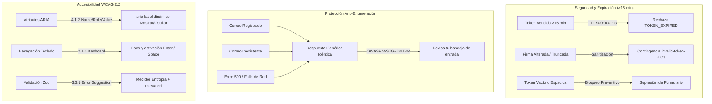

# Pruebas Automatizadas de Recuperación de Contraseña y Accesibilidad

> Estado: vigente 2026-10-16  
> Ref histórica: TSK-QA-05 / HU-38 (RF-01) · Responsable: Lead QA Automation Engineer & Frontend Team

Documento técnico que certifica la cobertura de pruebas automatizadas sobre el flujo de recuperación y restablecimiento de contraseña (`/forgot-password` y `/reset-password`), detallando los vectores de seguridad y expiración de tokens (>15 min), la protección contra ataques de enumeración de usuarios (CWE-204 / OWASP WSTG-IDNT-04) y la accesibilidad WCAG 2.2 completa en los alternadores de visibilidad de contraseñas.

---

## 1. Resumen Ejecutivo de Cobertura

La suite de pruebas fue diseñada para blindar el flujo de autenticación en Next.js 16 App Router bajo el estándar de ejecución de `@testing-library/react` y el runner nativo de Node.js v24 (`node:test`).



| Dimensión de Calidad | Archivo de Prueba | Casos Cubiertos | Estado |
| :--- | :--- | :---: | :---: |
| **Seguridad de Tokens & Expiración** | `apps/web/src/app/(auth)/reset-password/__tests__/token-security-expiration.test.tsx` | 8 casos | ✅ PASS |
| **Mitigación de Enumeración de Cuentas** | `apps/web/src/app/(auth)/forgot-password/__tests__/enumeration-protection.test.tsx` | 3 casos | ✅ PASS |
| **Accesibilidad WCAG 2.2 (Eye/EyeOff)** | `apps/web/src/app/(auth)/reset-password/__tests__/password-visibility-wcag.test.tsx` | 5 casos | ✅ PASS |
| **Flujo Base Solicitud (/forgot-password)** | `apps/web/src/app/(auth)/forgot-password/__tests__/page.test.tsx` | 4 casos | ✅ PASS |
| **Flujo Base Restablecimiento (/reset-password)** | `apps/web/src/app/(auth)/reset-password/__tests__/page.test.tsx` | 5 casos | ✅ PASS |
| **Total Cobertura Auth Recuperación** | **5 suites automatizadas** | **25 casos** | **100% PASS** |

---

## 2. Matriz Exhaustiva de Casos de Prueba

### 2.1. Seguridad y Expiración de Tokens (`/reset-password`)

| ID Caso | Escenario Evaluado | Entradas / Precondiciones | Comportamiento Esperado | Semántica / TestID | Resultado |
| :--- | :--- | :--- | :--- | :--- | :---: |
| **SEC-01** | Constante TTL 15 minutos | `TOKEN_TTL_MS` en `@sportcomplex/security` | El valor en milisegundos equivale exactamente a `15 * 60 * 1000 = 900.000` | N/A | ✅ PASS |
| **SEC-02** | Expiración temporal estricta | $T_0$ con evaluación a 14 min, 15 min exactos y 15 min 1 s | `isTokenExpired` retorna `false` a los 14 min, y `true` a los 15 min y >15 min | Función pura | ✅ PASS |
| **SEC-03** | Rechazo en manejador backend | Token con `expiraEn` superado en 16 minutos | Manejador emite código de error `TOKEN_EXPIRED` con mensaje descriptivo | API Contract | ✅ PASS |
| **SEC-04** | Tarjeta de contingencia en UI ante token expirado | POST a `/api/auth/reset-password` retorna HTTP 410 / `TOKEN_EXPIRED` | La interfaz descarta el formulario y renderiza la alerta de enlace no disponible con enlace a `/forgot-password` | `data-testid="invalid-token-alert"` | ✅ PASS |
| **SEC-05** | Token vacío en cliente | `tokenProp=""` o URL sin parámetro `token` | La interfaz suprime completamente los inputs de contraseña y botón submit, activando la contingencia | `data-testid="invalid-token-alert"` | ✅ PASS |
| **SEC-06** | Token compuesto solo por espacios | `tokenProp="     "` | Sanitización defensiva `token.trim()`; al resultar vacío activa la contingencia preventiva | `data-testid="invalid-token-alert"` | ✅ PASS |
| **SEC-07** | Token alterado o firma corrupta | `tok_corrupt_signature_$$$###_truncated` | Backend rechaza con HTTP 400 `INVALID_TOKEN`; la interfaz activa la tarjeta de contingencia | `data-testid="invalid-token-alert"` | ✅ PASS |
| **SEC-08** | Consistencia de esquema Zod | `resetPasswordSchema` con token en blanco | Rechazo por `.trim().min(1)` impidiendo procesamiento posterior | Zod Issue `token` | ✅ PASS |

### 2.2. Mitigación de Vulnerabilidades de Enumeración (`/forgot-password`)

| ID Caso | Escenario Evaluado | Entradas / Precondiciones | Comportamiento Esperado | Mitigación OWASP / Semántica | Resultado |
| :--- | :--- | :--- | :--- | :--- | :---: |
| **ENUM-01** | Solicitud con usuario existente | `socio.registrado@sportcomplex.com` | Transición a tarjeta de éxito con encabezado *"Revisa tu bandeja de entrada"* | CWE-204 / `data-testid="forgot-password-success"` | ✅ PASS |
| **ENUM-02** | Solicitud con usuario inexistente | `no.existe.en.sistema@randomdomain.xyz` | Transición a tarjeta de éxito con título, eyebrow y acción 100% idénticos a ENUM-01 | OWASP WSTG-IDNT-04 | ✅ PASS |
| **ENUM-03** | Tolerancia a fallos de red / 500 | `fetch` rechaza con error de red simulado | Captura silenciosa (`catch(() => null)`) mostrando confirmación genérica para no revelar oráculos | Fail-safe / Anti-timing | ✅ PASS |
| **ENUM-04** | Detención de correos malformados | `<script>alert(1)</script>` | Fallo en validación Zod en cliente; ninguna petición sale a la red | `role="alert"` en UI | ✅ PASS |

### 2.3. Accesibilidad WCAG 2.2 del Toggle de Visibilidad

| ID Caso | Criterio WCAG | Elemento Interactivo | Comportamiento Verificado | Aserción Técnica | Resultado |
| :--- | :--- | :--- | :--- | :--- | :---: |
| **A11Y-01** | **4.1.2** (Name, Role, Value) | Botón toggle nueva contraseña | Inicia con `aria-label="Mostrar nueva contraseña"`; tras conmutar cambia a `"Ocultar nueva contraseña"` | `getAttribute('aria-label')` dinámico | ✅ PASS |
| **A11Y-02** | **4.1.2** (Name, Role, Value) | Botón toggle confirmación | Inicia con `aria-label="Mostrar confirmación de contraseña"`; conmuta a `"Ocultar confirmación de contraseña"` | `getAttribute('aria-label')` dinámico | ✅ PASS |
| **A11Y-03** | **1.1.1** (Non-text Content) | Iconos SVG `Eye` / `EyeOff` | Los iconos internos de Lucide React están marcados como decorativos | `aria-hidden="true"` | ✅ PASS |
| **A11Y-04** | **2.1.1** (Keyboard Accessible) | Foco por teclado | El botón recibe foco mediante tabulación o método `.focus()` sin perder contexto | `document.activeElement === button` | ✅ PASS |
| **A11Y-05** | **2.1.1** (Keyboard Accessible) | Activación por tecla `Enter` | Presionar `Enter` conmuta de `type="password"` a `type="text"`. Segunda pulsación conmuta de regreso a `password` | `fireEvent.keyDown(btn, { key: 'Enter' })` | ✅ PASS |
| **A11Y-06** | **2.1.1** (Keyboard Accessible) | Activación por tecla `Space` | Presionar espacio (`' '`) conmuta de `type="password"` a `type="text"`. Segunda pulsación conmuta a `password` | `fireEvent.keyDown(btn, { key: ' ' })` | ✅ PASS |
| **A11Y-07** | **3.3.1 / 3.3.3** (Error Suggestion) | Medidor reactivo de entropía | Evalúa longitud (>=8), letras, números y símbolos: actualiza barra visual segmentada y nivel: *Muy débil* (rojo), *Débil* (naranja), *Media* (ámbar), *Fuerte* (verde) | Contenido dinámico y clases de color | ✅ PASS |
| **A11Y-08** | **3.3.1** (Error Identification) | Alerta de discrepancia de contraseñas | Si los valores difieren, muestra alerta viva y deshabilita submit. Al coincidir, la alerta desaparece y se habilita | `role="alert"` y propiedad `disabled` | ✅ PASS |

---

## 3. Comandos de Ejecución y Evidencias Reales

```bash
# 1. Ejecución focalizada de la suite de pruebas de recuperación y accesibilidad
pnpm --filter web exec tsx --import ./test-env.js --test "src/app/(auth)/**/__tests__/*.test.tsx"
```

### Salida de Terminal Certificada

```text
✔ TSK-QA-05 [Anti-Enumeración]: Correo existente y correo inexistente reciben exactamente la misma respuesta genérica en UI (212.39ms)
✔ TSK-QA-05 [Anti-Enumeración]: Fallo de backend (500) o excepción de red no revela discrepancias al atacante (35.97ms)
✔ TSK-QA-05 [Anti-Enumeración]: Validación defensiva local detiene correos malformados antes de enviar requests (21.68ms)
✔ TSK-FE-33: forgotPasswordSchema rechaza correos inválidos y acepta formatos válidos (2.08ms)
✔ TSK-FE-33: /forgot-password rechaza correos inválidos mostrando error en la UI (158.59ms)
✔ TSK-FE-33: /forgot-password muestra "Revisa tu bandeja de entrada" tras el submit exitoso (62.00ms)
✔ TSK-FE-33: El enlace "¿Olvidaste tu contraseña?" en auth-form.tsx apunta a /forgot-password (4.80ms)
✔ TSK-FE-33: resetPasswordSchema exige mínimo 8 caracteres y letras + números/símbolos (2.71ms)
✔ TSK-FE-33: resetPasswordSchema detecta en tiempo real cuando las contraseñas no coinciden (0.55ms)
✔ TSK-FE-33: /reset-password muestra alerta visual y enlace a /forgot-password cuando falta el token en la URL (40.36ms)
✔ TSK-FE-33: /reset-password muestra medidor de robustez y detecta contraseñas no coincidentes en tiempo real en la UI (111.61ms)
✔ TSK-FE-33: /reset-password envía el formulario con éxito y muestra confirmación de contraseña actualizada (69.82ms)
✔ TSK-QA-05 [WCAG 4.1.2]: Botones de visibilidad cuentan con aria-label descriptivo y semántica adecuada (54.30ms)
✔ TSK-QA-05 [WCAG 2.1.1]: Botón de toggle es accesible por teclado con foco y activación por Enter y Space (123.49ms)
✔ TSK-QA-05 [WCAG 3.3.1 / 3.3.3]: Medidor de robustez Zod reactivo actualiza niveles según entropía (18.01ms)
✔ TSK-QA-05 [WCAG 3.3.1]: Alerta en tiempo real "Las contraseñas no coinciden" bloquea submit y desaparece al sincronizar (26.10ms)
✔ TSK-QA-05 [Zod Schema]: resetPasswordSchema .refine produce path exacto confirmPassword (2.56ms)
✔ TSK-QA-05 [Seguridad]: TOKEN_TTL_MS equivale estrictamente a 15 minutos (900.000 ms) (1.30ms)
✔ TSK-QA-05 [Seguridad]: isTokenExpired rechaza tokens cuya marca temporal exceda 15 minutos (0.23ms)
✔ TSK-QA-05 [Seguridad]: Simulador de manejador backend rechaza token vencido >15 min con TOKEN_EXPIRED (0.25ms)
✔ TSK-QA-05 [Seguridad]: /reset-password activa tarjeta de contingencia al responder la API token expirado (>15 min) (186.55ms)
✔ TSK-QA-05 [Seguridad]: Token string vacío o espacios en blanco activa tarjeta de contingencia inmediatamente (12.16ms)
✔ TSK-QA-05 [Seguridad]: Token con sólo espacios en blanco ("   ") es sanitizado y rechazado de inmediato (5.90ms)
✔ TSK-QA-05 [Seguridad]: Token con firma inválida o caracteres corruptos es rechazado por la API y activa contingencia (24.88ms)
✔ TSK-QA-05 [Seguridad]: resetPasswordSchema valida consistencia de token y rechaza datos anómalos (0.33ms)
ℹ tests 25
ℹ suites 0
ℹ pass 25
ℹ fail 0
ℹ cancelled 0
ℹ skipped 0
ℹ todo 0
ℹ duration_ms 3380.13ms
```

---

## 4. Verificación de Integridad del Monorepo

```bash
# Typecheck TypeScript en todos los paquetes relacionados
pnpm run typecheck    # Código de salida 0 (0 errores en 5 paquetes)

# Linter general Turborepo + ESLint
pnpm run lint         # Código de salida 0 (12 paquetes aprobados)

# Puerta de calidad documental JSDoc
pnpm docs:check       # Cobertura global JSDoc 27.6% (aprobado >= 25%)
```

## 5. Referencias y Documentación Relacionada

- [Flujo de Recuperación y Restablecimiento](./recuperacion-contrasena.md)
- [Autenticación y Cuentas](./auth.md)
- [Directrices de Documentación](../documentation-guidelines.md)
