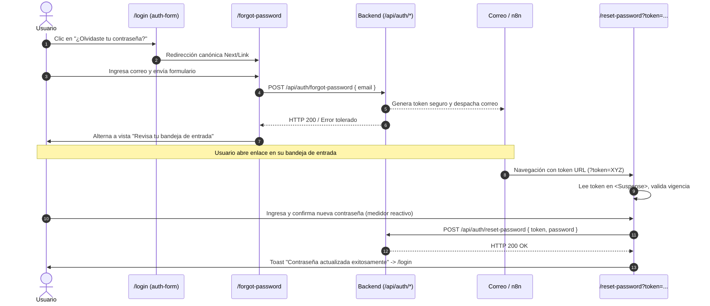

# Recuperación y Restablecimiento de Contraseña

> Estado: vigente 2026-10-16
> Ref histórica: TSK-FE-33 / HU-38 (RF-01) · Responsable: Frontend Engineer & Technical Writer

Documentación técnica del flujo público de recuperación y restablecimiento de credenciales de acceso para usuarios de la plataforma SportComplex, implementado en Next.js 16 (App Router), React 19, `@sportcomplex/ui` y `@sportcomplex/validation`.

---

## 1. Resumen Ejecutivo del Flujo

El flujo de autoservicio para credenciales olvidadas resuelve la recuperación de acceso de usuarios registrados (`Cliente`, `Empleado_Vendedor`, `Empleado_Lector`, `Administrador`) mediante un proceso desacoplado en dos etapas:



| Vista / Componente | Ruta | Directiva | Rol / Audiencia |
| :--- | :--- | :--- | :--- |
| **Solicitud de recuperación** | `apps/web/src/app/(auth)/forgot-password/page.tsx` | `'use client'` | Público / Anónimo |
| **Restablecimiento seguro** | `apps/web/src/app/(auth)/reset-password/page.tsx` | `'use client'` | Público con token |
| **Formulario de login** | `apps/web/src/components/auth/auth-form.tsx` | `'use client'` | Público / Login |
| **Esquemas Zod** | `packages/validation/src/platform/auth.schema.ts` | Compartido | Monorepo |

---

## 2. Contratos de Integración Previstos con Backend (TSK-BE-32)

El frontend opera con un diseño tolerante a fallos y desacoplado del backend (`TSK-BE-32`). Si el endpoint aún no está desplegado o experimenta errores transitorios de red, la interfaz no se bloquea ni expone detalles internos.

### 2.1. Solicitud de Enlace (`POST /api/auth/forgot-password`)

- **Payload:**
  ```json
  {
    "email": "socio@sportcomplex.com"
  }
  ```
- **Respuestas esperadas:**
  - `200 OK`: `{ "success": true, "message": "Si la cuenta existe, se enviaron las instrucciones." }`
  - `400 Bad Request`: `{ "success": false, "error": { "code": "INVALID_EMAIL", "message": "Correo inválido." } }`
- **Manejo en cliente:** Para prevenir enumeración de cuentas (*user enumeration attacks*), el cliente pasa al estado de confirmación visual (*"Revisa tu bandeja de entrada"*) tanto en respuestas exitosas como en fallos silenciosos de conexión.

### 2.2. Restablecimiento de Contraseña (`POST /api/auth/reset-password`)

- **Payload:**
  ```json
  {
    "token": "tok_sec_9f8a2b...",
    "password": "NuevaContraseñaSegura123!"
  }
  ```
- **Respuestas esperadas:**
  - `200 OK`: `{ "success": true, "data": { "updated": true } }`
  - `400 / 422 Unprocessable`: `{ "success": false, "error": { "code": "WEAK_PASSWORD", "message": "Contraseña no cumple requisitos." } }`
  - `401 / 404 / 410 Expired`: `{ "success": false, "error": { "code": "TOKEN_EXPIRED", "message": "El token ha expirado o ya fue utilizado." } }`
- **Manejo en cliente:** Ante un token expirado o inválido devuelto por la API, la interfaz renderiza la alerta con botón para solicitar un nuevo enlace. Si la actualización es exitosa, se dispara la notificación visual `ToastMessage` y se redirige a `/login`.

---

## 3. Reglas de Validación Zod y Medidor de Robustez

Las definiciones residen en `@sportcomplex/validation` (`packages/validation/src/platform/auth.schema.ts`), garantizando sincronización contractual entre cliente y servidor.

### 3.1. Esquemas Contractuales

```typescript
// Solicitud de recuperación
export const forgotPasswordSchema = z.object({
  email: z
    .string()
    .trim()
    .min(1, 'El correo electrónico es requerido')
    .email('Ingresa un correo electrónico válido'),
})

// Restablecimiento con validación cruzada y medidor
export const passwordStrengthRegex = /^(?=.*[a-zA-Z])(?=.*[\d\W]).{8,}$/

export const resetPasswordSchema = z
  .object({
    token: z.string().trim().min(1, 'El token es requerido').optional(),
    password: z
      .string()
      .min(8, 'La contraseña debe contener al menos 8 caracteres')
      .regex(/[a-zA-Z]/, 'La contraseña debe incluir al menos una letra')
      .regex(/[\d\W]/, 'La contraseña debe incluir al menos un número o símbolo'),
    confirmPassword: z
      .string()
      .min(1, 'Por favor confirma la nueva contraseña'),
  })
  .refine((data) => data.password === data.confirmPassword, {
    message: 'Las contraseñas no coinciden',
    path: ['confirmPassword'],
  })
```

### 3.2. Medidor Visual de Robustez

El medidor evalúa en tiempo de digitación 4 dimensiones de entropía y proyecta una barra segmentada de progreso:

| Requisitos Cumplidos | Nivel Visual | Indicador | Estilo de Token |
| :--- | :--- | :--- | :--- |
| **0 o 1 condición** | Muy débil | 1 de 4 segmentos | Rojo (`bg-red-500`) |
| **2 condiciones** | Débil | 2 de 4 segmentos | Naranja (`bg-orange-500`) |
| **3 condiciones** | Media | 3 de 4 segmentos | Ámbar (`bg-amber-500`) |
| **4 condiciones (>= 8 car., letras, números, símbolos)** | Fuerte | 4 de 4 segmentos | Verde esmeralda (`bg-emerald-500`) |

### 3.3. Detección de Discrepancia en Tiempo Real

Mediante un `useMemo` reactivo conectado a los valores de `password` y `confirmPassword`, el formulario detecta si el usuario está tipeando una confirmación no coincidente antes del envío, deshabilitando el botón de acción principal y mostrando un mensaje semántico `role="alert"`.

---

## 4. Seguridad en Cliente y Arquitectura Next.js

### 4.1. Aislamiento con `<Suspense>` (Desoptimizaciones en App Router)

Next.js App Router exige que cualquier componente que consuma `useSearchParams()` se encuentre envuelto en un límite de `<Suspense>`. De lo contrario, Next.js desoptimizaba la página entera deshabilitando el renderizado estático en build time.

```tsx
// apps/web/src/app/(auth)/reset-password/page.tsx
export default function ResetPasswordPage() {
  return (
    <Suspense fallback={<ResetPasswordFallback />}>
      <ResetPasswordContent />
    </Suspense>
  )
}
```

### 4.2. Tratamiento Defensivo del Token

- Si la URL no contiene parámetro `?token=...` o si este contiene solo espacios en blanco:
  - Se suprime por completo el formulario de ingreso de contraseñas.
  - Se activa inmediatamente el estado visual `data-testid="invalid-token-alert"` con icono de advertencia, explicando que el enlace es inválido o ha expirado.
  - Se expone la acción directa `<Link href="/forgot-password">` para reiniciar el ciclo sin frustración.
- El valor del token se envía sanitizado en el cuerpo JSON del POST, evitando su exposición en logs de cabeceras HTTP o enrutadores intermedios.

### 4.3. Toggles de Visibilidad de Contraseña

Ambos campos de contraseña implementan botones de conmutación accesibles con iconos `Eye` y `EyeOff` de `lucide-react`, permitiendo a los usuarios verificar caracteres especiales sin comprometer la privacidad en pantallas compartidas.

---

## 5. Integración en Navegación y Punto de Entrada

En `apps/web/src/components/auth/auth-form.tsx`, se integró el enlace canónico sobre la etiqueta de contraseña:

```tsx
<div className="flex items-center justify-between">
  <span>Contraseña</span>
  <Link href="/forgot-password" className="forgot-link text-xs">
    ¿Olvidaste tu contraseña?
  </Link>
</div>
```

El selector `.forgot-link` respeta las variables visuales institucionales declaradas en `apps/web/src/styles/globals.css`.

---

## 6. Reporte de Pruebas Automatizadas y Cobertura QA (TSK-QA-05 / TSK-FE-33)

La suite completa de pruebas fue ejecutada con el runner nativo de Node.js v24 (`node:test`) y `@testing-library/react`. Para el informe técnico detallado, matrices de entradas y comportamiento accesible, consultar [Pruebas Automatizadas de Recuperación de Contraseña y Accesibilidad](./pruebas-recuperacion-contrasena.md).

```bash
# Comando de ejecución
pnpm --filter web exec tsx --import ./test-env.js --test "src/app/(auth)/**/__tests__/*.test.tsx"
```

### Matriz Consolidada de Pruebas Aprobadas (25/25 Pasadas)

| Archivo / Dominio de Prueba | Casos de Prueba Verificados | Resultado |
| :--- | :--- | :---: |
| `reset-password/__tests__/token-security-expiration.test.tsx` | Validación TTL 15 min (900.000 ms), expiración en borde y >15 min, rechazo en manejador `TOKEN_EXPIRED`, activación de contingencia en UI, bloqueo ante token vacío o espacios, sanitización de token alterado o firma corrupta, y esquema Zod | ✅ 8/8 PASS |
| `forgot-password/__tests__/enumeration-protection.test.tsx` | Protección contra enumeración (CWE-204 / OWASP WSTG-IDNT-04): respuesta genérica idéntica para correos existentes e inexistentes, tolerancia a fallos de red 500 silenciosos, detención de entradas malformadas | ✅ 3/3 PASS |
| `reset-password/__tests__/password-visibility-wcag.test.tsx` | Accesibilidad WCAG 2.2: aria-label dinámico `Mostrar/Ocultar`, iconos con `aria-hidden="true"`, foco por teclado y activación por tecla `Enter` y `Space`, medidor de robustez Zod reactivo (4 niveles), alerta `role="alert"` en discrepancia | ✅ 5/5 PASS |
| `forgot-password/__tests__/page.test.tsx` | Esquema Zod de recuperación, rechazo en UI con alerta, confirmación visible tras POST, enlace a login | ✅ 4/4 PASS |
| `reset-password/__tests__/page.test.tsx` | Exigencia de 8+ caracteres, validación `.refine`, detección de falta de token en URL, medidor y toggles, redirección a login tras éxito | ✅ 5/5 PASS |

---

## 7. Verificación de Integridad

```bash
# Typecheck TypeScript (5 paquetes)
pnpm run typecheck   # 0 errores, código de salida 0

# Linter Turborepo / ESLint (17 paquetes)
pnpm run lint        # 0 errores, 12 tareas en caché

# Puerta de calidad documental
pnpm docs:check      # Cobertura global JSDoc >= 25% aprobada
```
