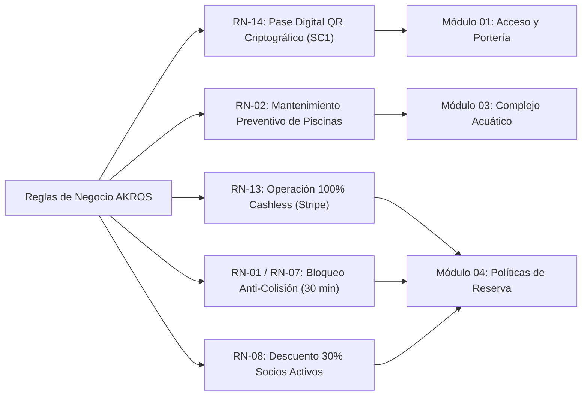

# Reglamentos y Marco Normativo (`/rules`)
> Estado: vigente 2026-10-15

- **Ruta:** `apps/web/src/app/(public)/rules/page.tsx` — vista pública SSG
> Ref histórica: SCRUM-185/186/187; leyes colombianas aplicadas al club AKROS
- **Stack:** Next.js 16 (App Router), React 19, Tailwind CSS, Framer Motion

## 1. Justificación de Producto

Decisión: **permanencia formal** de la ruta canónica `/rules` por tres fundamentos:

1. **Respaldo jurídico:** la ley colombiana exige publicidad clara de reglamentos de uso, riesgos inherentes y condiciones de salubridad en complejos deportivos.
2. **Erradicación de enlaces huérfanos:** `/rules` consolida en un único punto autoritativo todos los términos del club (sustituye al placeholder `/legal`).
3. **Cierre del bucle de rescate 404:** la página 404 ("Kinetic Apex", ver `/rules`) enlaza "Reglamentos y Normativa" → `/rules`; el usuario rescatado aterriza en una experiencia funcional.

## 2. Marco Legal Colombiano Aplicado

| Ley / Decreto | Materia | Artículos del Reglamento AKROS | Requisitos Implementados |
| :--- | :--- | :--- | :--- |
| **Ley 181 de 1995** | Ley del Deporte | Módulos 02 y 05 | Fair play, respeto a árbitros, preservación de escenarios |
| **Ley 1209 de 2008** | Seguridad y Salubridad en Piscinas | Módulo 03 (Arts. 3.1–3.3) | Salvavidas certificados, gorro de baño, ducha previa, prohibición de vidrio, supervisión de menores de 12 años |
| **Ley 1581 de 2012** & Decreto 1377 de 2013 | Protección de Datos Personales (Habeas Data) | Módulo 06 (Arts. 6.1–6.3) | Tratamiento seguro de datos, autorización informada para credenciales QR, aviso CCTV |
| **Ley 1801 de 2016** | Código Nacional de Seguridad y Convivencia | Módulo 05 (Arts. 5.1–5.3) | Prohibición de armas, cigarrillo/vape, sustancias y licor; sanciones de expulsión y veto |

## 3. Trazabilidad de Reglas de Negocio (RN)

- **RN-14 (Acceso QR):** ingreso por torniquetes o lectura manual (`Empleado_Lector`) requiere QR firmado `SC1`. Pases intransferibles.
- **RN-02 (Piscinas):** mantenimiento e hipercloración todos los lunes hábiles (o martes si el lunes es festivo).
- **RN-13 (Cashless):** cero efectivo; todo vía Stripe (tarjeta o billetera digital).
- **RN-01 & RN-07 (Bloqueo anti-colisión):** retención de franja 30 min durante el pago; liberación al expirar.
- **RN-08 (Membresía):** descuento automático del 30% a socios vigentes.

## 4. Auditoría y Saneamiento de Enlaces

| Archivo / Componente | Elemento | Enlace Previo | Corregido | Estado |
| :--- | :--- | :--- | :--- | :--- |
| `components/home/institutional-footer.tsx` | Columna "Club & Experiencia" | `/legal` | `/rules` | Saneado |
| `components/home/institutional-footer.tsx` | Barra inferior legal | `/legal` | `/rules` | Saneado |
| `components/layout/top-bar.tsx` | Menú público "Reglamentos" | `/legal` | `/rules` | Saneado |
| `components/home/faq-section.tsx` | Banner "Ver reglamentos" | `/legal` | `/rules` | Saneado |
| `app/(auth)/register/page.tsx` | "Política de Tratamiento de Datos" | `/legal` | `/rules` | Saneado |
| `app/not-found.tsx` | Tarjeta rescate 3 | `/rules` | `/rules` | Verificado |
| `app/(public)/legal/page.tsx` | Endpoint histórico | Estático | `redirect('/rules')` | Redireccionado |

## 5. Accesibilidad y Estándares UI (WCAG 2.2 & W3C APG)

La vista cumple WCAG 2.2 con navegación por teclado completa, jerarquía semántica de encabezados (un `<h1>` por módulo), foco visible en todos los interactivos y `prefers-reduced-motion` respetado en las microinteracciones (ver tokens de movimiento en `docs/architecture/design-system.md` §3.4).

## Trazabilidad

> Ref histórica: SCRUM-185/186/187 · ruta canónica `/rules` (sustituye `/legal`)
